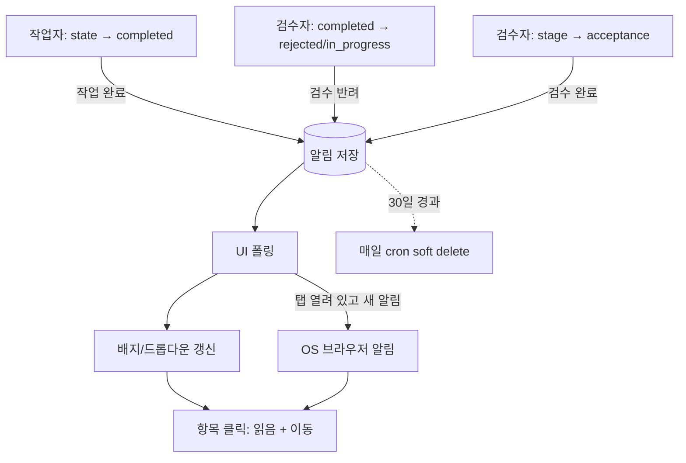

# Job 완료/반려 알림 (INNO-123)

## Summary

검수자가 Job을 **검수 완료/반려**하면 작업자에게, 작업자가 **작업 완료**하면 검수자에게 인앱 알림을 만든다. 헤더 GitHub 아이콘 왼쪽의 종 아이콘(안 읽은 수 배지)과 드롭다운 목록으로 보여주고, ImageLab 탭이 열려 있는 동안 새 알림이 오면 OS 브라우저 알림을 띄운다. 항목을 클릭하면 읽음 처리 후 해당 Job 어노테이션 화면의 적절한 프레임으로 이동한다.

---

## Problem Frame

현재 검수 결과와 작업 완료는 Jobs 목록의 Stage/State 컬럼을 직접 확인해야만 알 수 있다. 헤더에 알림 UI가 없고 브라우저 알림도 없다. 그래서 작업자는 반려된 Job을 늦게 발견하고, 검수자는 검수 대기 Job을 목록을 뒤져 찾는다. 라운드(제출→반려→재제출→승인) 사이의 대기 시간이 그대로 생산성 손실이 된다.

이 fork는 이미 라운드 경계를 서버에서 정확히 판별한다. `cvat/apps/engine/job_snapshots.py`의 `classify_job_transition`이 Job `pre_save`에서 제출(state→`completed`), 반려(`completed`→`rejected`/`in_progress`), 승인(stage→`acceptance`)을 구분하고 행위자(`get_current_user`)를 기록한다. 알림 이벤트는 이 세 경계와 정확히 일치한다.

---

## Key Decisions

- **알림 이벤트 = 기존 라운드 경계 3종.** `작업 완료`(SUBMITTED), `검수 반려`(REJECTED), `검수 완료`(ACCEPTED). 경계 정의를 새로 만들지 않고 `classify_job_transition`과 같은 판별을 쓴다. 그래서 job_rounds/스냅샷/알림이 같은 "라운드" 의미를 공유한다. validation 등 다른 stage 이동은 알림 대상이 아니다.
- **알림은 서버에서 생성·저장한다.** 어떤 클라이언트(UI, SDK, API)로 전이했든 누락되지 않고, 읽음 상태가 기기·탭 간에 일치한다. 알림 생성 실패가 Job 전이를 실패시키지 않는다(스냅샷과 같은 best-effort 원칙).
- **행위자 본인에게는 알리지 않는다.** 작업자가 자기 Job을 실수로 `rejected`로 바꾸는 사례가 프로덕션에 있다(`cvat/apps/production_stats/queries/__init__.py`의 `resolve_reviewers` 주석). 행위자 = 수신자면 알림을 만들지 않는다.
- **전달은 주기적 폴링.** 서버에 WebSocket/SSE 인프라가 없다(Django Channels 미사용, `cvat/settings/base.py`에 관련 설정 없음). 알림 지연 수십 초는 이 업무 흐름에서 허용 가능하므로 새 인프라를 들이지 않는다.
- **브라우저 알림은 ImageLab 탭이 열려 있을 때만 뜬다.** 폴링 기반이라 탭이 모두 닫혀 있으면 OS 알림은 오지 않는다. 다음에 접속하면 배지와 목록으로 확인한다. Web Push(Service Worker + VAPID)는 범위 밖이다.
- **목록은 이벤트 1건 = 항목 1건, 이벤트 시각 내림차순.** 시안의 "최근 수정 시간"은 Job의 `updated_date`가 아니라 알림 이벤트 시각으로 해석한다. `updated_date`는 어노테이션 저장마다 바뀌어 정렬이 흔들린다.
- **30일 경과 알림은 soft delete.** 기존 주기 작업 메커니즘(`PERIODIC_RQ_JOBS`의 `cleaning` 큐 cron)으로 매일 처리한다. 사용자 수동 삭제 UI는 만들지 않는다.

---

## Actors

- A1. 작업자(annotator) — Job의 `assignee`. 작업 완료 처리를 하고, 검수 반려/완료 알림을 받는다.
- A2. 검수자(reviewer) — `reviewer` IAM 역할(전역 그룹 또는 조직 역할) 보유자. 조직 내 모든 Job을 볼 수 있다(`cvat/apps/engine/rules/jobs.rego`). 검수 반려/완료를 하고, 작업 완료 알림을 받는다.
- A3. 서버 — Job 전이를 판별해 알림을 생성하고, 30일 경과 알림을 정리한다.

---

## Requirements

**알림 생성**

- R1. 검수 반려(Job state가 `completed`에서 `rejected` 또는 `in_progress`로 전이)가 일어나면 그 Job의 담당자(assignee)에게 `검수 반려` 알림을 만든다.
- R2. 검수 완료(Job stage가 `acceptance`로 전이)가 일어나면 그 Job의 담당자에게 `검수 완료` 알림을 만든다.
- R3. 작업 완료(같은 stage 안에서 state가 `completed`로 전이)가 일어나면 검수자들에게 `작업 완료` 알림을 만든다. 수신 대상 범위는 미결정 사항 Q1을 따른다.
- R4. 행위자 본인은 수신자에서 제외한다. 담당자가 없는 Job의 검수 반려/완료는 알림을 만들지 않는다.
- R5. 각 알림은 수신자, Job, 이벤트 종류, 행위자, 이벤트 시각, 읽음 여부를 기록한다. 표시용 Job 번호와 Task 이름은 조회 시 현재 값을 쓴다.
- R6. 알림 생성은 서버사이드에서 전이 커밋 이후에 일어나고, 실패해도 Job 전이를 실패시키거나 눈에 띄게 지연시키지 않는다.

**헤더 아이콘과 드롭다운**

- R7. 헤더 GitHub 아이콘 왼쪽에 종 아이콘을 두고, 안 읽은 알림 수를 빨간 배지로 표시한다. 0이면 배지를 숨기고, 99 초과는 `99+`로 표시한다.
- R8. 종 아이콘을 클릭하면 드롭다운으로 알림 목록을 이벤트 시각 내림차순으로 보여준다. 알림 상세 페이지는 만들지 않는다.
- R9. 각 항목은 Job 번호, 이벤트 태그(`검수 반려` / `검수 완료` / `작업 완료`), Task 이름, 상대 시간(예: "3분 전")을 표시한다. `작업 완료` 항목에는 작업자명(행위자)을 함께 표시한다.
- R10. 안 읽은 항목은 파란 점과 배경색으로 구분한다.
- R11. 드롭다운 상단에 `알림 · 최신순 · ⓘ`, `☐ 읽은 알림 제외`, `모두 읽음`을 둔다. ⓘ 툴팁은 "알림은 30일이 지나면 자동으로 삭제됩니다."이다.
- R12. 드롭다운 높이는 고정이고, 상단 영역은 고정된 채 목록만 세로 스크롤된다.
- R13. `읽은 알림 제외`를 체크하면 안 읽은 알림만 보여준다.
- R14. `모두 읽음`은 현재 사용자의 모든 알림을 읽음 처리하고 배지를 0으로 만든다.
- R15. 알림이 없으면 빈 상태 문구를 보여준다.

**항목 클릭**

- R16. 항목을 클릭하면 그 알림을 읽음 처리하고(배지 -1), 드롭다운을 닫고, 해당 Job 어노테이션 화면으로 이동한다.
- R17. `검수 반려`는 클릭 시점 기준 그 Job의 첫 번째 미해결 이슈가 있는 프레임으로 이동한다. 미해결 이슈가 없으면 첫 프레임으로 이동한다.
- R18. `검수 완료`와 `작업 완료`는 Job의 첫 프레임으로 이동한다.
- R19. Job이 삭제됐거나 사용자가 더 이상 접근할 수 없으면 그 알림은 목록과 배지에서 제외한다.

**전달과 브라우저 알림**

- R20. UI는 로그인 상태에서 주기적으로 새 알림과 안 읽은 수를 가져온다. 배지와 목록은 새로고침 없이 갱신된다.
- R21. ImageLab 탭이 열려 있는 동안 새 알림이 도착하면 OS 브라우저 알림을 띄운다. 대상 이벤트 범위는 미결정 사항 Q2를 따른다.
- R22. OS 알림을 클릭하면 해당 탭을 포커스하고 R16–R18과 같이 읽음 처리 후 이동한다.
- R23. 페이지 로드 시점에 이미 있던 알림으로는 OS 알림을 띄우지 않는다. 그 세션에서 새로 도착한 알림만 띄운다.
- R24. 탭이 여러 개 열려 있어도 같은 알림의 OS 알림은 한 번만 보인다.
- R25. 알림 권한은 최초 1회 요청한다. 거부하면 다시 묻지 않고, 인앱 배지/목록은 그대로 동작한다.

**보존과 정리**

- R26. 이벤트 시각으로부터 30일이 지난 알림은 읽음 여부와 무관하게 soft delete되어 목록과 배지에서 사라진다.
- R27. 사용자 수동 삭제 기능은 제공하지 않는다.

---

## Key Flows

- F1. 반려 → 작업자 확인
  - **Trigger:** 검수자가 제출된 Job을 반려.
  - **Actors:** A2, A1, A3
  - **Steps:** 서버가 담당자에게 `검수 반려` 알림 생성 → 작업자 UI가 다음 폴링에서 배지 증가, 탭이 열려 있으면 OS 알림 → 작업자가 클릭 → 읽음 처리 후 첫 미해결 이슈 프레임으로 이동.
  - **Covers:** R1, R5, R7, R16, R17, R20, R21, R22
- F2. 작업 완료 → 검수자 확인
  - **Trigger:** 작업자가 Job을 완료 처리.
  - **Actors:** A1, A2, A3
  - **Steps:** 서버가 검수자들에게 `작업 완료` 알림(작업자명 포함) 생성 → 검수자 UI 배지/OS 알림 → 클릭 시 첫 프레임으로 이동.
  - **Covers:** R3, R9, R18, R21

---

## Acceptance Examples

- AE1. **Covers R1, R4.** Given 작업자 A가 담당한 Job 12가 `completed`, When 검수자 B가 `rejected`로 바꾸면, Then A에게 `검수 반려` 알림 1건이 생기고 B에게는 생기지 않는다.
- AE2. **Covers R4.** Given 작업자 A가 담당한 Job 12가 `completed`, When A 본인이 `in_progress`로 되돌리면, Then 어떤 알림도 생기지 않는다(행위자 = 담당자).
- AE3. **Covers R17.** Given Job 12에 미해결 이슈가 프레임 40, 15에 있고, When A가 `검수 반려` 알림을 클릭하면, Then 프레임 15에서 열린다. Given 클릭 전에 모든 이슈가 해결됐다면, Then 첫 프레임에서 열린다.
- AE4. **Covers R23, R24.** Given A에게 안 읽은 알림 3건이 있고 탭 2개를 새로 열면, Then OS 알림은 뜨지 않고 배지는 3이다. When 새 반려가 발생하면, Then OS 알림은 1번만 뜬다.
- AE5. **Covers R13, R16.** Given `읽은 알림 제외`가 체크된 상태, When 항목 하나를 클릭하면, Then 배지가 1 줄고, 다음에 드롭다운을 열면 그 항목은 보이지 않는다.
- AE6. **Covers R26.** Given 31일 전에 만든 안 읽은 알림, When 일일 정리 작업이 돌면, Then 배지와 목록에서 사라지지만 DB 행은 soft delete로 남는다.

---

## Scope Boundaries

- 알림 상세 페이지 — 만들지 않는다(티켓 합의).
- 탭이 모두 닫힌 상태의 OS 알림(Web Push), 이메일/Slack 알림 — 범위 밖.
- 실시간 푸시(WebSocket/SSE) — 폴링으로 충분. 지연이 문제로 드러나면 재검토.
- 이슈 생성/코멘트/담당자 변경 알림 — 이번 범위는 Job 라운드 경계 3종만.
- 사용자별 알림 설정(종류별 끄기 등), 수동 삭제 — 범위 밖.
- 이미 다른 검수자가 처리한 `작업 완료` 알림을 자동 읽음/무효화하는 것 — 범위 밖(Q1 결과에 따라 후속 검토).

---

## Dependencies / Assumptions

- 이 조직의 워크플로우는 stage `annotation`에서 state로 라운드를 움직이고 승인만 stage를 바꾼다(`job_snapshots.py` 모듈 docstring). 다른 워크플로우를 쓰는 프로젝트가 생기면 이벤트 판별을 다시 봐야 한다.
- Job에는 검수자 지정 필드가 없다. 검수자는 `reviewer` 역할로만 식별되고, 사후 통계는 승인/반려 행위자로 추정한다(`resolve_reviewers`). 이 때문에 `작업 완료` 수신자 범위가 미결정 사항이 된다.
- 브라우저는 백그라운드 탭의 타이머를 늦춘다(Chrome은 오래 숨겨진 탭을 분당 1회 수준으로 제한). 탭이 백그라운드면 OS 알림이 최대 1분가량 늦을 수 있다.
- 사용자는 대부분 macOS다. macOS 시스템 설정에서 브라우저 알림이 꺼져 있으면 권한을 허용해도 OS 알림이 보이지 않는다.
- 어노테이션 화면은 이미 `?frame=N` 쿼리로 시작 프레임을 받는다(`cvat-ui/src/containers/annotation-page/annotation-page.tsx`).

---

## Outstanding Questions

### Resolve Before Planning

아래 "미결정 사항" 섹션 참고.

### Deferred to Planning

- 알림 생성 훅 위치 — `job_snapshots.py`의 `pre_save`/`post_save` 수신기와 판별을 공유할지, 별도 수신기로 둘지. 동기(전이 커밋 직후 `on_commit`) 생성으로 충분한지, `notifications` 큐로 보낼지.
- 폴링 주기와 백오프 — 기본 30초, 숨겨진 탭에서는 브라우저 제한에 맡김을 제안. 안 읽은 수 전용 경량 조회를 둘지.
- `Issue.frame`은 task 기준 프레임이다(CLAUDE.md). 어노테이션 화면 `frame` 파라미터와 같은 기준인지 확인.
- OS 알림 중복 방지 방식(알림 id 기반 tag 등)과 R22 클릭 시 탭 포커스 처리.
- soft delete 대상의 hard purge 여부와 주기 — 당분간 hard delete 없음을 제안.

---

## 미결정 사항 (사용자 확인 필요)

아래 항목은 모두 아키텍처나 티켓 합의 동작을 바꾸지 않는 수준이라 blocking이 아니다. 계획은 각 항목의 **권장안을 가정(사용자 확인 대기)으로 채택**해 진행한다.

- Q1. **`작업 완료` 알림을 받을 검수자 범위.** Job에 검수자 지정 필드가 없다.
  - **권장:** 그 Job을 볼 수 있는 모든 검수자(조직 Job이면 그 조직의 `reviewer` 역할 멤버, 조직 밖 Job이면 전역 `reviewer` 그룹), 행위자 제외. 검수자 수가 적은 현재 조직 규모에 맞고 구현이 단순하다.
  - 대안 A: 그 Job을 이전에 반려한 검수자가 있으면 그 사람에게만(재제출), 없으면 전체 검수자.
  - 대안 B: Task/Project 소유자 또는 관리자(admin)에게도 함께 보냄.
- Q2. **OS 브라우저 알림을 띄울 이벤트.** 티켓은 "처리할 Job이 생기면"이라고 했다.
  - **권장:** 처리가 필요한 `검수 반려`(작업자)와 `작업 완료`(검수자)만 OS 알림. `검수 완료`는 배지/목록에만 표시.
  - 대안: 세 종류 모두 OS 알림.
- Q3. **알림 권한 요청 시점.** Firefox·Safari는 사용자 클릭 없이 권한을 요청하면 무시하거나 막는다.
  - **권장:** 종 아이콘을 처음 클릭할 때 요청.
  - 대안 A: 로그인 직후 헤더에 "브라우저 알림 켜기" 안내 배너를 띄우고 클릭 시 요청.
  - 대안 B: 페이지 첫 로드 시 바로 요청(Chrome에서만 안정적).
- Q4. **같은 Job에 이벤트가 여러 번 쌓일 때.** (제출→반려→재제출…)
  - **권장:** 이벤트마다 항목 1건(이력 보존, 이벤트 시각 정렬).
  - 대안: Job당 1건으로 합쳐 최신 이벤트로 갱신하고 다시 안 읽음 처리("Job 리스트"에 더 문자 그대로 가까움).
- Q5. **`검수 반려`/`검수 완료` 항목에 검수자명도 표시할지.** 시안은 `작업 완료`에만 작업자명을 명시했다.
  - **권장:** 시안대로 `작업 완료`만 이름 표시.
  - 대안: 세 종류 모두 행위자명 표시(반려자가 여럿일 때 누구에게 물어볼지 알 수 있음).

---

## Sources

- `cvat/apps/engine/job_snapshots.py` — `classify_job_transition`, `remember_job_transition`(pre_save), `schedule_job_snapshot`(post_save + `on_commit`), 행위자 기록.
- `cvat/apps/engine/signals.py` — job_snapshots 수신기 등록 지점.
- `cvat/apps/engine/models.py` — `Job`(stage/state/assignee, `updated_date`), `Issue`(`frame`, `resolved`).
- `cvat/apps/engine/rules/jobs.rego`, `cvat/apps/iam/rules/utils.rego`, `cvat/apps/organizations/rules/organizations.rego` — 검수자 역할과 Job 조회 권한.
- `cvat/apps/production_stats/queries/__init__.py` — `resolve_reviewers`(검수자 추정, 작업자 자기 반려 사례).
- `cvat/settings/base.py` — `CVAT_QUEUES`(`notifications`, `snapshots`, `cleaning`), `PERIODIC_RQ_JOBS`(cron 정리 작업 패턴).
- `cvat-ui/src/components/header/header.tsx` — `cvat-right-header`의 GitHub 버튼(종 아이콘 삽입 위치).
- `cvat-ui/src/containers/annotation-page/annotation-page.tsx` — `?frame=` 시작 프레임 파라미터.
