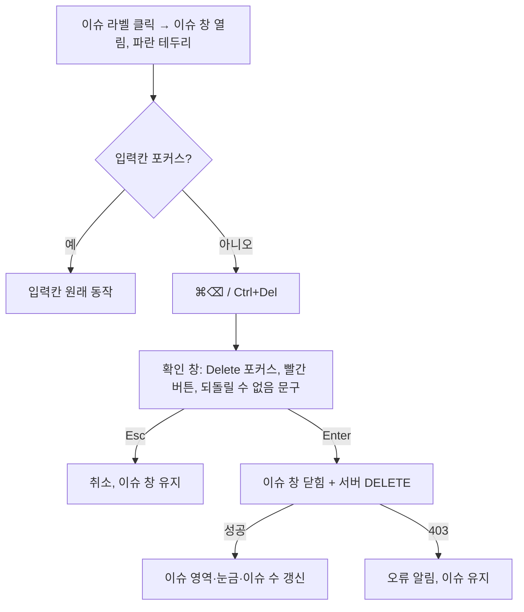

# 이슈 삭제 단축키 (INNO-127)

## Summary

이슈 창이 열려 있는 이슈를 mac `⌘⌫` / Windows `Ctrl+Del`로 삭제한다. 단축키는 기존 Remove 버튼과 같은 확인 창을 띄우며, 확인 창은 Enter=삭제 / Esc=취소로 키보드만으로 끝낼 수 있게 다듬는다. 권한·서버 동작은 Remove 버튼과 동일하고, 새 서버 기능은 없다.

## Problem Frame

지금 이슈 삭제는 마우스로만 된다: 캔버스 이슈 라벨 클릭 → 이슈 창 `Remove` → 확인 모달 `Delete`. 이슈 관련 단축키는 열기(`N`), 보이기 토글(`T I`, `T R`)뿐이다. `Del`은 객체 삭제(`del`, `shift+del`)에, `Alt+Del`은 프레임 삭제에 쓰이고 있어 그대로 가져다 쓸 수 없다. 사용자는 대부분 mac이라 조합은 mac 기준으로 정했다(시안 합의 완료).

## Key Decisions

- **"선택된 이슈" = 지금 화면에 이슈 창이 떠 있는 이슈.** 이슈 창은 한 번에 하나만 열린다. 이 상태는 Redux가 아니라 `IssueAggregator` 컴포넌트의 로컬 state(`expandedIssue`)라서, 단축키 핸들러가 이 값에 접근할 수 있어야 한다(위치는 planning).
- **조합 키 + 확인 창 유지.** 삭제는 서버에 즉시 반영되고 되돌릴 수 없다. 단일 키 오입력을 막으려고 조합 키를 쓰고, 확인 창도 남긴다.
- **두 조합을 한 동작에 함께 등록.** `bulk-wrapper.tsx`의 `SELECT_ALL: ['ctrl+a', 'command+a']`와 같은 방식으로 `['ctrl+del', 'command+backspace']`를 등록한다. OS 분기 없이 양쪽 다 바인딩된다.
- **권한은 클라이언트에서 가리지 않는다.** Remove 버튼도 현재 권한과 무관하게 항상 보이고, 거부는 서버(OPA)가 한다. 단축키도 같은 경로를 탄다.
- **현행 하드 삭제를 유지한다(사용자 결정 2026-10-28).** 이슈를 삭제하면 `IssueAnnotationSnapshot`, `IssueResolutionChange`, `Comment`가 `on_delete=CASCADE`로 함께 지워지고 Beacon `job_issues`·`issue_facts`에서도 빠진다(ClickHouse에는 `delete:issue` 이벤트만 남는다). 사용자는 이 손실을 알고 있다. 그래서 단축키를 단일 Backspace가 아닌 ⌘/Ctrl 조합(`⌘⌫` / `Ctrl+Del`)으로 정하고 확인 창을 유지했다. 소프트 삭제·FK 변경은 하지 않으며 후속 티켓도 없다.

## Requirements

**단축키 동작**

- R1. 이슈 창이 열려 있을 때 `⌘⌫`(mac) 또는 `Ctrl+Del`(Windows)을 누르면 그 이슈의 삭제 확인 창이 뜬다. Remove 버튼을 누른 것과 같은 결과다.
- R2. 열린 이슈 창이 없으면 아무 일도 일어나지 않는다. 안내 메시지도 없다.
- R3. 이슈 창이 실제로 화면에 보일 때만 동작한다. 다른 프레임으로 이동했거나 `T I`/`T R`로 이슈를 숨겨 창이 렌더링되지 않은 상태라면 R2와 같이 무동작이다.
- R4. 댓글 입력칸 등 텍스트 입력 요소에 포커스가 있으면 단축키는 동작하지 않고, 입력칸 원래 동작(mac: 줄 앞까지 지우기, Windows: 다음 단어 지우기)이 그대로 일어난다.
- R5. 확인 창이 떠 있는 동안 단축키를 다시 눌러도 확인 창이 중복으로 뜨지 않는다.
- R6. Standard 모드와 Review 모드 모두에서 동작한다.
- R7. 객체 삭제(`Del`, `Shift+Del`), 프레임 삭제(`Alt+Del`) 등 기존 단축키와 충돌하지 않는다. 이슈 창이 열린 상태에서 활성 객체가 있어도 `⌘⌫`/`Ctrl+Del`은 객체를 지우지 않는다.

**확인 창**

- R8. 확인 창은 열리면 Delete 버튼에 포커스가 있다. Enter=삭제, Esc=취소.
- R9. 확인 창에 `삭제한 이슈는 되돌릴 수 없습니다.` 문구를 추가한다.
- R10. Delete 버튼은 빨간색(위험 동작 스타일)이다.
- R11. R8–R10은 Remove 버튼 경로와 단축키 경로에 똑같이 적용된다(확인 창은 하나).

**표시와 설정**

- R12. 열린 이슈 창은 파란 테두리로 표시해, 단축키가 어느 이슈에 작용할지 보이게 한다.
- R13. 이슈 창의 Remove 버튼 옆에 OS에 맞는 단축키를 표시한다. mac은 `⌘⌫`, 그 외는 `Ctrl+Del`.
- R14. F1 단축키 목록에 `Delete issue` 항목이 `ctrl+del`, `command+backspace`로 나온다.
- R15. F2 > Shortcuts에서 이 단축키를 변경할 수 있다. 변경 시 기존 충돌 검사(`conflict-detector`)를 그대로 따른다.

**삭제 이후**

- R16. 삭제가 성공하면 이슈 창이 닫히고, 캔버스의 이슈 영역·슬라이더 눈금·이슈 수(INNO-124)가 새로고침 없이 바로 갱신된다.
- R17. 권한이 없어 서버가 거부하면 기존 오류 알림(`Could not remove issue from the server`)이 뜨고 이슈는 그대로 남는다.

## Key Flows

## Acceptance Examples

- AE1. 검수자 A가 자기가 만든 이슈 창을 열고 `⌘⌫` → Enter. 이슈가 사라지고 이슈 수가 1 줄어든다.
- AE2. 검수자 A가 검수자 B의 이슈 창을 열고 `⌘⌫` → Enter. 오류 알림이 뜨고, 이슈 창을 다시 열면 이슈가 그대로 있다.
- AE3. 댓글 입력칸에 "키포인트 위치"를 쓰다가 `⌘⌫`. 입력 글자만 지워지고 확인 창은 뜨지 않는다.
- AE4. 이슈 창을 열지 않고 객체만 선택한 채 `⌘⌫`. 아무 일도 없고 객체도 남아 있다.
- AE5. 이슈 창을 연 상태로 다음 프레임으로 이동 후 `⌘⌫`. 아무 일도 없다(R3).
- AE6. Windows에서 이슈 창을 열고 `Ctrl+Del` → Esc. 확인 창만 닫히고 이슈 창은 열린 채 남는다.

## Scope Boundaries

- 서버 삭제 API·권한(OPA) 변경 없음.
- 확인 창 없이 즉시 삭제하는 옵션, 삭제 되돌리기(undo)는 다루지 않는다.
- 이슈 창 없이 사이드바 이슈 목록에서 선택해 삭제하는 경로는 다루지 않는다.
- 소프트 삭제·삭제 시 스냅샷 보존은 하지 않는다(Key Decisions 참조).

## Dependencies / Assumptions

- **코드 확인됨 — 입력칸 억제:** `utils/mousetrap-react.tsx`의 `stopCallback`이 포커스가 INPUT/SELECT/TEXTAREA면 모든 단축키를 막는다. 댓글 입력칸은 antd `Input`(INPUT)이라 R4는 기존 동작으로 충족된다.
- **코드 확인됨 — 모달 중 억제:** 같은 `stopCallback`이 `ant-modal`이 열려 있으면 F1/F2 토글 외 단축키를 막는다. R5는 기존 동작으로 충족된다.
- **코드 확인됨 — 충돌 없음:** 현재 `backspace`를 쓰는 단축키는 없고, Mousetrap은 수식키 조합을 정확히 매칭하므로 `ctrl+del`은 `del` 바인딩을 깨우지 않는다. `conflict()`의 접두사 검사에서도 `del`/`shift+del`/`alt+del`/`ctrl+a`와 충돌하지 않는다. 형제 티켓 INNO-125의 `z`와도 무관하다.
- **코드 확인됨 — 현재 확인 창:** `issue-dialog.tsx`의 `Modal.confirm`은 `autoFocusButton: 'cancel'`, `okButtonProps: { type: 'primary' }`(파란색)이다. R8·R10은 이 두 값을 바꾸는 변경이다.
- **코드 확인됨 — 이슈 창 상태:** `expandedIssue`는 프레임 이동이나 이슈 숨김 시 초기화되지 않는다. 그래서 R3이 필요하다. 그대로 쓰면 다른 프레임의 이슈를 지우려다 `deleteIssueAsync`가 `frameIssues`에서 이슈를 못 찾아 오류가 난다.
- **코드 확인됨 — 마운트 위치:** `IssueAggregator`는 Standard·Review workspace에만 마운트된다(R6 충족). Attribute/Single-shape/Tag workspace에서는 이슈 창이 없으므로 단축키도 무동작이다.
- **코드 확인됨 — 권한:** `cvat/apps/engine/rules/issues.rego`에서 reviewer는 `is_issue_owner`일 때만 UPDATE/DELETE 가능(org·sandbox 모두). 그 외 삭제 가능자는 task staff, 이슈 작성자, org maintainer 이상이다.
- **코드 확인됨 — 실패 시 이슈 창:** 현재 `onOk`는 서버 응답 전에 이슈 창을 닫는다. 따라서 R17의 실패 시에도 이슈 창은 닫힌 채 오류 알림만 뜬다. 이를 바꾸지 않는다.
- **코드 확인됨 — 갱신:** `REMOVE_ISSUE_SUCCESS`가 `review.issues`와 `frameIssues`를 갱신한다. INNO-124의 눈금·이슈 수가 이 상태에서 파생되면 R16은 추가 작업 없이 충족된다(INNO-124 설계에 의존).
- **가정(미검증):** Chrome·Firefox(mac)는 입력칸 밖 `⌘⌫`에, Windows 브라우저는 입력칸 밖 `Ctrl+Del`에 기본 동작이 없다. 핸들러가 `preventDefault`도 하므로 위험은 낮다.
- **코드 확인됨 — F2 한계:** `utils/key-code-mapper.ts`에 `MetaLeft`/`MetaRight` 매핑이 없어 mac에서 F2로 ⌘ 조합을 새로 기록할 수 없다(기존 한계). R15는 ctrl 계열 조합으로의 변경과 기본값 복원으로 충족되며, ⌘ 기록 지원은 범위 밖이다.
- **미적용 경로:** Windows 키(meta)+Backspace도 `command+backspace`로 매칭되어 Windows에서 동작할 수 있다. 무해하므로 막지 않는다.

## 미결정 사항 (사용자 확인 필요)

두 항목 모두 INNO-127 계획의 구조를 바꾸지 않아 비차단으로 판단했다. 권장안을 **가정(사용자 확인 대기)**으로 채택하고 planning을 진행한다. (하드 삭제 유지 여부는 사용자 결정 2026-10-28로 확정되어 Key Decisions로 옮겼다.)

1. **F2에서 단축키를 바꾼 경우 Remove 버튼 옆 표시(R13).**
   - 권장 — 가정(사용자 확인 대기): 현재 설정된 조합 중 OS에 맞는 것(mac은 command 포함, 그 외는 ctrl 포함)을 기호로 표시하고, 맞는 것이 없으면 첫 조합을 그대로 표시.
   - 대안: 항상 기본값 `⌘⌫`/`Ctrl+Del` 고정 표시(변경 시 표시가 틀려짐).
2. **삭제 실패 시 이슈 창을 다시 열어둘지.** 현재는 먼저 닫고 실패하면 알림만 띄운다.
   - 권장 — 가정(사용자 확인 대기): 현행 유지(시안 "권한 없으면 서버 거부 후 오류 알림"과 일치).
   - 대안: 서버 응답 후 닫기. 실패 시 창이 남아 맥락이 유지되지만 Remove 버튼 동작도 함께 바뀐다.

## Sources / Research

- `cvat-ui/src/components/annotation-page/review/issue-dialog.tsx` — Remove 버튼, `Modal.confirm`
- `cvat-ui/src/components/annotation-page/review/issues-aggregator.tsx` — `expandedIssue` 로컬 state
- `cvat-ui/src/utils/mousetrap-react.tsx` — `stopCallback`(입력칸·모달 억제)
- `cvat-ui/src/utils/conflict-detector.ts`, `cvat-ui/src/utils/enums.tsx`(`ShortcutScope`)
- `cvat-ui/src/components/bulk-wrapper.tsx` — `ctrl+a`/`command+a` 이중 등록 선례
- `cvat-ui/src/containers/annotation-page/standard-workspace/objects-side-bar/objects-list.tsx`, `cvat-ui/src/components/annotation-page/top-bar/player-navigation.tsx` — 기존 `del` 계열 바인딩
- `cvat-ui/src/actions/review-actions.ts`(`deleteIssueAsync`), `cvat-ui/src/reducers/review-reducer.ts`, `cvat-ui/src/reducers/notifications-reducer.ts`
- `cvat/apps/engine/rules/issues.rego`, `cvat/apps/engine/models.py`(`Issue`, `IssueAnnotationSnapshot`, `IssueResolutionChange`)
