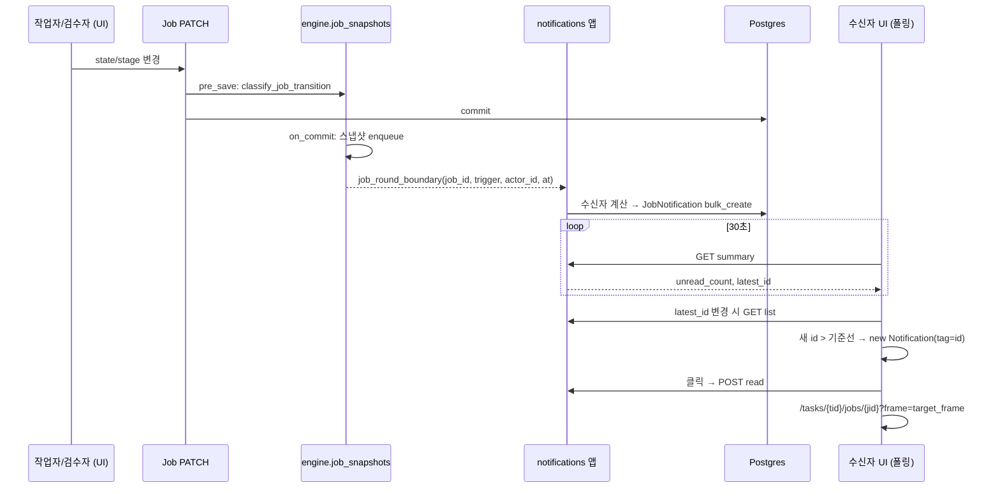

# feat: Job 완료/반려 인앱 알림 + 브라우저 알림 (INNO-123)

## Summary

Job 라운드 경계(작업 완료·검수 반려·검수 완료)가 커밋되면 서버가 수신자별 알림 행을 만든다. 신규 `cvat/apps/notifications` 앱이 모델·API·30일 soft delete cron을 맡고, 엔진은 기존 `job_snapshots.py`의 경계 판별 결과를 커스텀 시그널로 내보내기만 한다. UI는 헤더 종 아이콘이 30초 폴링으로 배지·드롭다운을 갱신하고, 탭이 열려 있는 동안 새 알림을 OS 브라우저 알림으로 띄운다.

---

## Problem Frame

검수 결과와 작업 완료를 상대방이 Jobs 목록 Stage/State로만 확인할 수 있어 라운드 사이 대기 시간이 길어진다. 경계 판별은 이미 `classify_job_transition`이 정확히 하고 있으므로, 남은 일은 수신자 결정·저장·전달·표시다. (see origin: `docs/brainstorms/2026-10-28-inno-123-job-notifications-requirements.md`)

---

## Requirements

origin의 R1–R27을 그대로 따른다. 계획 수준에서 묶으면:

- **생성:** R1–R6 — 경계 3종, 행위자 제외, 담당자 없음 처리, 커밋 후 best-effort 생성.
- **헤더 UI:** R7–R15 — 종 아이콘·배지(`99+`), 드롭다운 구성, 필터, 모두 읽음, 빈 상태.
- **클릭 이동:** R16–R19 — 읽음 처리, 프레임 결정, 접근 불가 항목 숨김.
- **전달·OS 알림:** R20–R25 — 폴링, 새 알림만 OS 알림, 탭 간 중복 방지, 권한 1회 요청.
- **보존:** R26–R27 — 30일 soft delete, 수동 삭제 없음.

origin Acceptance Examples AE1–AE6은 아래 단위 테스트 시나리오에 연결한다.

---

## Assumptions

origin "미결정 사항"의 권장안을 채택했다. Q1·Q4는 사용자 결정 2026-10-28, Q2·Q3·Q5는 가정(사용자 확인 대기). 바뀌어도 영향 범위는 표시한 단위에 한정된다.

- Q1 (사용자 결정 2026-10-28) `작업 완료` 수신자 = 그 Job의 조직에서 활성 `reviewer` 멤버(조직 Job), 또는 Django 그룹 `reviewer` 사용자(조직 밖 Job). 행위자와 비활성 사용자 제외. — U2의 수신자 함수만 바뀐다.
- Q2 (가정(사용자 확인 대기)) OS 알림 대상 = `검수 반려`(작업자), `작업 완료`(검수자). `검수 완료`는 배지/목록만. — U7의 필터 한 줄.
- Q3 (가정(사용자 확인 대기)) 권한 요청 = 종 아이콘 첫 클릭 시. — U7.
- Q4 (사용자 결정 2026-10-28) 이벤트 1건 = 알림 1건. — U1/U3. Job당 1건으로 바꾸면 모델에 upsert 키가 생긴다.
- Q5 (가정(사용자 확인 대기)) 행위자명은 `작업 완료` 항목에만 표시. API는 모든 항목에 행위자를 내려주므로 UI 표시만 바꾸면 된다.

---

## Key Technical Decisions

- **신규 앱 `cvat/apps/notifications`.** 엔진 마이그레이션 번호(0103까지)를 건드리지 않아 같은 날 병행 중인 INNO-124..127과 번호 충돌이 없다. 앱 자체 `0001` 마이그레이션을 갖는다.
- **엔진 → 알림은 커스텀 시그널로 분리.** `job_snapshots.py`의 `schedule_job_snapshot`이 이미 `on_commit`에서 경계 kwargs(job_id, trigger, actor_id, transitioned_at)를 갖고 있다. 여기서 `job_round_boundary` 시그널을 함께 보내고 알림 앱이 구독한다. pre_save에서 옛 행을 다시 조회하는 두 번째 수신기를 만들지 않으며, 엔진은 알림 앱을 import하지 않는다.
- **생성은 `on_commit`에서 동기 `bulk_create`, 실패는 삼킨다.** 수신자 수(작업자 1명 또는 검수자 수 명)가 작아 RQ 큐를 쓸 이유가 없다. 스냅샷과 같은 best-effort 원칙(R6)으로 예외는 로그만 남긴다. 시그널 수신기 예외가 스냅샷 enqueue를 막지 않도록 `send_robust`를 쓴다.
- **수신자는 생성 시점에 확정해 행으로 저장(fan-out on write).** 읽음 상태가 사용자별이고 30일 보존이므로 수신자별 행이 가장 단순하다. 접근을 잃은 수신자의 행은 조회 시점에 숨긴다(아래 R19). 조직 밖 Job의 `reviewer` 그룹 수신자는 sandbox 검수자 규칙상 모든 Job을 볼 수 있으므로(`cvat/apps/engine/rules/jobs.rego` "Sandbox reviewer") fan-out이 권한 밖 정보를 노출하지 않는다.
- **이동 프레임은 서버가 목록 응답에 `target_frame`으로 계산.** `검수 반려`는 그 Job의 미해결 이슈 중 최소 `frame`, 없으면 Job 시작 프레임(`segment.start_frame`). 나머지는 Job 시작 프레임. 목록을 가져올 때마다 다시 계산하고, 드롭다운이 열려 있는 동안은 매 폴링마다 목록을 다시 가져와 "클릭 시점 기준"(R17)을 폴링 주기 안에서 맞춘다. `Issue.frame`과 `segment.start_frame`은 둘 다 task 기준 프레임 번호다.
- **API는 수신자 본인 범위, 조직 컨텍스트 무시.** 목록은 현재 `X-Organization`과 무관하게 `recipient = request.user`로 필터한다. 사용자가 조직을 바꿔도 배지가 흔들리지 않는다. R19는 Job 삭제 시 FK cascade와, 목록·summary 쿼리에서 수신자가 접근을 잃은 행을 제외하는 것으로 처리한다: 조직 Job인데 활성 멤버십 없음, `rejected`/`accepted`인데 수신자가 현재 담당자가 아님, 조직 밖 `submitted`인데 수신자가 `reviewer` 그룹에 없음.
- **OPA 권한 클래스는 둔다, 규칙은 "인증된 사용자 + 본인 리소스".** fork의 `reviewer`는 `get_priority`에 없어서 `utils.has_perm(utils.WORKER)`가 거짓이다(`cvat/apps/organizations/rules/organizations.rego` 주석). `access_tokens.rego`를 그대로 복사하면 검수자가 거부되므로, 역할 우선순위가 아니라 `input.auth.user` 존재와 소유 여부로 허용한다.
- **OpenAPI 스키마에서 제외.** `production_stats`와 같은 `extend_schema(exclude=True)`. cvat-core가 axios로 직접 호출하고 SDK 클라이언트가 필요 없으며, CI 스키마 diff 부담을 피한다.
- **폴링 2단계.** 30초마다 경량 `summary`(안 읽은 수 + 최신 알림 id)만 조회한다. 목록은 드롭다운을 열 때와 `latest_id`가 바뀔 때만 가져온다. 목록은 최신 100건으로 제한한다(30일 보존 기준 충분, 무한 스크롤은 후속).
- **OS 알림은 `Notification` API + 알림 id 기반 `tag`.** 같은 tag는 OS가 하나로 합치므로 여러 탭에서 같은 알림을 띄워도 한 번만 보인다(R24). 페이지 로드 첫 summary의 `latest_id`를 기준선으로 삼아 그보다 큰 id만 OS 알림을 띄운다(R23). Service Worker/Web Push는 쓰지 않는다.
- **UI 상태는 Redux 대신 헤더 전용 훅.** 기존 Redux `notifications` 슬라이스는 오류 토스트용이라 이름이 겹친다. 알림 상태는 헤더에서만 쓰므로 컴포넌트 훅(`useJobInbox` 류)으로 두어 리듀서 추가를 피한다. 코드 식별자는 `jobInbox`/`JobNotification` 계열로 써서 기존 `notifications`와 구분한다.

---

## High-Level Technical Design

알림 수명: `생성(unread)` → `읽음(read_at 설정)` → 30일 경과 시 `soft delete(deleted_at 설정)`. 읽음 여부와 무관하게 30일이 지나면 숨긴다.

---

## Implementation Units

### U1. notifications 앱 골격 + JobNotification 모델

**Goal:** 알림 저장소를 만든다.
**Requirements:** R5, R26
**Dependencies:** 없음
**Files:**
- `cvat/apps/notifications/__init__.py`, `apps.py`, `models.py`, `migrations/0001_initial.py`
- `cvat/settings/base.py` (INSTALLED_APPS)
- `cvat/apps/notifications/tests/test_models.py`

**Approach:**
- 필드: 수신자(User FK, cascade), Job(FK, cascade), 이벤트 종류(`submitted`/`rejected`/`accepted` — `JobSnapshotTrigger` 값과 동일), 행위자(User FK, null, SET_NULL), 생성 시각(=전이 시각), `read_at`(null), `deleted_at`(null).
- 인덱스: (수신자, `deleted_at`, `read_at`) 안 읽은 수 조회용, (수신자, 생성 시각 desc) 목록용.
- Task 이름·Job 번호는 저장하지 않고 조회 시 join한다(origin R5).
- 기본 manager는 전체, "활성" queryset 헬퍼가 `deleted_at IS NULL`을 건다.

**Patterns to follow:** `cvat/apps/access_tokens/models.py`(사용자 소유 모델), `cvat/apps/engine/models.py`의 `JobSnapshotTrigger`.

**Test scenarios:**
- 활성 queryset이 `deleted_at`이 있는 행을 제외한다.
- Job 삭제 시 알림이 cascade 삭제된다.
- 행위자 사용자 삭제 시 알림은 남고 행위자가 null이 된다.

**Verification:** 마이그레이션이 깨끗한 DB와 기존 운영 스냅샷 DB 모두에 적용되고 `makemigrations --check`가 깨끗하다.

---

### U2. 경계 시그널 + 수신자 결정 + 생성

**Goal:** 라운드 경계 커밋 후 수신자별 알림을 만든다.
**Requirements:** R1–R6; AE1, AE2
**Dependencies:** U1
**Files:**
- `cvat/apps/engine/job_snapshots.py` (시그널 정의·발신 추가)
- `cvat/apps/notifications/signals.py`, `cvat/apps/notifications/services.py`, `apps.py`(`ready`에서 수신기 등록 + `load_app_iam_rules(self)` 호출 — `cvat/apps/production_stats/apps.py`와 동일. 빠지면 rego가 OPA 번들에 안 들어가 모든 요청이 거부된다)
- `cvat/apps/notifications/tests/test_creation.py`

**Approach:**
- `job_snapshots.py`에 `job_round_boundary` 시그널을 두고, `schedule_job_snapshot`이 등록하는 `on_commit` 콜백에서 스냅샷 enqueue와 별개로 `send_robust`한다. 스냅샷 동작은 바뀌지 않아야 한다.
- 수신자 함수:
  - `rejected`/`accepted` → Job 담당자. 담당자 없음 또는 행위자 = 담당자면 빈 목록.
  - `submitted` → Job 조직이 있으면 그 조직의 활성 `Membership(role=reviewer)` 사용자, 없으면 Django 그룹 `reviewer` 사용자. 행위자와 `is_active=False` 제외.
- `bulk_create` 전체를 try/except로 감싸 실패를 로그만 남긴다.

**Execution note:** 이 단위는 테스트 먼저. 기존 `test_job_snapshots.py`가 회귀 없음을 보장해야 한다.

**Patterns to follow:** `job_snapshots.py`의 `enqueue_job_snapshot`(실패 격리), `cvat/apps/engine/tests/test_job_snapshots.py`(전이 테스트 구성).

**Test scenarios:**
- Covers AE1. 검수자 B가 담당자 A의 `completed` Job을 `rejected`로 → A에게 `rejected` 1건, B에게 0건.
- `completed` → `in_progress`도 `rejected` 알림을 만든다.
- Covers AE2. 담당자 A 본인이 `completed` → `in_progress` → 알림 0건.
- stage → `acceptance` → 담당자에게 `accepted` 1건.
- 담당자 없는 Job 반려 → 0건.
- 조직 Job 제출 → 그 조직 활성 reviewer 2명에게 각 1건. 다른 조직 reviewer, 비활성 멤버십, 행위자는 제외.
- 조직 밖 Job 제출 → `reviewer` 그룹 사용자에게 생성.
- `validation` 등 다른 stage 이동, 같은 state 재저장, `updated_date`만 갱신 → 0건.
- 트랜잭션 롤백 시 알림 0건(`on_commit` 이후에만 생성).
- 알림 생성이 예외를 던져도 Job PATCH는 200이고 스냅샷 행은 정상 생성된다.

**Verification:** 신규 테스트와 기존 `test_job_snapshots.py`, `test_issue_snapshots_*` 통과.

---

### U3. 알림 API + OPA 권한

**Goal:** 수신자가 자기 알림을 조회·읽음 처리한다.
**Requirements:** R7, R8, R9, R13, R14, R16, R17, R18, R19; AE3, AE5
**Dependencies:** U1
**Files:**
- `cvat/apps/notifications/views.py`, `serializers.py`, `permissions.py`, `urls.py`
- `cvat/apps/notifications/rules/notifications.rego`, `cvat/apps/notifications/rules/notifications_test.rego`
- `cvat/urls.py`
- `cvat/settings/base.py` (`OBJECTS_NOT_RELATED_WITH_ORG`에 뷰셋 basename 추가 — `access_token`과 같은 이유. 없으면 단건 읽음의 object 권한 검사가 `organization_id`를 찾다 500)
- `cvat/apps/notifications/tests/test_api.py`

**Approach:**
- 엔드포인트(`/api/notifications/` 아래): 목록(`unread_only` 필터, 최신 100건, 생성 시각 desc), `summary`(안 읽은 수, 최신 id), 단건 읽음, 모두 읽음. 모두 `extend_schema(exclude=True)`.
- 목록 항목: id, 이벤트, 생성 시각, 읽음 여부, Job id, Task id, Task 이름, 행위자(id, username, 표시 이름), `target_frame`.
- `target_frame`은 Job의 미해결 이슈 최소 frame을 subquery로 annotate하고, 없으면 `segment.start_frame`. 목록 1회 쿼리로 해결한다.
- R19 제외 조건(목록·summary 공통): `deleted_at` 있음, 조직 Job인데 수신자의 활성 멤버십이 없음, `rejected`/`accepted`인데 수신자 ≠ 현재 담당자, 조직 밖 `submitted`인데 수신자가 `reviewer` 그룹에 없음.
- 읽음 처리는 멱등이며 `read_at`이 이미 있으면 유지한다. 다른 사용자의 알림 id는 404.
- 권한 클래스는 `production_stats`처럼 OPA 패키지명 = rego 파일명 = URL 세그먼트(`notifications`). 규칙은 인증 사용자 허용 + 단건은 `resource.recipient.id == auth.user.id`.

**Patterns to follow:** `cvat/apps/access_tokens/{views,permissions}.py`와 `rules/access_tokens.rego`(소유자 filter), `cvat/apps/production_stats/urls.py`(스키마 제외).

**Test scenarios:**
- 목록은 본인 알림만, 생성 시각 desc. `X-Organization`을 바꿔도 결과가 같다.
- `unread_only=true` → 안 읽은 것만. Covers AE5: 단건 읽음 후 `unread_only` 목록에서 사라지고 summary 수가 1 준다.
- 모두 읽음 → summary 0. 다른 사용자 알림은 영향 없음.
- 다른 사용자의 알림을 읽음 처리 → 404.
- `reviewer` 전용 사용자(전역 그룹, 조직 역할 각각)가 목록·읽음 API를 쓸 수 있다.
- Covers AE3. 반려 알림의 Job에 미해결 이슈 frame 40, 15 → `target_frame`=15. 모두 resolve 후 → Job 시작 프레임.
- 두 번째 세그먼트 Job(시작 프레임 ≠ 0)의 `accepted` 알림 → `target_frame`=그 Job 시작 프레임.
- `deleted_at` 있는 알림, 탈퇴한 조직의 Job 알림 → 목록과 summary에서 제외.
- 반려 알림 후 Job 담당자를 다른 사람으로 변경 → 원래 수신자의 목록·summary에서 제외.
- 조직 밖 `submitted` 수신자를 `reviewer` 그룹에서 제거 → 그 알림 제외.
- 익명 요청 → 401.

**Verification:** API 테스트, OPA 테스트 통과. `cvat/schema.yml` 재생성 결과에 diff 없음.

---

### U4. 30일 soft delete cron

**Goal:** 오래된 알림을 숨긴다.
**Requirements:** R26, R27; AE6
**Dependencies:** U1
**Files:**
- `cvat/apps/notifications/cron.py`
- `cvat/settings/base.py` (`PERIODIC_RQ_JOBS`에 `cleaning` 큐 항목, 매일 1회)
- `cvat/apps/notifications/tests/test_cron.py`

**Approach:** 생성 시각이 30일보다 오래되고 `deleted_at`이 없는 행에 `deleted_at=now`를 청크 단위 update한다. 보존 기간은 설정값(기본 30일)으로 둔다. hard delete는 하지 않는다.

**Patterns to follow:** `cvat/apps/access_tokens/cron.py`(청크 처리, 로그).

**Test scenarios:**
- Covers AE6. 31일 전 안 읽은 알림 → `deleted_at` 설정, 행은 남음.
- 29일 전 알림 → 변화 없음.
- 이미 soft delete된 행 → `deleted_at` 갱신 안 함.

**Verification:** cron 함수가 `PERIODIC_RQ_JOBS`에 등록되고 utils 워커 스케줄러에 보인다.

---

### U5. cvat-core 클라이언트

**Goal:** UI가 알림 API를 cvat-core로 호출한다.
**Requirements:** R20 지원
**Dependencies:** U3
**Files:**
- `cvat-core/src/server-proxy.ts`, `cvat-core/src/server-response-types.ts`
- `cvat-core/src/api.ts`, `cvat-core/src/api-implementation.ts`, `cvat-core/src/index.ts`(타입 노출)

**Approach:** `jobInbox` 네임스페이스에 `summary()`, `list({ unreadOnly })`, `markRead(id)`, `markAllRead()`를 둔다. 응답은 camelCase 평면 객체로 반환하고 클래스 래퍼는 만들지 않는다. 조직 헤더를 붙이지 않아도 되지만 붙어도 결과가 같다(U3).

**Patterns to follow:** `cvat-core/src/api-token.ts`와 `apiTokens` 네임스페이스 등록 방식.

**Test expectation:** none -- 얇은 HTTP 래퍼다. 동작은 U3 API 테스트와 U6/U7 수동 검증으로 덮는다. `yarn workspace cvat-core run type-check` 통과.

---

### U6. 헤더 종 아이콘 + 드롭다운 + 폴링

**Goal:** 시안 1–4와 클릭 이동을 구현한다.
**Requirements:** R7–R18, R20; F1, F2; AE3, AE5
**Dependencies:** U5
**Files:**
- `cvat-ui/src/components/header/job-inbox/job-inbox.tsx`, `job-inbox-item.tsx`, `use-job-inbox.ts`, `styles.scss`
- `cvat-ui/src/components/header/header.tsx` (`cvat-right-header`의 GitHub 버튼 왼쪽에 삽입)

**Approach:**
- 훅: 로그인 상태에서 30초마다 `summary`. `latest_id`가 바뀌었거나 드롭다운이 열릴 때 목록을 다시 가져온다. 로그아웃 시 타이머 해제.
- antd `Badge`(`overflowCount=99`) + `Dropdown`/`Popover`. 패널은 고정 높이, 헤더 행(`알림 · 최신순 · ⓘ`, `읽은 알림 제외` 체크박스, `모두 읽음`) 고정, 목록만 `overflow-y: auto`.
- 항목: `#<Job id>`, 태그(`검수 반려` 빨강, `검수 완료` 초록, `작업 완료` 파랑 — 색은 구현 시 조정), Task 이름, `dayjs` 상대 시간(ko). `작업 완료`는 행위자 이름 표시. 안 읽음은 파란 점 + 배경색.
- 훅은 드롭다운이 열려 있는 동안 매 폴링마다 목록도 다시 가져온다(`target_frame` 최신화). 열린 상태에서 갱신될 때 스크롤 위치를 유지한다.
- 클릭: 낙관적으로 읽음 표시·배지 -1 → `markRead` → 드롭다운 닫기 → 이동.
  - `markRead`가 404(Job 삭제·접근 상실)면 항목을 지우고 "더 이상 접근할 수 없는 Job입니다" 한 줄 메시지를 띄우고 이동하지 않는다. 네트워크 실패면 그대로 이동하고, 다음 summary에서 배지가 보정된다.
  - 어노테이션 화면 밖: `history.push('/tasks/{tid}/jobs/{jid}?frame={target_frame}')`.
  - 같은 Job을 이미 열고 있음: push하지 않고 `changeFrameAsync(target_frame)`로 프레임만 이동한다. `AnnotationPageComponent`는 `job === null`일 때만 `getJob()`을 부르고 `?frame=`는 최초 로드에서만 읽기 때문이다.
  - 다른 Job을 열고 있음: 새 URL로 push하고, top-bar의 미저장 변경 확인(`history.block`)이 통과된 뒤에만 `closeJob()`을 dispatch해 새 `initialFrame`으로 `getJob()`이 다시 돌게 한다. 취소하면 아무것도 바꾸지 않는다.
- 드롭다운 상태: 첫 열기(목록 없음) → 스피너. 목록 로드 실패 → 패널 안 "불러오지 못했습니다 · 다시 시도" 행(직전 목록이 있으면 유지). 알림 없음 → "알림이 없습니다". `읽은 알림 제외` 체크 + 결과 없음 → "안 읽은 알림이 없습니다". summary 폴링 실패는 조용히 다음 주기에 재시도(토스트 없음).
- Task 이름은 한 줄 말줄임 + 전체 이름 툴팁, 상대 시간에는 절대 시각 툴팁.
- 접근성: 종 버튼 `aria-label`에 안 읽은 수 포함, 항목은 포커스 가능한 버튼(Enter/Space), 안 읽음 상태를 텍스트(시각적으로 숨김)로도 노출, Esc로 닫으면 종 버튼으로 포커스 복귀.

**Patterns to follow:** `header.tsx`의 기존 헤더 버튼(`cvat-header-button`, `CVATTooltip`), `cvat-ui/src/containers/annotation-page/annotation-page.tsx`의 `?frame=` 처리.

**Test scenarios (수동 + 선택적 Cypress `tests/cypress/e2e/`):**
- Covers F1. 작업자 계정 탭을 열어 두고 다른 브라우저에서 검수자가 반려 → 30초 안에 배지 +1.
- Covers AE3. 반려 항목 클릭 → 첫 미해결 이슈 프레임에서 열림, 배지 -1, 드롭다운 닫힘.
- `검수 완료`/`작업 완료` 클릭 → Job 시작 프레임.
- Covers AE5. `읽은 알림 제외` 체크 후 클릭한 항목이 다시 열었을 때 안 보임.
- 알림 120건 → 패널 높이 고정, 상단 고정, 목록 스크롤, 최신 100건 표시.
- 배지 0 숨김, 100건 이상 `99+`.
- 어노테이션 화면에서 같은 Job의 반려 알림 클릭 → 리로드 없이 해당 프레임으로 이동.
- 어노테이션 화면에서 미저장 변경이 있는 채로 다른 Job 알림 클릭 → 확인 창. 취소 시 현재 Job 유지, 확인 시 새 Job이 target 프레임으로 열림.
- 클릭 직전 Job이 삭제된 항목 → 메시지 표시, 이동 없음, 항목 사라짐.
- 목록 로드 실패, 필터 결과 없음 → 각 상태 문구 표시.

**Verification:** `yarn workspace cvat-ui run type-check`, eslint 통과. 로컬 스택(`docker-compose.local.yml`)에서 작업자·검수자 두 계정으로 F1, F2 재현.

---

### U7. 브라우저(OS) 알림

**Goal:** 탭이 열려 있는 동안 새 알림을 OS 알림으로 띄운다.
**Requirements:** R21–R25; AE4
**Dependencies:** U6
**Files:**
- `cvat-ui/src/components/header/job-inbox/browser-notifications.ts`
- `cvat-ui/src/components/header/job-inbox/use-job-inbox.ts`, `job-inbox.tsx`

**Approach:**
- 지원 판정: `'Notification' in window && window.isSecureContext`. 보안 컨텍스트가 아니면(LAN `http://192.168.1.101:8081` 접속) OS 알림 없이 배지·목록만 동작한다.
- 권한: 종 아이콘 첫 클릭(사용자 제스처) 때 드롭다운을 연 뒤 `Notification.permission === 'default'`이면 요청한다. `denied`면 다시 묻지 않는다.
- 기준선: 페이지 로드 후 첫 `summary`의 `latest_id`. 이후 목록에서 id > 기준선이고 아직 띄우지 않은 항목 중 `rejected`·`submitted`만 OS 알림을 띄운다.
- `new Notification(title, { body, tag: 'imagelab-job-notification-<id>' })`. 제목 예: `검수 반려 · Job #123`, 본문: Task 이름(+ 작업 완료면 작업자명).
- 클릭: `window.focus()` → U6의 클릭 처리(읽음 + 이동) 재사용 → 알림 닫기.

**Patterns to follow:** U6 클릭 핸들러.

**Test scenarios (수동):**
- Covers AE4. 안 읽은 3건 상태로 탭 2개 열기 → OS 알림 없음, 배지 3. 새 반려 발생 → OS 알림 1번.
- 권한 `denied` → OS 알림 없음, 배지·목록 정상. 새로고침 후 재요청 없음.
- `accepted` 알림 → 배지만 증가, OS 알림 없음.
- OS 알림 클릭 → 탭 포커스, 해당 Job·프레임으로 이동, 읽음 처리.
- macOS Chrome·Safari, Firefox에서 권한 요청이 첫 종 클릭으로 뜬다.

**Verification:** macOS Chrome에서 F1 흐름 전체를 OS 알림 포함해 재현.

---

## Acceptance Examples

origin AE1–AE6을 그대로 따른다. 연결: AE1·AE2 → U2, AE3 → U3·U6, AE4 → U7, AE5 → U3·U6, AE6 → U4.

---

## Scope Boundaries

origin Scope Boundaries를 그대로 유지한다: 알림 상세 페이지, Web Push·이메일·Slack, WebSocket/SSE, 이슈·코멘트·담당자 변경 알림, 사용자별 알림 설정, 수동 삭제, 처리된 `작업 완료` 자동 무효화는 범위 밖.

### Deferred to Follow-Up Work

- 목록 무한 스크롤(100건 초과 열람).
- soft delete 행의 hard purge.
- 탭 간 BroadcastChannel 리더 선출로 폴링 1개로 줄이기.
- `/api/notifications/`를 OpenAPI·SDK에 노출.

---

## Open Questions

- 한 폴링 주기에 새 알림이 여러 건 오면(예: 반려 8건 연속) OS 알림을 묶을지, 탭이 보이고 포커스된 상태면 OS 알림을 생략할지. 현재 계획은 건별 표시. 구현 중 실사용으로 판단.
- 30일 soft delete 행의 hard purge 시점(사용자 식별 정보 보존 기간).
- 조직 멤버가 아닌 admin이 담당자인 조직 Job의 알림은 R19 규칙상 숨겨진다. 의도된 동작인지.

---

## System-Wide Impact

- **Job 전이 경로:** `job_snapshots.py`의 `on_commit` 콜백에 시그널 발신이 추가된다. `send_robust`와 try/except로 스냅샷·전이에 영향이 없어야 한다.
- **API 부하:** 로그인 사용자당 30초에 1회 경량 쿼리. 현재 사용자 규모(수십 명)에서 무시 가능. 인덱스(U1)로 안 읽은 수 조회를 인덱스 스캔으로 유지한다.
- **배포:** 서버 이미지 rebuild + 신규 앱 마이그레이션 적용. cron 스케줄은 서버 init(`syncperiodicjobs`)이 재시작 시 등록하고, cron 함수를 import할 수 있도록 utils 워커 이미지도 rebuild한다. UI 이미지도 rebuild.
- **IAM:** 새 rego 패키지는 `NotificationsConfig.ready()`의 `load_app_iam_rules` 호출로 OPA 번들(`/api/auth/rules`)에 포함된다. reviewer 허용이 `has_perm`에 의존하지 않음을 OPA 테스트로 고정한다.

---

## Risks & Dependencies

- **백그라운드 탭 타이머 제한.** Chrome은 오래 숨겨진 탭의 타이머를 분당 1회로 줄인다. OS 알림이 최대 1분가량 늦을 수 있다(origin 가정). 수용.
- **OS 알림은 보안 컨텍스트 전용.** `https://imagelab.mora.center`와 localhost에서만 동작한다. 운영 LAN 주소 `http://192.168.1.101:8081`로 접속한 사용자는 배지·목록만 받는다. 로컬 검증(localhost)에서는 드러나지 않으므로 배포 후 운영 도메인에서 확인한다.
- **macOS 시스템 알림 설정.** 브라우저 권한을 허용해도 macOS에서 브라우저 알림이 꺼져 있으면 안 보인다. 운영 안내로 해결.
- **assignee가 실제 작업자가 아닌 운영 패턴.** 담당자를 검수자로 바꿔 검수하는 조직이라면 `검수 반려`가 검수자 자신에게 가거나(행위자 제외로 0건) 누락된다. 이 fork의 흐름은 담당자를 유지한다고 가정한다(`job_snapshots.py` docstring). 배포 후 1주 알림 건수를 확인한다.
- **조직 reviewer 범위 과다.** 검수자 수가 늘면 `작업 완료` 알림이 모든 검수자에게 쌓인다(Q1, 사용자 결정 2026-10-28). 범위를 좁히려면 U2 수신자 함수만 바꾼다.

---

## Sources / Research

- `cvat/apps/engine/job_snapshots.py` — `classify_job_transition`, `remember_job_transition`, `schedule_job_snapshot`(`on_commit`), `enqueue_job_snapshot`(실패 격리 패턴).
- `cvat/apps/iam/middleware.py` — privilege는 그룹 중 최우선 하나(`admin > user > reviewer > worker`). 전역 검수자 판별은 privilege가 아니라 그룹 소속으로 해야 한다.
- `cvat/apps/iam/rules/utils.rego` — `get_priority`에 reviewer 없음 → `has_perm` 거짓.
- `cvat/apps/organizations/models.py` — `Membership.REVIEWER`, `is_active`.
- `cvat/apps/access_tokens/` — 사용자 소유 리소스 앱, OPA filter, cron 패턴.
- `cvat/settings/base.py` — `PERIODIC_RQ_JOBS`, `CVAT_QUEUES.CLEANING`.
- `cvat-ui/src/components/header/header.tsx` — `cvat-right-header` GitHub 버튼.
- `cvat-ui/src/components/jobs-page/job-card.tsx` — Job URL 형식 `/tasks/{tid}/jobs/{jid}`.
- `cvat-ui/src/containers/annotation-page/annotation-page.tsx` — `?frame=` 초기 프레임.
