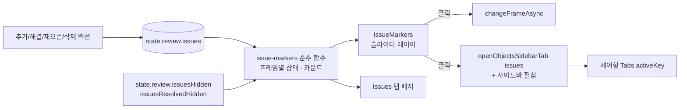

# feat: 슬라이더 이슈 마커 + Issues 탭 미해결/전체 배지 (INNO-124)

## Summary

annotation 페이지 상단 프레임 슬라이더에 이슈 프레임 마커(IssueMarkers) 레이어를 얹고, 사이드바 Issues 탭 라벨에 job 전체 `미해결/전체` 배지를 단다. 마커를 클릭하면 그 프레임으로 이동하고 Issues 탭이 열린다. 모든 표시는 이미 클라이언트에 로드된 `state.review.issues`에서 파생하므로 서버/API 변경은 없다.

(see origin: [docs/brainstorms/2026-10-28-inno-124-issue-markers-requirements.md](../brainstorms/2026-10-28-inno-124-issue-markers-requirements.md))

---

## Problem Frame

job에서 이슈가 몇 건이고 어느 프레임에 있는지 한눈에 볼 수 없다. 슬라이더에는 이슈 표시가 없고, Issues 탭 `Items: N`은 현재 프레임 이슈 수만 보여준다. 이슈 프레임은 `<` `>` 버튼으로 하나씩 찾아야 한다. 클라이언트는 이미 job의 모든 이슈를 갖고 있으므로(`job.issues()` → `fetchAll`) 문제는 순수하게 표시 계층이다.

---

## Requirements Traceability

| R-ID | 요구 (origin) | 단위 |
|---|---|---|
| R1–R3 | 프레임당 마커 1개, 합치지 않음, 2×12px 정수 픽셀 | U1, U3 |
| R4 | 미해결 있으면 빨강, 모두 해결이면 회색 | U1, U3 |
| R5 | 현재 프레임 핸들이 항상 마커 위 | U3 |
| R6–R8 | 최근접 스냅, 4×16px 강조, 범위 6px/이웃 중간점, 툴팁 없음 | U1, U3 |
| R9 | 클릭 → 프레임 이동 + Issues 탭 활성화 | U2, U3 |
| R10 | 스냅 범위 밖은 기존 슬라이더 동작 | U3 |
| R11–R12 | Issues 탭 `미해결/전체` 배지, 색, 0건 숨김 | U1, U4 |
| R13 | 사이드바 탭 좌우 여백 16→12px | U4 |
| R14 | `Items: N` 유지 | U4 (변경 없음 확인) |
| R15–R16 | job 전체 기준, 추가·해결·재오픈·삭제 즉시 반영(INNO-127 포함) | U1, U5 |
| R17 | `T R` 켜면 회색 마커 숨김, 숫자는 유지 | U1, U3 |
| R18 | Standard/Review, 작업자/검수자 동일 | U3, U4 |
| R19 | on/off 설정 없음 | — (설정 추가하지 않음) |
| R20 | `T I` 켜면 모든 마커 숨김, 배지는 유지 (사용자 결정 2026-10-28) | U1, U3, U5 |

---

## Assumptions

origin의 남은 미결정 3건은 비차단이며, 권장안을 **가정(사용자 확인 대기)**으로 채택한다. 사용자가 다르게 정하면 U2·U3의 국소 분기만 바뀐다. (원래 2번 `T I`와 마커의 관계는 사용자가 결정해 R20이 되었다.)

- A1. 사이드바가 접혀 있을 때 마커를 클릭하면 사이드바를 펼치고 Issues 탭을 연다.
- A3. 마커는 모든 workspace에서 보인다. Issues 탭이 없는 workspace에서는 클릭 시 프레임 이동만 한다. Single shape workspace(슬라이더 `onChange` 비활성)에서는 마커가 보이되 클릭·스냅이 비활성이다.
- A4. 삭제된 프레임의 이슈도 마커로 표시한다.

---

## Key Technical Decisions

- **파생 데이터는 순수 함수 + 메모이즈.** `issues` 배열 → (프레임별 미해결 여부, 미해결 수, 전체 수)를 순수 함수로 계산한다. reducer는 해결·재오픈 시 issue를 in-place 변경하고 `issues`를 새 배열로 교체하므로, 배열 참조를 키로 하는 `useMemo`면 즉시 반영과 성능이 함께 성립한다. 새 Redux 상태로 중복 저장하지 않는다. `reselect`는 cvat-ui 의존성에 없어 도입하지 않는다.
- **가시성 규칙은 두 플래그의 조합이다.** `issuesHidden`(`T I`/눈 아이콘)이면 마커 없음. 아니면 `issuesResolvedHidden`(`T R`)일 때 회색 마커만 제외한다. 배지 카운트는 두 플래그 모두와 무관하다(R17, R20).
- **마커 좌표는 antd 슬라이더 핸들과 같은 매핑을 쓴다.** 핸들 위치는 `(value - min) / (max - min) × width`다. 기존 진행도 SVG는 `stop - start + 1` 분할을 써서 미세하게 다르다. 마커를 클릭한 프레임에 핸들이 정확히 겹쳐야 하므로 핸들 매핑을 따르고 `Math.round`로 정수 픽셀에 맞춘다. `min == max`(1프레임 job)이면 x=0.
- **스냅 = "6px 이내 최근접 마커".** 각 마커의 범위 `[x - min(6, 왼쪽 간격/2), x + min(6, 오른쪽 간격/2)]`는 "6px 이내에서 가장 가까운 마커"와 동치다. 그래서 정렬된 픽셀 배열에서 이진 탐색 한 번으로 구현한다.
- **같은 픽셀 충돌 규칙.** 슬라이더 폭은 고정 350px(`.cvat-player-slider` in `cvat-ui/src/components/annotation-page/styles.scss`)라 352프레임 이상 job에서는 서로 다른 이슈 프레임이 같은 정수 픽셀에 떨어진다. 마커는 프레임별로 합치지 않고 모두 그리되(R2), 같은 픽셀이면 빨강을 회색 위에 그려 미해결이 가려지지 않게 한다. 스냅 대상은 같은 픽셀 후보 중 커서 위치를 프레임 값으로 환산했을 때 가장 가까운 프레임이다. 동률이면 미해결 프레임, 그다음 작은 프레임 번호 순이다.
- **포인터 처리: 오버레이는 `pointer-events: none`, 이벤트는 래퍼에서 가로챈다.** 슬라이더를 감싼 `Col`에서 mousemove로 스냅 상태를 계산한다. 스냅 중 mousedown은 캡처 단계에서 `preventDefault`/`stopPropagation`해 antd 슬라이더 점프를 막고 마커 동작을 실행한다. 스냅이 아니면 이벤트를 건드리지 않아 기존 클릭·드래그가 그대로다(R10). 핸들 위에서 시작해 포인터가 움직인 드래그는 스냅보다 우선한다. 현재 프레임 마커는 핸들 아래에 있으므로(R5), 핸들 위 mousedown이라도 포인터가 움직이지 않고 mouseup되면 마커 클릭으로 처리해 Issues 탭을 연다(R9).
- **z-order.** 마커 레이어는 rail(진행도 SVG 포함) 위, 핸들(`z-index: 100`) 아래, 챕터 마크(`z-index: 2`, rail 위 -16px)와는 세로로 겹치지 않는다. 마커는 rail 세로 중앙에 12px 높이로 놓는다.
- **Issues 탭 활성화는 Redux로 제어.** 사이드바 `Tabs`는 현재 비제어(`defaultActiveKey='objects'`)다. `annotation` 상태에 활성 탭 키를 두고 `Tabs`를 `activeKey`/`onChange`로 제어한다. 그러면 슬라이더(top bar)에서 사이드바 탭을 열 수 있다. 사이드바 펼침(A1)은 기존 `sidebarCollapsed`와 같은 reducer case에서 함께 처리한다.
- **플러그인 슬롯 대신 `player-navigation.tsx`에 직접 넣는다.** `player.slider` 플러그인 슬롯도 있지만, 마커는 포크 기본 기능이고 핸들과의 포인터 조정이 필요해 컴포넌트에 직접 둔다.
- **색은 기존 토큰을 재사용한다.** 빨강은 챕터 active와 같은 계열(`#ff4136`) 또는 antd error 색, 회색은 챕터 기본색(`#ccc`) 계열을 쓴다. 강조(진한 색) 값은 구현 시 기존 SCSS 변수에서 고른다.

---

## High-Level Technical Design

데이터 흐름 (단일 출처 → 두 표시 면):



마커 위치·스냅 계산 (방향성 스케치):

```text
x(frame)      = round((frame - min) / max(1, max - min) * width)
markers       = sort by x; 같은 x는 grey 먼저, red 나중에 그림
snap(cursorX) = 6px 이내에서 |x - cursorX| 최소인 후보들
                → 후보 중 |frame - cursorFrame| 최소 → 동률이면 unresolved → 작은 frame
```

---

## Implementation Units

### U1. 이슈 마커 파생 로직 (순수 함수)

**Goal:** `issues`에서 마커·배지에 필요한 값과, 픽셀 배치·스냅 계산을 순수 함수로 제공한다.

**Requirements:** R1–R4, R6–R7, R11–R12, R15–R17, R20

**Dependencies:** 없음

**Files:**
- 생성: `cvat-ui/src/utils/issue-markers.ts`
- 테스트: U5의 Cypress 시나리오가 이 로직을 UI로 검증한다(cvat-ui에는 단위 테스트 러너가 없음).

**Approach:**
- 요약 함수: issues → 프레임별 `{ frame, hasUnresolved }` 정렬 목록과 `{ unresolved, total }` 카운트를 낸다. 카운트는 `issuesResolvedHidden`과 무관하다.
- 표시 필터: `issuesHidden`이면 빈 목록을 낸다. 아니면 `issuesResolvedHidden`일 때 `hasUnresolved === false` 프레임을 제외한다. 카운트는 두 플래그와 무관하다.
- 배치 함수: 프레임 목록 + `min`/`max`/`width` → 정수 x와 그리기 순서.
- 스냅 함수: 배치 결과 + 커서 x → 대상 프레임 또는 없음. Key Technical Decisions의 규칙을 따른다.
- `Issue` 타입은 `cvat-core-wrapper`의 것을 쓴다(`frame`, `resolved`).

**Patterns to follow:** `cvat-ui/src/utils/` 아래 작은 순수 유틸(`math.ts`, `filter-annotations.ts`).

**Test scenarios:** (U5에서 E2E로 검증. 로직 경계는 아래 입력으로 확인)
- 같은 프레임에 미해결 1 + 해결 1 → 마커 1개, `hasUnresolved=true`, 카운트 `1/2`.
- 이슈 0건 → 마커 없음, 카운트 `0/0`.
- `issuesResolvedHidden=true` → 해결만 있는 프레임 제외, 카운트 불변.
- `issuesHidden=true` → 마커 목록이 비고(미해결 프레임 포함), 카운트 불변. `issuesHidden`과 `issuesResolvedHidden`이 함께 켜져도 결과는 빈 목록.
- 두 마커가 8px 간격 → 서로를 향한 쪽은 4px까지만 스냅, 바깥쪽은 6px.
- 두 프레임이 같은 x → 커서 프레임 값에 더 가까운 쪽이 스냅된다. 그리기 순서에서 빨강이 마지막이다.
- `min == max` → x=0, 0으로 나누기 없음.

**Verification:** 함수가 React/Redux에 의존하지 않고, 위 입력에서 기대 출력이 나온다.

### U2. 사이드바 탭 제어 + "Issues 탭 열기" 액션

**Goal:** 슬라이더 등 사이드바 밖에서 Issues 탭을 활성화하고, 접혀 있으면 펼칠 수 있게 한다.

**Requirements:** R9, A1

**Dependencies:** 없음

**Files:**
- 수정: `cvat-ui/src/reducers/index.ts` (annotation 상태에 사이드바 활성 탭 키 추가)
- 수정: `cvat-ui/src/reducers/annotation-reducer.ts`
- 수정: `cvat-ui/src/actions/annotation-actions.ts`
- 수정: `cvat-ui/src/components/annotation-page/standard-workspace/objects-side-bar/objects-side-bar.tsx`
- 참고: `mapStateToProps`/`mapDispatchToProps`와 `connect`는 `objects-side-bar.tsx` 안에 있다(별도 컨테이너 없음).

**Approach:**
- 기본값은 `'objects'`. 기존 사용자 경험(진입 시 Objects 탭)을 유지한다.
- 새 액션은 탭 키를 설정하고, 대상이 `issues`면 `sidebarCollapsed=false`로 만든다. 펼칠 때 캔버스 리사이즈가 필요하다. 지금은 `collapse()` 클로저 안에서만 `transitionend` → `window resize`를 쏜다. 이 로직을 `sidebarCollapsed` 변화에 반응하는 `useEffect`로 옮겨, 수동 토글과 새 액션 모두 캔버스를 다시 맞추게 한다.
- `Tabs`는 `activeKey`와 `onChange`로 제어한다. 사용자의 수동 탭 전환도 같은 상태로 흐른다.
- `CLOSE_JOB` 시 기본값으로 초기화한다.

**Patterns to follow:** `COLLAPSE_SIDEBAR` 액션/리듀서 case, `ObjectsSideBar`의 `collapse()`.

**Test scenarios:**
- Objects 탭이 활성일 때 액션 → Issues 탭이 활성.
- 사이드바가 접힌 상태에서 액션 → 사이드바가 펼쳐지고 Issues 탭 활성, 캔버스가 새 폭에 맞게 리사이즈.
- 사용자가 탭을 수동 전환 → 기존과 동일하게 동작.
- Single shape workspace처럼 Issues 탭이 없는 경우 → 액션이 무해하게 무시된다(탭 목록에 없는 키로 깨지지 않음).

**Verification:** 탭 전환·펼침이 Redux 상태 하나로 일관되게 움직이고, 기존 탭 동작이 회귀하지 않는다.

### U3. IssueMarkers 컴포넌트 (슬라이더 레이어 + 호버/클릭)

**Goal:** 슬라이더 위에 마커를 그리고, 스냅 강조와 클릭 이동을 제공한다.

**Requirements:** R1–R10, R17, R18, R20, A3–A4

**Dependencies:** U1, U2

**Files:**
- 생성: `cvat-ui/src/components/annotation-page/top-bar/issue-markers.tsx`
- 수정: `cvat-ui/src/components/annotation-page/top-bar/player-navigation.tsx` (슬라이더를 감싼 `Col`에 레이어 배치와 포인터 핸들러 연결)
- 수정: `cvat-ui/src/containers/annotation-page/top-bar/top-bar.tsx` (마커 클릭 콜백: 재생 정지 → 가드된 프레임 이동 → Issues 탭 열기)
- 수정: `cvat-ui/src/components/annotation-page/styles.scss`

**Approach:**
- 입력은 `state.review.issues`, `issuesHidden`, `issuesResolvedHidden`, `startFrame`/`stopFrame`, workspace다. 슬라이더 폭은 렌더된 rail에서 측정한다(현재 CSS 고정 350px지만 하드코딩하지 않는다).
- 렌더는 rail 위 절대 위치 레이어(SVG 또는 div)이고 `pointer-events: none`이다. 기본 2×12px, 스냅 시 4×16px 진한 색. 정수 x에 맞추고, 4px 폭 강조는 중앙 정렬 시 소수점이 생기지 않게 왼쪽 오프셋을 정수로 맞춘다.
- 래퍼의 mousemove/mouseleave로 스냅 상태를 갱신한다. 마커 목록이 바뀌면(이슈 갱신, `T I`/`T R`) 스냅 상태도 다시 계산하거나 비운다. 드래그 중에는 스냅 강조를 끈다.
- 스냅 중 mousedown은 캡처 단계에서 가로챈다. 클릭은 `changeFrameAsync`를 직접 부르지 않고, top-bar 컨테이너(`cvat-ui/src/containers/annotation-page/top-bar/top-bar.tsx`)에 새 콜백을 두어 처리한다. 이 콜백은 슬라이더 경로(`onChangePlayerSliderValue`)처럼 재생 중이면 먼저 멈추고, `isAbleToChangeFrame` 가드가 붙은 기존 `changeFrame`을 호출한 뒤 U2 액션을 보낸다. 가드가 이동을 막으면 탭도 열지 않는다. 이미 현재 프레임이면 이동 없이 탭만 연다.
- Issues 탭이 있는 workspace는 Standard/Review 허용 목록으로 판정한다. 그 밖의 workspace에서는 U2 액션을 생략한다(A3).
- 마커는 장식 요소(`aria-hidden`)로 둔다. 키보드 접근은 기존 `<` `>` 이슈 프레임 이동이 담당한다.
- 핸들 위 mousedown은 가로채지 않는다(핸들 드래그 우선).
- Single shape workspace에서는 스냅·클릭을 끈다(A3). 프레임 이동 가능 여부는 기존 `isAbleToChangeFrame` 가드를 따른다.
- 툴팁은 없다(R8). 커서는 스냅 중 `pointer`.
- `issuesHidden`이면 아무것도 그리지 않고 스냅·클릭도 없다. 슬라이더 조작은 기존과 동일하다(R20).

**Patterns to follow:** 같은 파일의 `cvat-player-slider-progress` SVG 오버레이, 챕터 `marks` 스타일(`.ant-slider-mark-chapter`).

**Test scenarios:**
- 미해결 이슈가 있는 프레임 → 빨간 마커. 모두 해결 → 회색.
- 현재 프레임이 이슈 프레임 → 핸들이 마커 위에 보인다.
- 마커 근처 호버 → 그 마커만 4×16px로 강조, 벗어나면 원래 크기.
- 강조된 마커 클릭 → 해당 프레임으로 이동, Issues 탭 활성.
- 현재 프레임 마커(핸들 아래) 클릭 → 이동 없이 Issues 탭 활성. 핸들을 끌면 기존 드래그.
- 재생 중 마커 클릭 → 재생이 멈추고 해당 프레임으로 이동.
- 마커 위에 커서를 둔 채 `T R`/`T I` 전환 → 사라진 마커의 강조·클릭 상태가 남지 않는다.
- 마커에서 먼 rail 클릭·핸들 드래그 → 기존과 동일하게 프레임 이동.
- `T R` 켬 → 회색 마커가 사라지고 그 위치는 스냅 대상이 아니다.
- `T I`(또는 눈 아이콘) 켬 → 모든 마커가 사라지고 마커 위치 클릭은 일반 슬라이더 클릭으로 동작한다.
- Single shape workspace → 마커는 보이지만 클릭해도 이동하지 않는다.
- 이슈 0건 → 레이어가 아무것도 그리지 않고 포인터 동작에 영향이 없다.

**Verification:** 마커 클릭 후 핸들이 클릭한 마커와 같은 x에 있다. 마커가 없는 구간의 슬라이더 조작이 변하지 않는다.

### U4. Issues 탭 배지 + 탭 여백

**Goal:** Issues 탭 라벨에 `미해결/전체` 배지를 달고 탭 좌우 여백을 줄인다.

**Requirements:** R11–R14, R18

**Dependencies:** U1

**Files:**
- 수정: `cvat-ui/src/components/annotation-page/standard-workspace/objects-side-bar/objects-side-bar.tsx` (Issues 탭 `label`)
- 수정: `cvat-ui/src/components/annotation-page/standard-workspace/objects-side-bar/styles.scss` (`.ant-tabs-tab` padding: 좌우 `$grid-unit-size * 2` → 12px 상당, 배지 스타일)

**Approach:**
- 라벨은 `Issues` + 배지(`unresolved/total`)다. `total === 0`이면 배지를 렌더하지 않는다. `unresolved > 0`이면 빨강, 아니면 회색.
- 카운트는 U1 요약 함수에서 받는다. `issuesHidden`·`issuesResolvedHidden`과 무관하다(배지는 항상 표시).
- 여백은 Objects·Labels 탭에도 함께 적용된다(origin R13). `$grid-unit-size`는 8px이므로 12px은 `$grid-unit-size * 1.5`다.
- `issues-list.tsx`의 `Items: N`은 변경하지 않는다(R14).

**Patterns to follow:** 기존 탭 스타일 블록 `.cvat-objects-sidebar-tabs.ant-tabs.ant-tabs-card`.

**Test scenarios:**
- 이슈 6건 중 미해결 5 → `Issues 5/6` 빨간 배지.
- 모두 해결 → `0/6` 회색. 이슈 0건 → 배지 없음.
- `100/114` → 사이드바 폭 300px에서 세 탭 라벨이 잘리지 않는다.
- `T R` 켬, `T I` 켬 → 어느 경우에도 배지가 보이고 숫자 불변.

**Verification:** Standard/Review workspace에서 배지가 같은 값으로 보이고, 탭 줄바꿈·잘림이 없다.

### U5. 즉시 반영 확인 + E2E

**Goal:** 이슈 추가·해결·재오픈·삭제가 마커·배지에 즉시 반영됨을 보증하고, 핵심 흐름을 Cypress로 고정한다.

**Requirements:** R9, R11–R12, R15–R17, R20

**Dependencies:** U3, U4

**Files:**
- 생성: `tests/cypress/e2e/features/issue_markers.js`
- 참고: `tests/cypress/support/commands_review_pipeline.js`, `tests/cypress/e2e/actions_users/registration_involved/case_28_review_pipeline_feature.js`

**Approach:**
- 갱신 경로는 이미 `issues`를 바꾼다: `FINISH_ISSUE_SUCCESS`(추가), `REMOVE_ISSUE_SUCCESS`(삭제), `RESOLVE/REOPEN_ISSUE_SUCCESS`(새 배열). U1이 `issues` 참조에 메모이즈되면 추가 코드 없이 반영된다. 이를 확인만 하고, 누락 경로가 있으면 그 reducer case에서 `issues`를 새 배열로 교체한다.
- INNO-127 단축키 삭제가 `deleteIssueAsync` → `REMOVE_ISSUE_SUCCESS`를 타는지는 INNO-127 구현 측 계약이다. 이 plan은 그 경로가 같은 액션을 쓴다는 전제를 테스트로 고정한다.

**Test scenarios:**
- Covers AE1. 프레임 A에 이슈 2건(하나 해결) → 빨간 마커 1개. 남은 건 해결 → 회색으로 즉시 변경.
- Covers AE2. 해결된 이슈 재오픈 → 마커 빨강, 배지 `0/2` → `1/2` 빨강.
- Covers AE3. 프레임의 유일한 이슈 삭제 → 마커 사라짐, 배지 전체 -1. 마지막 이슈면 배지 사라짐.
- Covers AE4. `T R` → 회색 마커 사라짐, 빨간 마커·배지 유지.
- Covers AE7. `T I` 켬 → 모든 마커 사라짐, 배지 유지. 끄면 `T R` 상태에 맞게 복원.
- 스냅·배치 경계(U1): 8px 간격 두 마커 사이 스냅 분할, 같은 픽셀 프레임의 동률 규칙, 1프레임 job(`min == max`), `T I`+`T R` 동시 켬 → 빈 마커 목록.
- Covers AE6. Objects 탭 활성 상태에서 마커 클릭 → 해당 프레임 이동, Issues 탭 활성, `Items`가 그 프레임 이슈 수.
- 새 이슈 생성 → 새로고침 없이 그 프레임에 빨간 마커, 배지 +1.

**Verification:** 시나리오가 페이지 새로고침 없이 통과한다.

---

## Scope Boundaries

- 다른 사용자의 동시 변경 실시간 반영은 하지 않는다(job 재진입 시 반영).
- quality conflict 프레임은 마커·배지에 넣지 않는다. `<` `>` 순회 동작은 바꾸지 않는다.
- 툴팁·썸네일·근접 클러스터링·on/off 설정은 없다.
- 서버/API/스키마 변경은 없다.

### Deferred to Follow-Up Work

- 슬라이더 폭 확대(현재 350px 고정)는 밀집 job의 마커 판독성을 높이겠지만 이 티켓 범위 밖이다.
- cvat-ui 단위 테스트 러너 도입(U1 순수 함수 단위 테스트용).

---

## Risks & Dependencies

| 위험 | 영향 | 완화 |
|---|---|---|
| mousedown 가로채기가 antd Slider 내부 이벤트 순서와 충돌 | 마커 클릭 시 슬라이더도 점프하거나, 핸들 드래그가 막힘 | 캡처 단계 가로채기 + 핸들 히트 우선. U3 테스트에 rail 클릭·핸들 드래그 회귀 포함 |
| 350px에 수백 프레임 → 같은 픽셀 다수 | 원하는 프레임을 정확히 집기 어려움 | 동률 규칙으로 결정적 동작 보장, 드문 구간은 드래그(origin 합의) |
| 제어형 Tabs 전환 시 기존 탭 상태(예: Labels `forceRender`) 회귀 | 탭 전환 동작 변화 | `forceRender` 등 기존 prop 유지, 수동 전환 테스트 |
| INNO-127이 다른 액션 경로로 삭제를 구현 | 단축키 삭제 후 마커 미갱신 | U5 테스트로 계약 고정, INNO-127 plan과 교차 확인 |

---

## Open Questions

**Deferred to Implementation**

- 슬라이더 폭 측정 방법(ResizeObserver vs 마운트 시 1회). 현재 CSS 고정 폭이라 어느 쪽이든 동작한다.
- Ground truth job(`meta.includedFrames`로 프레임이 띄엄띄엄)에서 이슈 프레임이 job 범위 밖일 가능성. 이슈는 job 프레임에만 생성되므로 발생하지 않는다고 보고, 범위 밖이면 그리지 않는다.
- 삭제된 프레임의 마커를 클릭했을 때 "삭제 프레임 표시" 설정이 꺼져 있으면 `changeFrame`이 다른 프레임으로 건너뛸 수 있다. A4는 표시만 정했고 이동 결과는 정하지 않았다. 구현 시 실제 동작을 확인하고, 마커 프레임과 도착 프레임이 다르면 사용자 확인 대상으로 올린다.
- 이슈 로드 전/실패 시 배지·마커 상태: 현재 `issues` 기본값은 빈 배열이라 "이슈 없음"과 구분되지 않는다. 기존 job 로드 실패 처리(페이지 오류)를 따른다고 보고, 구분이 필요하면 후속으로 다룬다.
- 터치·펜 입력(호버 없음)에서의 스냅 동작. ImageLab 사용자는 대부분 Mac 데스크톱이라 이번 범위에서는 마우스만 보장한다.

---

## Sources & Research

- `cvat-ui/src/reducers/review-reducer.ts` — `issues`/`frameIssues` 갱신 경로.
- `cvat-ui/src/actions/review-actions.ts` — `finishIssueAsync`, `resolveIssueAsync`, `reopenIssueAsync`, `deleteIssueAsync`.
- `cvat-ui/src/actions/annotation-actions.ts` — `job.issues()` 로드, `changeFrameAsync`, `collapseSidebar`.
- `cvat-core/src/server-proxy.ts` `getIssues` — `fetchAll`로 전체 로드.
- `cvat-ui/src/components/annotation-page/top-bar/player-navigation.tsx`, `cvat-ui/src/components/annotation-page/styles.scss` — Slider, 진행도 SVG, 챕터 마크, 폭 350px, 핸들 z-index 100.
- `cvat-ui/src/components/annotation-page/standard-workspace/objects-side-bar/objects-side-bar.tsx`, `.../styles.scss` — 비제어 Tabs, 탭 padding.
- `cvat-ui/src/components/annotation-page/standard-workspace/objects-side-bar/issues-list.tsx` — `Items: N`, `<` `>`, `T R` 단축키.
- `cvat-ui/src/utils/is-able-to-change-frame.ts` — 프레임 이동 가드.
- 외부 리서치는 하지 않았다. 슬라이더 오버레이·Redux 파생 패턴이 저장소에 이미 있다.
