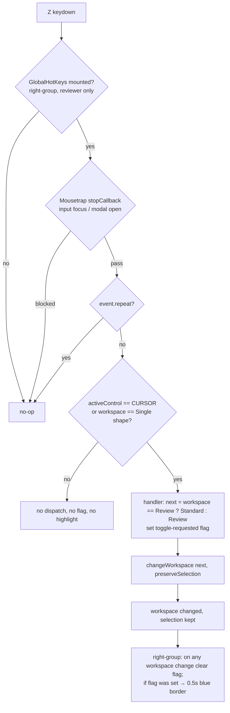

# feat: Reviewer-only Z shortcut to toggle Standard/Review workspace (INNO-125)

## Summary

검수자(`reviewer` 그룹) 계정에서만 `Z`로 어노테이션 workspace를 Standard ↔ Review로 전환한다. 단축키 항목은 기존 방식대로 모듈 로드 시 전역 keyMap에 등록하고, 키 바인딩·F1·F2·드롭다운 표시는 검수자 여부로 막는다. `Z` 전환만 선택 상태를 유지하도록 workspace 변경 액션에 옵션을 추가하고, 단축키로 바뀐 경우 드롭다운 테두리를 0.5초 강조한다. 순수 UI 작업이며 서버 변경은 없다.

---

## Problem Frame

검수자는 Standard와 Review를 자주 오가지만 지금은 우측 상단 workspace 드롭다운을 마우스로 열어야 한다. 키(`Z`)와 동작은 검수자와 합의됐다(see origin: `docs/brainstorms/2026-10-28-inno-125-workspace-toggle-shortcut-requirements.md`). 계획의 핵심 난점은 단축키 시스템이 사용자 구분 없이 모듈 import 시점에 전역 등록되고, F2 커스텀 키의 저장·복원이 그 시점의 keyMap에 묶여 있다는 점이다.

---

## Requirements

origin의 R1–R15를 따른다. 단, R14의 "등록 안 함"은 항목 미등록이 아니라 바인딩·노출(F1·F2·드롭다운·충돌 모달) 차단으로 충족한다. 관찰되는 결과는 같고, 근거는 Key Technical Decisions의 "항목은 전역 등록"이다. 요약:

- R1–R2. 검수자가 `Z`를 누르면 Review → Standard, 그 외 모든 workspace → Review. 모든 workspace에서 동작.
- R3–R4. 프레임·확대/이동 위치·활성/선택 객체 유지.
- R5–R7. 입력창 포커스, 커서 모드가 아닌 상태(그리기·편집 중), 모달 열림 시 동작 안 함.
- R8–R10. 알림 없음, 단축키로 바뀐 경우에만 드롭다운 테두리 0.5초 파랑, 검수자 드롭다운의 Standard·Review 항목 옆에 현재 키 표시.
- R11–R13. F1에 `Switch Standard/Review` 표시, F2에서 변경·저장·복원, 충돌 시 기존 충돌 모달.
- R14–R15. 비검수자에게는 무반응·비노출, 드롭다운 기존 동작 유지.

Acceptance Examples AE1–AE7은 origin 그대로이며 U5 시나리오에 연결한다.

---

## Key Technical Decisions

- **항목은 전역 등록, 노출·바인딩은 검수자 게이트.** `registerComponentShortcuts`를 모듈 로드 시 호출하는 기존 패턴을 따른다. 그래야 `restoreSettingsAsync`가 잡는 `defaultState`에 항목이 들어가고 F2 커스텀 키 저장·복원(`actions/settings-actions.ts`)이 수정 없이 동작한다. 사용자 판정 후 늦게 등록하는 방식은 이 저장·복원 경로를 따로 고쳐야 하고, 로그인/아웃과 복원 순서 경합도 생긴다. 비검수자에게 관찰되는 결과(무반응, F1·F2·드롭다운 비노출)는 R14와 같다.
- **바인딩 위치는 top-bar 우측 그룹.** `components/annotation-page/top-bar/right-group.tsx`는 모든 workspace에서 마운트되고 드롭다운을 직접 소유한다. 여기서 검수자일 때만 `GlobalHotKeys`를 렌더하면, F1 목록(`getApplicationKeyMap`, 현재 바인딩만 표시)은 자동으로 검수자에게만 항목을 보여준다. 강조 상태도 같은 컴포넌트 로컬 상태로 둘 수 있다.
- **스코프는 `ShortcutScope.ANNOTATION_PAGE`.** 충돌 검사가 이 스코프를 GENERAL과 모든 workspace 스코프에 대조하므로(`utils/conflict-detector.ts`) R13이 기존 로직으로 충족된다. 현재 `z` 단독 바인딩은 코드·SAM 플러그인·canvas 어디에도 없다.
- **선택 유지는 액션 옵션으로.** `changeWorkspace`에 선택 유지 옵션을 추가하고 `CHANGE_WORKSPACE` reducer는 옵션이 있을 때 `activatedStateID`·`selectedStatesID`를 비우지 않는다. 드롭다운 경로는 옵션 없이 호출돼 기존 동작(선택 해제)을 유지한다. 기존 가드(커서 모드가 아니면 무시, 단 현재 workspace가 Single shape이면 허용)와 GT 객체 필터는 두 경로 모두 그대로다.
- **전환 목적지는 순수 함수.** "Review면 Standard, 아니면 Review"를 작은 순수 함수로 둔다. 이전 모드 기억은 하지 않는다.
- **검수자 판정 헬퍼 1개 신설.** `groups.includes('reviewer')`를 반환하는 작은 헬퍼를 만들고 이 기능의 모든 게이트가 이를 쓴다. 기존 `isReviewer`/`isReviewerOnly` 인라인 체크는 건드리지 않는다.
- **강조는 "토글 요청 후 workspace가 실제로 바뀜"에 반응.** right-group은 reducer의 거부를 관찰할 수 없으므로, 핸들러가 같은 가드(커서 모드 또는 Single shape)를 먼저 확인해 통과할 때만 요청 플래그를 세우고 디스패치한다. workspace가 바뀔 때마다 플래그를 지우고, 플래그가 있었으면 0.5초 강조한다. 그래서 그리기 중 `Z`(R6)나 이후 마우스 전환(R9)에서 강조가 잘못 나오지 않는다.

---

## Assumptions

origin 미결정 사항에 대한 권장 기본값을 채택했다. Q1은 사용자가 결정했고, 나머지는 가정(사용자 확인 대기)이다.

- 검수자 = 시스템 그룹 `reviewer` 포함(admin 겸직 포함) **또는** 현재 잡의 조직에서 멤버십 역할 `reviewer` (origin Q1). 사용자 결정 2026-10-28: 조직 reviewer 역할 포함. 조직 역할은 현재 조직의 멤버십 조회(`/api/memberships`, 사용자 필터)로 비동기로 알아내며, 역할이 확인되면 바인딩·F2·드롭다운 표시가 나타난다. 판정은 `cvat-ui/src/utils/is-reviewer.ts`의 `useIsReviewer` 한 곳에 있다.
- `Z` 전환만 선택 유지, 드롭다운은 기존대로 선택 해제 (origin Q2).
- Attribute 등에서 `Z` → Review → `Z` → Standard (origin Q3).
- 비검수자의 F2 목록에서 항목 숨김 (origin Q4).

---

## High-Level Technical Design

노출 게이트 (검수자 헬퍼 하나가 모두 제어):

| 표면 | 검수자 | 비검수자 |
|---|---|---|
| 키 바인딩(right-group `GlobalHotKeys`) | 마운트 | 마운트 안 함 |
| F1 목록 | 바인딩 결과로 자동 표시 | 자동 비표시 |
| F2 Shortcuts 목록 | 표시·편집 | 목록에서 필터 |
| F2 충돌 모달 대상 | 포함 | 제외 |
| 드롭다운 항목 옆 키 | 표시 | 비표시 |

---

## Implementation Units

### U1. 단축키 항목 등록과 검수자 판정 헬퍼

**Goal:** `SWITCH_STANDARD_REVIEW_WORKSPACE`(가칭) 항목을 전역 keyMap에 등록하고, 이 기능 전용 검수자 판정 헬퍼를 만든다.

**Requirements:** R11, R12, R13, R14

**Dependencies:** 없음

**Files:**
- 신설: `cvat-ui/src/utils/is-reviewer.ts` (이름은 구현 시 확정)
- 수정: `cvat-ui/src/components/annotation-page/top-bar/right-group.tsx` (모듈 스코프 등록)
- 테스트: `tests/cypress/e2e/features/workspace_toggle_shortcut.js` (U5)

**Approach:**
- 항목: name `Switch Standard/Review`, 설명 한 줄, sequences `['z']`, scope `ANNOTATION_PAGE`.
- `left-group.tsx`의 `componentShortcuts` + `registerComponentShortcuts` 패턴을 그대로 따른다.
- 헬퍼는 auth 상태의 사용자 그룹을 받아 `reviewer` 포함 여부를 반환한다. selector 형태로 쓸 수 있게 한다.

**Patterns to follow:** `components/annotation-page/top-bar/left-group.tsx`의 UNDO/REDO 등록.

**Test scenarios:**
- 검수자 F2 > Shortcuts > Annotation page 그룹에 `Switch Standard/Review`가 `Z`로 보인다.
- 검수자가 F2에서 `Next frame`(`f`)을 `z`로 바꾸려 하면 충돌 모달에 `Switch Standard/Review`가 나온다. Covers AE6.

**Verification:** 앱 로드 후 store keyMap과 `defaultState`에 항목이 있다.

### U2. 선택 유지 옵션이 있는 workspace 변경

**Goal:** `changeWorkspace`에 선택 유지 옵션을 추가하고 reducer가 이를 반영한다. 전환 목적지 순수 함수를 둔다.

**Requirements:** R1, R2, R4, R6, R15

**Dependencies:** 없음

**Files:**
- 수정: `cvat-ui/src/actions/annotation-actions.ts` (`changeWorkspace`)
- 수정: `cvat-ui/src/reducers/annotation-reducer.ts` (`CHANGE_WORKSPACE`)
- 테스트: `tests/cypress/e2e/features/workspace_toggle_shortcut.js`

**Approach:**
- 옵션은 기본값 false. 기존 호출부(드롭다운, Cypress `changeWorkspace` 커맨드가 거치는 UI)는 그대로 둔다.
- 옵션이 true면 `activatedStateID`·`selectedStatesID`를 유지한다. `activatedAttributeID`는 Attribute workspace 전용이라 비운다.
- 기존 가드(커서 모드가 아니면 그대로 반환, Single shape에서는 허용)는 유지한다.
- 목적지 함수(Review → Standard, 나머지 4개 → Review)는 `annotation-actions.ts`에서 `changeWorkspace` 옆에 export하고, U3 핸들러가 이를 import한다.

**Test scenarios:**
- 드롭다운으로 Standard → Review 전환 시 활성 객체가 해제된다(회귀 없음, R15).
- `Z` 전환 시 활성 객체 #N이 Review에서도 활성 상태다. Covers AE1.
- 폴리곤 그리기 중 `Z` → workspace·그리기 상태 그대로. Covers AE4.

**Verification:** 드롭다운 경로 동작이 변경 전과 같다.

### U3. 키 바인딩, 강조, 드롭다운 키 표시

**Goal:** 검수자일 때만 바인딩을 마운트하고, 전환 후 드롭다운을 0.5초 강조하며, Standard·Review 옵션 옆에 현재 키를 표시한다.

**Requirements:** R1, R2, R3, R5, R7, R8, R9, R10, R11, R14

**Dependencies:** U1, U2

**Files:**
- 수정: `cvat-ui/src/components/annotation-page/top-bar/right-group.tsx`
- 수정: `cvat-ui/src/containers/annotation-page/top-bar/top-bar.tsx` (keyMap, 정규화된 키 문자열, 검수자 여부, 선택 유지 전환 콜백 전달)
- 수정: `cvat-ui/src/components/annotation-page/styles.scss` (`.cvat-workspace-selector` 강조 클래스)
- 테스트: `tests/cypress/e2e/features/workspace_toggle_shortcut.js`

**Approach:**
- `GlobalHotKeys`에 `subKeyMap(componentShortcuts, keyMap)`을 넘기는 기존 패턴을 쓰되 검수자일 때만 렌더한다. 입력창·모달 차단은 `utils/mousetrap-react.tsx`의 `stopCallback`이 처리한다.
- 핸들러는 키 반복 이벤트(`event.repeat`)를 무시해 물리적 한 번 누름 = 한 번 전환이 되게 한다.
- 핸들러는 reducer와 같은 가드(커서 모드 또는 Single shape)를 확인한다. 통과하면 목적지를 계산하고, 토글 요청 플래그를 세우고, 선택 유지 옵션으로 전환을 디스패치한다. 이를 위해 컨테이너가 `activeControl`을 넘긴다.
- workspace prop이 바뀔 때마다 플래그를 지운다. 플래그가 있었으면 강조 클래스를 0.5초 붙였다 뗀다. 연속 전환 시 타이머를 재시작하고, 언마운트 시 타이머를 정리한다.
- 드롭다운 키 표시: 검수자이고 키가 비어 있지 않을 때만, 펼친 목록의 Standard·Review 옵션 옆에 정규화된 키(예: `Z`)를 작게 표시한다. 닫힌 Select에는 workspace 이름만 보이게 한다(예: `labelRender` 또는 `optionLabelProp`로 순수 텍스트 라벨 지정). 현재 옵션에는 `title`이 없고, rc-select는 라벨이 문자열일 때만 `title`을 만든다. 따라서 모든 옵션에 `title={ws}`를 명시한다. Cypress `changeWorkspace` 커맨드가 `title`로 옵션을 고르기 때문이다.
- 컨테이너의 기존 `changeWorkspace`는 포커스 해제(`blur`)를 함께 한다. 토글 경로도 같은 처리를 거치게 한다.

**Patterns to follow:** `top-bar/player-buttons.tsx`의 `GlobalHotKeys` 사용, 컨테이너의 `normalizedKeyMap` 전달.

**Test scenarios:**
- 검수자, Standard, 프레임 37 → `Z` → Review, 프레임 37, 드롭다운 값 Review, 강조 클래스가 생겼다가 약 0.5초 뒤 사라진다. 다시 `Z` → Standard. Covers AE1.
- 검수자, Attribute → `Z` → Review → `Z` → Standard. Covers AE2.
- 검수자, 이슈 코멘트 입력창에서 `z` 입력 → 텍스트에 `z`, workspace 그대로. Covers AE3.
- 비검수자 `Z` → 무반응, F1 목록에 항목 없음, 드롭다운 옵션에 `Z` 없음. Covers AE5.
- 검수자가 F2에서 토글 키를 `w`로 변경 → `w`로 동작, `z` 무반응, 드롭다운 표시 `W`. 새로고침 후에도 유지.
- 검수자가 토글 키를 비움 → 드롭다운 표시 사라짐.
- 검수자 F1 목록에 `Switch Standard/Review`와 `z`가 보인다.
- 마우스로 드롭다운 전환 시 강조 없음(R9). 그리기 중 `Z`로 무시된 직후 마우스로 전환해도 강조 없음.
- 닫힌 드롭다운 텍스트는 `Review`/`Standard`뿐이고 키 접미사가 없다. 기존 Cypress `changeWorkspace` 커맨드가 검수자 세션에서도 옵션을 찾는다.
- `z`를 길게 누름 → 한 번만 전환된다.
- Single shape에서 그리는 중 `Z` → Review로 전환(드롭다운과 같은 기존 허용).
- 확대·이동한 상태에서 `Z` 왕복 후 배율·위치가 같다(R3).

**Verification:** 검수자/비검수자 두 계정으로 위 시나리오가 통과한다.

### U4. 비검수자 F2 목록·충돌 검사에서 항목 제외

**Goal:** 비검수자는 F2 Shortcuts에서 항목을 보지 못하고, 다른 단축키를 `z`로 바꿔도 이 항목과의 충돌 모달이 뜨지 않는다.

**Requirements:** R14

**Dependencies:** U1

**Files:**
- 수정: `cvat-ui/src/components/header/settings-modal/shortcut-settings.tsx` (목록 필터)
- 수정: `cvat-ui/src/components/header/settings-modal/multiple-shortcuts-display.tsx` (충돌 검사 대상에서 제외)
- 테스트: `tests/cypress/e2e/features/workspace_toggle_shortcut.js`

**Approach:**
- 두 컴포넌트에서 검수자 헬퍼로 항목을 걸러낸 keyMap을 쓴다.
- reducer의 `UPDATE_SEQUENCE`는 전체 keyMap으로 충돌을 해소하므로, 비검수자가 다른 항목을 `z`로 바꾸면 숨은 토글 항목의 `z`가 지워질 수 있다. 이 동작은 받아들인다(Risks 참조).

**Test scenarios:**
- 비검수자 F2 검색창에 `Switch` 입력 → `Switch Standard/Review` 없음.
- 비검수자가 `Next frame`을 `z`로 변경 → 충돌 모달 없이 적용, `z`로 다음 프레임 이동.

**Verification:** 비검수자 F2에서 항목이 검색·목록 어디에도 없다.

### U5. Cypress e2e

**Goal:** 위 시나리오를 검수자/비검수자 양쪽으로 자동화한다.

**Requirements:** 성공 기준 전체, AE1–AE7

**Dependencies:** U1–U4

**Files:**
- 신설: `tests/cypress/e2e/features/workspace_toggle_shortcut.js`

**Approach:**
- 기존 Cypress 픽스처에는 `reviewer` 그룹 사용자가 없다. 그룹 판정이 클라이언트 전용이므로 `cy.intercept`로 현재 사용자 조회 응답의 `groups`에 `reviewer`를 넣어 검수자를 흉내 낸다. 실제 그룹 사용자를 만드는 방식이 더 간단하면 구현 시 바꾼다.
- F1 표 검증은 `tests/cypress/e2e/features/shortcuts.js`의 표 탐색 헬퍼를 따른다.
- 이 포크는 `reviewer` 그룹 사용자의 잡을 Review로 연다(`GET_JOB_SUCCESS`). Standard에서 시작하는 시나리오는 intercept 후 먼저 workspace를 명시적으로 바꾼다. intercept가 auth 상태의 그룹에 실제 반영되는지도 첫 시나리오에서 확인한다.

**Test scenarios:** U2–U4 시나리오를 모은다. AE7(Ctrl 늦게 누름)은 `z` 단독 입력 후 복귀와 같으므로 AE1에 포함한다.

**Verification:** 새 spec이 로컬 스택에서 통과하고, 기존 `features/shortcuts.js`와 `case_71_shortcuts_window.js`가 회귀 없이 통과한다.

---

## System-Wide Impact

- 대상: 검수자 계정. 비검수자 화면과 동작은 바뀌지 않는다.
- 단축키 시스템(전역 keyMap, F1, F2)과 workspace 변경 액션을 건드린다. 서버·OPA·스키마 변경 없음.
- INNO-127이 같은 F1 목록에 Delete issue 단축키(`⌘⌫`/`Ctrl+Del`)를 추가한다. 키 충돌은 없다. 두 PR이 모두 머지된 뒤 F1·F2 표시와 충돌 감지를 함께 확인한다. 같은 파일을 건드리면 늦게 머지되는 쪽이 리베이스한다.

---

## Risks & Dependencies

- **브라우저 공유 시 커스텀 키 간섭.** 단축키 설정은 사용자별이 아니라 브라우저 localStorage에 저장된다(기존 동작). 비검수자가 같은 브라우저에서 다른 항목을 `z`로 바꾸면 숨은 토글 키가 지워질 수 있다. 검수자는 F2에서 다시 지정하면 된다. 실제 운영에서 공용 PC가 드물다고 보고 받아들인다.
- **로그아웃 후 재로그인(새로고침 없음).** 기존 shortcuts reducer는 로그아웃 시 keyMap을 비우는 upstream 동작이 있다. 이 기능 고유 문제는 아니지만, 계정 전환 시 검수자 게이트가 새 사용자 그룹을 따르는지 검증한다.
- **선택 유지 시 대상 workspace 표시.** Review workspace의 객체 목록은 readonly로 렌더된다. 활성 객체가 유지돼도 표시·하이라이트가 자연스러운지 구현 시 확인한다.
- **배율·위치 유지(R3).** `fitCanvas`는 캔버스 크기만 갱신하므로 유지될 가능성이 높다. 사이드바 폭 차이로 보이는 영역이 약간 달라질 수 있다. 어긋나면 전환 전후로 캔버스 기하를 저장·복원하는 보완을 구현 단계에서 판단한다.

---

## Scope Boundaries

- 다른 workspace로 가는 단축키, 모드 순환, 이전 모드 기억은 하지 않는다.
- 드롭다운 전환 동작(선택 해제 포함)은 바꾸지 않는다.
- 서버·권한 변경, 단축키 설정 서버 동기화는 하지 않는다.

### Deferred to Follow-Up Work

- 흩어진 `reviewer` 그룹 인라인 체크(`annotation-actions.ts`, `annotation-menu.tsx`)를 새 헬퍼로 통합.
- 로그아웃 시 keyMap 초기화 upstream 동작 정리.

---

## Open Questions

### Deferred to Implementation

- 항목 키 이름, 헬퍼 파일명.
- 선택 유지 시 활성/선택 객체가 GT 객체였다면 GT 필터로 사라진 state를 가리킬 수 있다. 무해한지 구현 시 확인한다.
- 강조 스타일이 antd 기본 포커스 링(파랑)과 구별되는지, 그리고 스크린리더 알림(aria-live)을 둘지 정한다. 리뷰에서 FYI로 나온 항목이다.
- Cypress에서 검수자를 intercept로 흉내 낼지, 실제 그룹 사용자를 만들지.

---

## Sources & Research

- origin: `docs/brainstorms/2026-10-28-inno-125-workspace-toggle-shortcut-requirements.md`
- 단축키: `cvat-ui/src/utils/mousetrap-react.tsx`, `utils/conflict-detector.ts`, `utils/component-subkeymap.ts`, `actions/shortcuts-actions.ts`, `reducers/shortcuts-reducer.ts`
- 설정 저장·복원: `cvat-ui/src/actions/settings-actions.ts`, `components/header/settings-modal/`
- workspace: `cvat-ui/src/components/annotation-page/top-bar/right-group.tsx`, `containers/annotation-page/top-bar/top-bar.tsx`, `reducers/annotation-reducer.ts`
- 테스트 패턴: `tests/cypress/e2e/features/shortcuts.js`, `tests/cypress/support/commands.js`(`changeWorkspace`)
- 외부 리서치: 하지 않음. 로컬 패턴(단축키 등록·바인딩 예시 다수)으로 충분.
