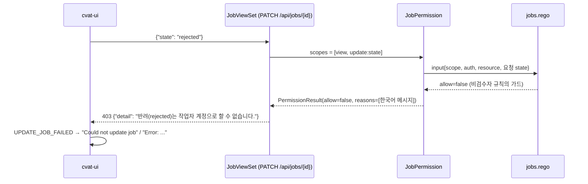

# feat: 검수자·관리자만 job을 rejected로 바꿀 수 있게 제한 (INNO-126)

## Summary

요청된 새 job state를 OPA input에 싣고, `jobs.rego`의 비(非)검수자 `update:state` 허용 규칙에 "새 값이 `rejected`가 아님" 조건을 건다. 거부 시 한국어 사유가 403 `detail`로 나가도록 IAM 거부 경로에 사유 전달을 추가한다. UI는 공용 판정 훅 하나로 세 진입점(어노테이션 메뉴, Jobs 목록 ⋮/일괄, Task 상세 job 카드)의 `rejected` 항목을 비활성+툴팁으로 바꾼다.

---

## Problem Frame

작업자(job 담당자)도 job state를 `rejected`로 바꿀 수 있다. `jobs.rego`는 `update:state`를 `is_job_staff`에게 주고, 요청 값은 OPA로 전달조차 되지 않는다. 화면도 네 상태를 모두 노출한다. (see origin: docs/brainstorms/2026-10-28-inno-126-reviewer-only-reject-requirements.md)

---

## Requirements

origin의 R1–R11을 그대로 따른다. 요약:

- R1. 비허용 계정의 `→ rejected` 요청은 403, state 불변.
- R2. 판단은 `jobs.rego` `update:state`에서 요청 값으로. 요청 값을 OPA input에 포함.
- R3. 새 값이 `rejected`가 아니면 기존 규칙 그대로(`rejected →` 다른 상태 포함).
- R4. 403 응답 메시지 `반려(rejected)는 작업자 계정으로 할 수 없습니다.` → 기존 알림 `Could not update job` / `Error: ...`.
- R5. 검수자·관리자 기존 권한 불변.
- R6–R9. 작업자 화면: 세 진입점에서 `rejected` 비활성+툴팁 `반려(rejected)는 작업자 계정으로 할 수 없습니다`, 확인 창 없음, 현재값 ✓ 유지, 판정 기준은 서버와 동일(조직 reviewer 포함).
- R10. 검수자·관리자 화면 불변.
- R11. OPA 테스트로 거부/허용 매트릭스 검증.

허용 계정: ~~전역 privilege `admin`, 전역 privilege `reviewer`, 조직 role `reviewer`~~ → **사용자 결정 2026-10-28(Q1): worker만 차단** — 실효 privilege가 worker가 아닌 모든 계정.

---

## Assumptions

origin의 미결정 사항을 권장안으로 채택했다. Q1은 사용자가 결정했고(2026-10-28), Q2·Q3은 **가정(사용자 확인 대기)**이다. 바뀌면 U2의 조건과 U4의 판정만 달라진다.

- Q1 → **사용자 결정 2026-10-28: worker만 차단.** 실효 privilege가 worker인 계정(sandbox에서는 전역 privilege `worker`, 조직 안에서는 조직 role `worker` 또는 무역할)만 반려 불가. 전역 admin, 전역 `user`/`reviewer`, 조직 owner/maintainer/supervisor/reviewer는 기존처럼 가능. 판정은 `jobs.rego`의 `can_reject` 한 곳과 UI `canRejectJob` 한 곳에 있다.
- Q2 → 작업자의 `rejected → rejected` no-op PATCH도 403.
- Q3 → Task 상세 job 카드에도 비활성 처리 적용.

---

## Key Technical Decisions

- **요청 값은 `resource`가 아닌 별도 키로 싣는다.** `resource`는 DB의 현재 job을 기술한다. 새 값은 요청에 속하므로 별도 최상위 키(예: 요청 본문의 state)로 넣는다. 키 이름은 구현 시 정한다. `update:state` scope에만 싣는다.
- **"rejected 요청"이 아닐 때만 기존 비검수자 규칙이 허용한다.** 규칙은 `not is_reject_request` 형태의 가드로 표현한다. 필드가 없으면 reject 요청이 아니므로, 요청 값을 모르는 기존 생성 테스트(`jobs_test.gen.rego`)는 결과가 바뀌지 않는다. 생성기·CSV는 건드리지 않는다.
- **가드는 `UPDATE_STATE` scope에만 걸린다.** 현재 규칙들은 `UPDATE_STATE`를 `UPDATE_ANNOTATIONS` 등과 한 집합으로 묶어 허용한다. 가드는 "scope가 `update:state`이고 요청 값이 `rejected`"일 때만 참이 되는 헬퍼로 만들어, 같은 규칙의 다른 scope는 영향받지 않게 한다.
- **검수자·관리자 규칙은 손대지 않는다.** `utils.is_admin` 선행 허용과 두 reviewer 규칙(조직·sandbox)은 가드 없이 그대로 둔다.
- **거부 사유는 OPA가 아닌 Python에서 붙인다.** `jobs/allow`는 bool을 반환하고, 사유를 rego에서 내려면 쿼리 형태를 바꿔야 한다. 대신 `JobPermission`이 "OPA가 거부했고 이것이 reject 요청"일 때 `PermissionResult.reasons`에 한국어 메시지를 채운다. 판단 자체는 여전히 rego가 한다(R2).
- **`PolicyEnforcer`는 거부 결과에 사유가 있으면 그 사유로 `PermissionDenied`를 던진다.** 현재 `reasons`는 버려지고 DRF 기본 문구가 나간다. 사유가 없는 거부는 지금처럼 기본 문구를 유지한다.
- **UI 판정은 공용 훅 하나로, 서버의 단일 privilege 모델을 그대로 복제한다.** 서버는 사용자 그룹 중 `IAM_ROLES` 순서(admin > user > reviewer > worker)의 첫 번째 하나만 privilege로 쓴다(`cvat/apps/iam/middleware.py`). 따라서 `user`+`reviewer` 그룹을 함께 가진 계정의 privilege는 `user`이고 반려 불가다. 또 sandbox reviewer 규칙은 `utils.is_sandbox`를 요구하므로, 조직 안에서는 전역 reviewer도 조직 role이 `reviewer`여야 한다. 조직 role은 `org.members` 필터 조회(analytics-report 페이지 패턴)로 얻는다. 기존 `isReviewerOnly`(annotation-actions, annotation-menu)는 의미가 달라 합치지 않는다.

---

## High-Level Technical Design

---

## Implementation Units

### U1. 요청 state를 OPA input에 싣기

**Goal:** `update:state` 권한 검사 시 요청된 새 state가 OPA input에 포함된다.

**Requirements:** R2

**Dependencies:** 없음

**Files:**
- Modify: `cvat/apps/engine/permissions.py` (`JobPermission.create`/`get_scope_specific_params`, payload 구성)
- Test: `cvat/apps/engine/tests/test_job_reject_permission.py` (신규, U3에서 함께 채움)

**Approach:**
- `get_scope_specific_params`에서 scope가 `UPDATE_STATE`일 때 `request.data['state']`를 파라미터로 받아 인스턴스에 보관한다. `__init__`에서 `task_id`처럼 pop한다.
- 키 이름은 U1에서 한 번 정하고 U2의 rego·테스트가 같은 리터럴을 쓴다. 가드는 키가 없으면 열린다(fail-open, 생성 테스트 호환용)이므로, U3의 worker 반려 403 테스트를 필수 회귀 게이트로 둔다.
- 값 검증은 기존 serializer `ChoiceField`(정확 일치)에 맡긴다. 대소문자 변형·리스트 값은 serializer가 400으로 거부한다.
- `get_opa_payload`(또는 resource 외 payload 확장)를 override해 그 값을 별도 키로 싣는다. `get_resource()`는 바꾸지 않는다.
- `jobs.rego` 상단 input 주석에 새 키를 문서화한다(U2).

**Patterns to follow:** `get_scope_specific_params`의 `task_id`/export 파라미터 전달 방식, `OpenPolicyAgentPermission.get_opa_payload`.

**Test scenarios:**
- `PATCH {"state": "rejected"}` → 생성된 `update:state` 권한 객체의 payload에 요청 state가 `rejected`로 들어 있다.
- `PATCH {"assignee": 1}` → `update:assignee` payload에는 요청 state 키가 없다.
- `update:state` scope의 payload에는 항상 요청 state 키가 있다.

**Verification:** payload 단위 테스트 통과, 다른 scope의 payload 불변.

### U2. `jobs.rego`에 reject 가드 추가 + OPA 테스트

**Goal:** 비검수자 `update:state` 허용 규칙이 `rejected` 요청을 허용하지 않는다.

**Requirements:** R1, R2, R3, R5, R11

**Dependencies:** U1 (input 키 이름)

**Files:**
- Modify: `cvat/apps/engine/rules/jobs.rego`
- Create: `cvat/apps/engine/rules/jobs_reject_test.rego`

**Approach:**
- 헬퍼 `is_reject_request`: scope가 `update:state`이고 요청 state가 `rejected`.
- `UPDATE_STATE`를 포함하는 비검수자 허용 규칙 4개(sandbox worker+`is_job_staff`, 조직 maintainer, 조직 worker+`is_job_staff`, 조직 무역할 worker 담당자)에 `not is_reject_request`를 추가한다.
- reviewer 규칙 두 개와 `utils.is_admin`은 그대로 둔다.
- 손으로 쓴 테스트는 `jobs_reviewer_test.rego` 스타일(고정 auth/resource 헬퍼 + 명시 케이스)을 따른다.

**Patterns to follow:** `cvat/apps/engine/rules/jobs_reviewer_test.rego`, `jobs_sandbox_reviewer_test.rego`.

**Test scenarios:**
- sandbox worker 담당자 → `rejected` 거부, `in progress`/`completed`/`new` 허용.
- sandbox `user` privilege task owner → `rejected` 허용(Q1 사용자 결정: worker만 차단).
- 조직 worker(privilege worker, role worker) job 담당자 → `rejected` 거부, `completed` 허용.
- 조직 무역할 worker 담당자 → `rejected` 거부.
- 조직 maintainer/owner/supervisor(privilege user) → `rejected` 허용(Q1 사용자 결정). 조직 role worker(privilege user 포함) → 거부.
- 조직 reviewer(privilege user, role reviewer) → `rejected` 허용.
- sandbox reviewer(privilege reviewer) → `rejected` 허용.
- admin(sandbox·조직) → `rejected` 허용.
- 요청 state 키 없음 + `update:state` → 기존 결과와 동일(생성 테스트 호환).
- worker 담당자 `update:annotations` → 여전히 허용(가드가 다른 scope에 새지 않음).
- Covers AE4. 현재 resource가 `rejected`인 job에 worker가 `in progress` 요청 → 허용.

**Verification:** 새 테스트와 기존 `jobs_test.gen.rego`, reviewer 테스트가 모두 OPA test에서 통과.

### U3. 거부 사유를 403 응답으로 전달

**Goal:** reject 요청이 거부되면 응답 `detail`이 `반려(rejected)는 작업자 계정으로 할 수 없습니다.`이다.

**Requirements:** R1, R4, AE3, AE6

**Dependencies:** U1, U2

**Files:**
- Modify: `cvat/apps/engine/permissions.py` (`JobPermission.check_access` override)
- Modify: `cvat/apps/iam/permissions.py` (`PolicyEnforcer._check_permission`: 사유 있는 거부 시 `PermissionDenied(사유)`)
- Test: `cvat/apps/engine/tests/test_job_reject_permission.py`

**Approach:**
- `JobPermission.check_access`: 상위 결과가 거부이고 이 객체가 reject 요청이면 사유를 채운 결과를 반환.
- `PolicyEnforcer`: 첫 거부 결과에 `reasons`가 있으면 그것으로 `PermissionDenied`를 raise. 없으면 기존처럼 `False`. 예외는 `access_tokens.PolicyEnforcer`의 `super()` 호출을 그대로 통과해 403이 된다.
- 영향 범위는 base enforcer 루프에서 검사되는 권한(이 계획에선 `JobPermission`)뿐이다. access token 플러그인 루프(`_check_permission_plugins`)는 bare `False`를 반환하므로 바뀌지 않는다.
- 한국어 사유는 "OPA 거부 + reject 요청"이면 붙는다. 조직 안의 전역 reviewer처럼 다른 이유로 거부된 경우에도 같은 문구가 나간다 — U4가 서버와 같은 판정을 하면 화면에서는 이 경우가 생기지 않는다.
- 권한 검사는 `perform_update` 전에 일어나므로 같은 요청의 다른 필드도 반영되지 않는다(AE6).

**Test scenarios** (live-source 절차로 실행, OPA·server 기동 필요):
- Covers AE3. sandbox worker 담당자가 `PATCH {"state": "rejected"}` → 403, `detail` 일치, DB state 불변.
- Covers AE6. worker가 `PATCH {"state": "rejected", "assignee": <id>}` → 403, assignee 불변.
- worker가 `rejected` job에 `PATCH {"state": "in progress"}` → 200.
- 전역 reviewer가 `completed` job에 `PATCH {"state": "rejected"}` → 200(AE5).
- admin → 200.
- worker가 이미 `rejected`인 job에 `PATCH {"state": "rejected"}` → 403(Q2 가정).
- 거부 시 `JobAnnotationSnapshot` 행이 생기지 않는다(round-boundary 미발생).
- 사유 없는 일반 거부(예: 남의 job view)는 기존 DRF 기본 문구 그대로.

**Verification:** 위 시나리오 통과, 기존 `test_job_snapshots.py` 통과.

### U4. 공용 반려 권한 판정 훅

**Goal:** UI에서 현재 사용자가 반려 가능한지 한 곳에서 판정한다.

**Requirements:** R9, R10

**Dependencies:** 없음(서버와 병렬 가능)

**Files:**
- Create: `cvat-ui/src/utils/hooks.ts`에 훅 추가 또는 신규 `cvat-ui/src/components/job-item/use-can-reject-job.ts` (위치는 구현 시 결정)

**Approach:**
- 실효 privilege = `groups` 중 `admin` > `user` > `reviewer` > `worker` 순서의 첫 번째(middleware와 동일).
- 실효 privilege가 `admin`이면 가능.
- 현재 조직이 없으면(sandbox) 실효 privilege가 `worker`가 아닐 때 가능(Q1 사용자 결정).
- 현재 조직이 있으면 자기 membership role이 있고 `worker`가 아닐 때 가능(Q1 사용자 결정). role은 `org.members` 필터로 조회하고, 모듈 수준 캐시(조직 id 키, 진행 중 요청 공유) 또는 Redux에 둬서 Task 상세의 여러 job 카드가 요청을 하나만 보내게 한다.
- 조회 전/실패 시에는 비활성으로 둔다(서버가 최종 판단). 조직 reviewer는 조회가 끝날 때까지 잠깐 비활성을 본다 — R10과의 작은 차이로 수용한다(운영은 sandbox 위주).

**Patterns to follow:** `cvat-ui/src/components/analytics-report/analytics-report-page.tsx`의 membership 조회.

**Test expectation:** UI 단위 테스트 인프라가 없어 U5의 수동·Cypress 검증으로 갈음. 다만 아래 판정 표는 수동 검증에서 모두 확인한다.

| 계정 | 컨텍스트 | 기대 (Q1 사용자 결정: worker만 차단) |
|---|---|---|
| `admin` | any | 가능 |
| `reviewer` / `user` / `user`+`reviewer` | sandbox | 가능 |
| `worker` | sandbox | 불가 |
| 조직 role owner/maintainer/supervisor/reviewer | 조직 | 가능 |
| 조직 role worker (전역 privilege 무관, admin 제외) | 조직 | 불가 |

**Verification:** type-check 통과, 위 표와 일치.

### U5. 세 진입점 비활성+툴팁

**Goal:** 작업자 화면에서 `rejected`가 비활성+툴팁이고, 검수자 화면은 그대로다.

**Requirements:** R6, R7, R8, R10, AE1, AE2, AE4

**Dependencies:** U4

**Files:**
- Modify: `cvat-ui/src/components/annotation-page/top-bar/annotation-menu.tsx`
- Modify: `cvat-ui/src/components/job-item/job-selectors.tsx` (`JobStateSelector`)
- Modify: `cvat-ui/src/components/jobs-page/actions-menu.tsx`, `cvat-ui/src/components/job-item/job-item.tsx` (훅 값 전달이 필요하면)
- Test: `tests/cypress/e2e/actions_users/registration_involved/case_28_review_pipeline_feature.js` (기존 검수 시나리오 갱신, Risks 참고)

**Approach:**
- 어노테이션 메뉴: 반려 불가면 `rejected` 항목을 `disabled`로, 라벨을 `CVATTooltip`으로 감싼다. `onClick`(확인 창)을 붙이지 않는다. 현재값 클래스(`cvat-submenu-current-job-state-item`)는 유지(AE4).
- `JobStateSelector`: `rejected` 옵션을 `disabled`로 하고 툴팁을 단다. 현재값이 `rejected`면 선택값으로 그대로 표시된다. 일괄 모드(value=null)에서도 같은 비활성.
- 툴팁 문구는 `반려(rejected)는 작업자 계정으로 할 수 없습니다`(마침표 없음), 서버 메시지는 마침표 포함 — Q1 사용자 결정에 맞춰 문구를 바꿨다.

**Test scenarios:**
- Covers AE1. 작업자 계정, annotation 메뉴 → `rejected` 항목에 disabled 클래스, 클릭해도 확인 모달이 뜨지 않음.
- Covers AE2. 작업자, Jobs 목록 다중 선택 ⋮ > State → `rejected` 옵션 disabled.
- Covers AE4. `rejected` job을 작업자가 열면 현재값 표시 + disabled, `in progress` 선택 가능.
- 작업자, Task 상세 페이지 job 카드 State 선택지 → `rejected` disabled + 툴팁.
- 검수자 계정(전역 reviewer) → 네 항목 모두 활성(R10).

**Verification:** `yarn workspace cvat-ui run type-check`와 eslint 통과, 로컬 스택에서 worker/reviewer/admin 계정으로 세 화면 수동 확인.

---

## Acceptance Examples

origin AE1–AE6을 위 단위 테스트 시나리오에 `Covers`로 연결했다. AE5(검수자 반려 성공)는 U2·U3에서 검증한다.

---

## Scope Boundaries

- `rejected →` 다른 상태, 작업자의 `completed → in progress` 되돌리기는 막지 않는다(`classify_job_transition`이 이것도 `REJECTED` 경계로 기록하지만 범위 밖).
- stage/assignee 권한, Issue resolve/reopen 권한은 불변.
- OPA 테스트 생성기(`cvat/apps/iam/rules/tests/generate_tests.py`, `cvat/apps/engine/rules/tests/`)는 수정하지 않는다.

### Deferred to Follow-Up Work

- 다른 permission 거부(access token 플러그인 루프 포함)에도 구체 사유를 붙이는 일반화.
- Ground-truth job 생성(`POST /api/jobs`)은 `JobWriteSerializer`가 `state`를 받아 `create` scope만 검사한다. task staff가 GT job을 `rejected`로 생성할 수 있는 경로가 남는다. 영향이 작아(GT job 한정) 이 계획에서 제외하고, 생성 시 `state`를 무시하거나 거부하는 후속 작업으로 둔다.

---

## System-Wide Impact

- **INNO-123 알림:** `검수 반려` 알림은 검수자·관리자 행동에서만 발생한다. 거부된 요청은 state를 바꾸지 않으므로 알림이 생기지 않아야 한다 — INNO-123 구현이 권한 검사 이후(전이 커밋 시점)에 훅을 걸어야 한다.
- **job round-boundary 스냅샷 / production_stats:** `job_facts`의 `rejections`, `job_rounds`의 rework 마크가 검수자 행동만 반영한다. 데이터 형태 불변.
- **API/SDK/CLI 사용자:** 작업자 토큰으로 `state=rejected` PATCH하는 스크립트가 있다면 403이 된다.

---

## Risks & Dependencies

- **upstream 테스트 영향.** `tests/cypress/.../case_28_review_pipeline_feature.js`는 회원가입한 `reviewer` 사용자(기본 그룹 `user`)가 반려한다. 이 사용자는 반려 불가가 되어 테스트가 깨진다. 그룹만 바꿔서는 고칠 수 없다: `reviewer` 그룹을 추가해도 privilege는 `user`이고, `user`를 빼면 같은 테스트 앞부분의 어노테이션 저장 단계가 실패한다. 이슈 생성·저장은 기존 사용자로 두고, 마지막 반려 단계만 admin(요청자 계정)으로 로그인해 수행하도록 바꾼다. `tests/python/rest_api/test_webhooks_sender.py`의 state 순회 테스트도 실행 사용자를 확인해 필요하면 admin으로 바꾼다.
- **Q1 결정(worker만 차단) 반영됨.** 전역 `user`·조직 maintainer 등의 기존 반려는 그대로 동작한다. 남는 영향은 worker 계정(및 조직 role worker)의 반려 403뿐이다. 조직 안의 전역 reviewer라도 조직 role이 worker면 차단된다. Cypress `case_28`은 회원가입 계정(전역 `user`)이 반려하므로 수정이 필요 없어졌다.
- **OPA 번들 갱신.** rego 변경은 서버의 `/api/auth/rules` 번들로 배포되므로 서버 재배포와 동시에 반영된다. 별도 조치 없음.
- **사유 전달의 범위.** `PolicyEnforcer` 변경은 모든 뷰에 적용된다. 사유를 반환하는 권한 클래스는 현재 access token 플러그인뿐이라 영향은 좁다.

---

## Sources / Research

- origin: `docs/brainstorms/2026-10-28-inno-126-reviewer-only-reject-requirements.md`
- `cvat/apps/engine/rules/jobs.rego`, `jobs_reviewer_test.rego`, `jobs_sandbox_reviewer_test.rego`, `tests/configs/jobs.csv`, `tests/generators/jobs_test.gen.rego.py`(`is_valid`, 요청 값 축 없음)
- `cvat/apps/iam/permissions.py`(`get_opa_payload`, `get_per_field_update_scopes`, `PolicyEnforcer`, `PermissionResult.reasons`), `cvat/apps/access_tokens/permissions.py`(`REJECTION_REASON`, `DEFAULT_PERMISSION_CLASSES`의 실제 enforcer)
- `cvat/apps/engine/permissions.py` `JobPermission`
- `cvat-core/src/server-proxy.ts`(`detail` → `ServerError` 메시지), `cvat-ui/src/reducers/notifications-reducer.ts`(`Could not update job`)
- `cvat-ui/src/actions/bulk-actions.ts`, `cvat-ui/src/components/jobs-page/actions-menu.tsx`(`onUpdateJobField`의 동일 상태 제외)
- `cvat/apps/engine/job_snapshots.py`, `cvat/apps/production_stats/queries/job_facts.py`
