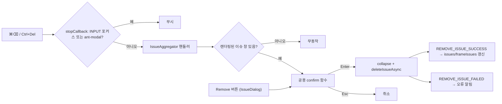

# feat: 이슈 삭제 단축키 (INNO-127)

## Summary

열린 이슈 창의 이슈를 `⌘⌫`(mac) / `Ctrl+Del`(Windows)로 삭제하는 단축키를 cvat-ui에 추가한다. 단축키와 Remove 버튼은 하나의 확인 창(Delete 포커스·빨간 버튼·되돌릴 수 없음 문구)을 공유한다. 서버·권한 변경은 없다.

---

## Problem Frame

이슈 삭제는 마우스 3단계(라벨 클릭 → Remove → Delete)로만 된다. `Del` 계열 키는 객체·프레임 삭제가 이미 쓰고 있다. 자세한 배경은 origin 문서 참조(see origin: docs/brainstorms/2026-10-28-inno-127-issue-delete-shortcut-requirements.md).

---

## Requirements

origin의 R1–R17을 따른다. R13의 표시 규칙은 Assumptions 1로 구체화했다(사용자 확인 대기). 구현 단위별 매핑은 각 U의 **Requirements**에 적는다.

- 단축키 동작: R1–R7
- 확인 창: R8–R11
- 표시와 설정: R12–R15
- 삭제 이후: R16–R17

---

## Assumptions

origin의 미결정 사항을 권장안으로 채택했다. 모두 **가정(사용자 확인 대기)**이다.

- Remove 버튼 옆 단축키 표시는 현재 keyMap에서 OS에 맞는 조합을 골라 기호로 보여준다(origin 미결정 1).
- 삭제 요청 전에 이슈 창을 닫는 현행 순서를 유지한다(origin 미결정 2).

---

## Key Technical Decisions

- KTD1. **단축키는 `IssueAggregator`에 바인딩한다. `IssueDialog`에 두지 않는다.** F1 목록은 `getApplicationKeyMap()`, 즉 지금 마운트된 `GlobalHotKeys`만 보여준다. `IssueDialog`에 두면 이슈 창이 열려 있을 때만 F1에 나온다(R14 위반). `IssueAggregator`는 Standard·Review workspace에 항상 마운트되어 있으므로 F1에 계속 노출되고, 열린 이슈 id(`expandedIssue`)에도 바로 접근할 수 있다.
- KTD2. **scope는 `ShortcutScope.ANNOTATION_PAGE`.** 두 workspace 모두에서 동작해야 하고, 이 scope는 충돌 검사가 모든 workspace scope를 대상으로 한다. `player-navigation.tsx`의 `alt+del`과 같은 scope라 함께 검사된다.
- KTD3. **sequences는 `['ctrl+del', 'command+backspace']`.** `bulk-wrapper.tsx`의 `SELECT_ALL` 선례를 따른다. OS 분기 없이 둘 다 바인딩한다.
- KTD4. **"선택된 이슈"는 실제로 렌더링된 이슈 창으로 판정한다.** `expandedIssue`는 프레임 이동·숨김 시 초기화되지 않으므로(origin Dependencies), 핸들러는 렌더 루프와 같은 조건(`canvasReady && geometry`, 현재 `frameIssues`에 있음, `issuesHidden` 아님, resolved-hidden 아님)을 통과한 id에만 반응한다. `expandedIssue` 초기화 동작 자체는 바꾸지 않는다.
- KTD5. **확인 창 로직을 공용 함수로 추출한다.** 지금은 `issue-dialog.tsx`의 `onDeleteIssue`에 묶여 있다. 단축키 경로와 Remove 버튼이 같은 함수를 호출하게 해 R11을 구조적으로 보장한다.
- KTD6. **입력칸·모달 억제는 기존 `stopCallback`에 맡긴다.** R4(INPUT 포커스)와 R5(ant-modal 열림)는 `utils/mousetrap-react.tsx`가 이미 처리한다. 새 억제 코드는 추가하지 않는다.
- KTD7. **현행 하드 삭제 유지(사용자 결정 2026-10-28).** 삭제 시 `IssueAnnotationSnapshot`·`IssueResolutionChange`·`Comment`가 CASCADE로 함께 지워진다. 사용자는 이 손실을 알고 있고, 그래서 단축키를 단일 Backspace가 아닌 ⌘/Ctrl 조합으로 정하고 확인 창을 유지했다. 소프트 삭제·FK 변경·후속 티켓 없음.

---

## High-Level Technical Design

---

## Implementation Units

### U1. 공용 이슈 삭제 확인 창

**Goal:** 확인 창을 공용 함수로 추출하고 Enter/Esc·빨간 버튼·경고 문구를 적용한다.

**Requirements:** R8, R9, R10, R11, R17

**Dependencies:** 없음

**Files:**
- `cvat-ui/src/components/annotation-page/review/issue-dialog.tsx` (수정)
- `cvat-ui/src/components/annotation-page/review/confirm-issue-deletion.ts` (신규, 공용 확인 창 함수)
- `tests/cypress/support/commands_review_pipeline.js` (`removeIssue`가 계속 통과하는지 확인, 필요 시 수정)

**Approach:**
- 함수는 이슈 id, 창 닫기 콜백, dispatch를 받아 `Modal.confirm`을 띄운다.
- `autoFocusButton`을 `'ok'`로 바꾸고 OK 버튼을 danger 스타일로 한다.
- 본문(`content`)에 `삭제한 이슈는 되돌릴 수 없습니다.`를 넣는다. 제목·`className`(`cvat-modal-confirm-remove-issue`)·`okText: 'Delete'`는 유지해 기존 Cypress 선택자를 깨지 않는다.
- `onOk`의 순서(창 닫기 → `deleteIssueAsync`)는 유지한다.
- 모듈 수준 "확인 창 열림" 플래그를 두고, 열려 있으면 호출을 무시한다. `onOk`·`onCancel`에서 해제한다. `Modal.confirm`이 비동기로 마운트되어 `stopCallback`의 `ant-modal` 검사가 한 틱 늦는 틈(빠른 연타)을 막는다.

**Patterns to follow:** 기존 `onDeleteIssue`; 다른 위험 동작 확인 창의 `okButtonProps: { danger: true }` 사용례(구현 시 grep).

**Test scenarios:**
- Remove 클릭 → 확인 창 열림 → 포커스된 요소가 Delete 버튼이고 빨간(danger) 클래스를 가진다.
- 확인 창 본문에 `삭제한 이슈는 되돌릴 수 없습니다.`가 보인다.
- Enter → DELETE 요청 204, 이슈 라벨 사라짐.
- Esc → 요청 없음, 확인 창 닫힘, 이슈 창은 열린 채.
- 기존 `removeIssue` Cypress 명령이 변경 없이 통과한다.

**Verification:** Remove 버튼 경로만으로 R8–R10이 확인된다.

---

### U2. 이슈 삭제 단축키 등록·핸들러

**Goal:** `DELETE_ISSUE` 단축키를 등록하고, 렌더링된 이슈 창이 있을 때만 U1 확인 창을 띄운다.

**Requirements:** R1, R2, R3, R4, R5, R6, R7, R14, R15

**Dependencies:** U1

**Files:**
- `cvat-ui/src/components/annotation-page/review/issues-aggregator.tsx` (수정, U1의 `confirm-issue-deletion.ts` 사용)
- `tests/cypress/e2e/features/issue_delete_shortcut.js` (신규)

**Approach:**
- 모듈 수준에서 `registerComponentShortcuts`로 `DELETE_ISSUE`를 등록한다. name `Delete issue`, description은 열린 이슈 창의 이슈를 삭제한다는 내용, sequences는 KTD3, scope는 KTD2.
- 컴포넌트는 `subKeyMap(componentShortcuts, keyMap)`으로 사용자 설정이 반영된 keyMap을 `GlobalHotKeys`에 넘긴다. `canvasReady`가 false라 조기 `return null` 하는 경로에서도 F1 노출이 끊기지 않도록, `GlobalHotKeys`를 조기 반환보다 앞에서 렌더링한다(조기 반환도 `GlobalHotKeys`를 반환). 표시 대상 이슈 계산도 조기 반환 전에 한다.
- 핸들러는 `event.repeat`(키 자동 반복)이면 무시한다. 이어서 KTD4 조건으로 렌더링된 이슈를 찾고, 없으면 바로 반환한다. 있으면 U1 함수를 `setExpandedIssue(null)`을 닫기 콜백으로 넘겨 호출한다.
- 렌더 루프의 표시 조건과 핸들러 조건이 어긋나지 않도록 한 곳에서 계산해 공유한다.

**Patterns to follow:** `components/annotation-page/standard-workspace/objects-side-bar/issues-list.tsx`(등록·subKeyMap·handlers 구성), `components/bulk-wrapper.tsx`(이중 sequence).

**Test scenarios:**
- Covers AE1. 이슈 창을 열고 body에서 `{meta}{backspace}` → 확인 창 → Enter → 이슈 삭제.
- Covers AE6. `{ctrl}{del}` → 확인 창 → Esc → 이슈 창 유지, 요청 없음.
- Covers AE3. 댓글 입력칸에 텍스트 입력 후 `{meta}{backspace}` → 확인 창 안 뜸.
- Covers AE4. 이슈 창 없이 객체 활성 상태에서 `{meta}{backspace}`, `{ctrl}{del}` → 확인 창 없음, 객체 수 그대로.
- Covers AE5. 이슈 창 연 뒤 다음 프레임 이동 → 단축키 → 확인 창 없음, 콘솔·알림 오류 없음.
- 이슈 창 연 뒤 `T I`로 숨김 → 단축키 → 확인 창 없음.
- 확인 창이 열린 상태에서 단축키 재입력 → `.cvat-modal-confirm-remove-issue`가 하나만 존재.
- Review workspace와 Standard workspace 각각에서 AE1 흐름이 동작한다.
- F1 열기 → `Delete issue` 행에 `ctrl+del`, `command+backspace`가 보인다(이슈 창 없이도).
- F2 > Shortcuts에서 `Delete issue`의 기존 태그를 모두 지우고(F2 편집기는 새 조합을 추가만 한다) `ctrl+shift+x`를 기록 → 새 키로 동작, 기존 키는 무동작.
- 키를 누른 채 유지(자동 반복) → 확인 창 하나만 뜬다.

**Verification:** 위 Cypress 시나리오 통과, 기존 `shortcuts.js`·`case_28_review_pipeline_feature.js` 회귀 없음, 앱 로드 시 충돌 검사 경고 없음.

---

### U3. 열린 이슈 창 표시와 단축키 힌트

**Goal:** 열린 이슈 창에 파란 테두리를 두고, Remove 버튼 옆에 OS별 단축키를 표시한다.

**Requirements:** R12, R13

**Dependencies:** U2 (keyMap의 `DELETE_ISSUE`를 읽음)

**Files:**
- `cvat-ui/src/components/annotation-page/review/issue-dialog.tsx` (수정)
- `cvat-ui/src/components/annotation-page/review/styles.scss` (수정)
- `tests/cypress/e2e/features/issue_delete_shortcut.js` (U2 파일에 추가)

**Approach:**
- `.cvat-issue-dialog`에 테마의 primary 색 토큰으로 테두리를 준다. 레이아웃·앵커 위치가 밀리지 않도록 `outline` 또는 inset `box-shadow`로 그린다. 이슈 창은 한 번에 하나만 열리므로 조건부 클래스는 필요 없다.
- 힌트 문자열: `platformInfoV2()`로 mac 여부를 판정하고, `DELETE_ISSUE`의 현재 sequences에서 mac이면 `command`/`meta` 포함, 아니면 `ctrl` 포함 조합 중 목록 순서상 첫 번째를 고른다. 맞는 조합이 없으면 목록의 첫 조합을 쓴다. sequences가 비어 있으면 힌트를 숨긴다(Assumptions 1).
- 표기 규칙(하나의 포매터로 통일): mac은 `command→⌘`, `shift→⇧`, `ctrl→⌃`, `alt→⌥`, `backspace→⌫`, `del→⌦`를 붙여 쓴다(기본값 `⌘⌫`). 그 외는 `Ctrl`/`Shift`/`Alt`/`Del`/`Backspace`를 `+`로 잇는다(기본값 `Ctrl+Del`).
- 힌트는 Remove 버튼 옆 보조 텍스트로, 버튼 클릭 영역을 넓히지 않는다.

**Patterns to follow:** `bulk-wrapper.tsx`의 `isMac` 판정, `issues-list.tsx`의 `normalizedKeyMap` 툴팁 사용.

**Test scenarios:**
- 이슈 창 열림 → `.cvat-issue-dialog`의 border-color가 primary 색.
- `cy.visit`의 `onBeforeLoad`에서 `navigator.userAgentData.platform`·`navigator.platform`을 mac으로 스텁 → 힌트 `⌘⌫`. (`platformInfoV2()`가 실행 OS를 그대로 읽으므로, 스텁 없이 단정하면 mac 개발 머신에서 깨진다.)
- 같은 방식으로 Windows 스텁 → 힌트 `Ctrl+Del`.
- (Windows 스텁) F2에서 기존 태그를 지우고 `ctrl+shift+x`를 기록하면 힌트가 `Ctrl+Shift+X`가 된다.
- sequences를 모두 지우면 힌트가 사라진다.

**Verification:** 위 시나리오 통과, mac Chrome에서 실제 `⌘⌫` 동작 1회 수동 확인.

---

### U4. 삭제 후 갱신과 권한 거부 확인

**Goal:** 삭제 성공 시 즉시 갱신(R16)과 권한 거부 시 알림(R17)을 회귀 테스트로 고정한다. 동작 변경은 없다.

**Requirements:** R16(목록·캔버스 갱신 부분. 눈금·이슈 수는 INNO-124 머지 후), R17

**Dependencies:** U2. 슬라이더 눈금·이슈 수 검증은 INNO-124 머지 후.

**Files:**
- `tests/cypress/e2e/features/issue_delete_shortcut.js` (추가)

**Approach:**
- 성공 경로: `REMOVE_ISSUE_SUCCESS`가 `issues`·`frameIssues`를 갱신하므로 캔버스 이슈 영역과 사이드바 이슈 목록이 바로 바뀌는지 확인한다. INNO-124의 눈금·이슈 수가 이 상태에서 파생되는지 INNO-124 구현과 대조한다.
- 거부 경로: 403 응답을 `cy.intercept`로 강제해 오류 알림 `Could not remove issue from the server`를 확인한다. 실제 reviewer 권한은 `cvat/apps/engine/rules/issues_reviewer_test.rego`의 기존 `test_reviewer_can_delete_own_issue`·`test_reviewer_cannot_delete_other_issue`가 이미 덮는다.

**Test scenarios:**
- 단축키 삭제 후 해당 프레임의 이슈 라벨·영역이 사라지고 사이드바 이슈 이동 버튼이 다음 이슈를 가리킨다.
- (INNO-124 머지 후) 슬라이더 눈금과 이슈 수가 1 줄어든다.
- Covers AE2. DELETE를 403으로 intercept → 오류 알림 표시, 새로고침 후 이슈 존재.

**Verification:** 시나리오 통과. INNO-124 미머지 시 해당 시나리오는 보류로 표시.

---

## Scope Boundaries

- 서버 API, OPA 규칙, 모델·마이그레이션 변경 없음.
- `expandedIssue`의 프레임 이동·숨김 시 초기화 동작은 바꾸지 않는다(KTD4가 우회).
- 사이드바 목록에서의 삭제, undo, 확인 생략 옵션은 범위 밖(origin Scope Boundaries).

### Deferred to Follow-Up Work

- F2 단축키 편집기에서 ⌘(Meta) 키 기록 지원(`key-code-mapper.ts`).

---

## Risks & Dependencies

| 위험 | 대응 |
|---|---|
| `GlobalHotKeys`가 `canvasReady` 이전 조기 반환에 걸려 F1에서 빠짐 | U2 Approach에서 배치를 명시, F1 시나리오로 검증 |
| 다른 컴포넌트가 같은 시점에 `command+backspace`/`ctrl+del`을 바인딩(형제 티켓 포함) | 충돌 검사가 등록 시 경고. INNO-123–126 머지 순서와 무관하게 앱 로드 콘솔 확인 |
| mac에서 F2로 ⌘ 조합을 기록할 수 없음 — `utils/key-code-mapper.ts`에 `MetaLeft`/`MetaRight` 매핑이 없다(기존 한계, `command+a`도 동일). mac 사용자가 `command+backspace`를 지우면 기본값 복원으로만 되돌릴 수 있다 | 이번 범위 밖. Deferred에 기록 |
| 사용자가 이미 다른 단축키에 `ctrl+del`/`command+backspace`를 설정해 두었으면 로드 시 충돌 해소로 기본 sequence가 조용히 빠질 수 있음(console.warn만) | 프로덕션 사용자 설정 현황상 가능성 낮음. 릴리스 노트에 언급 |
| 하드 삭제로 교정 데이터 손실이 늘어남 | 사용자 수용(KTD7). 조합 키 + 확인 창으로 오삭제를 줄인다 |
| INNO-124의 눈금·이슈 수가 별도 캐시를 쓰면 R16이 자동 충족되지 않음 | U4에서 INNO-124 구현과 대조 |

---

## Sources & Research

- 로컬 코드 조사만으로 충분해 외부 리서치는 하지 않았다(단축키 등록 선례 다수).
- `cvat-ui/src/components/shortcuts-dialog/shortcuts-dialog.tsx` — F1은 `getApplicationKeyMap()`(마운트된 바인딩) 기준 → KTD1 근거
- `cvat-ui/src/utils/mousetrap-react.tsx` — `stopCallback`
- `cvat-ui/src/utils/conflict-detector.ts`, `cvat-ui/src/reducers/shortcuts-reducer.ts`
- `cvat-ui/src/components/annotation-page/review/issues-aggregator.tsx`, `issue-dialog.tsx`
- `tests/cypress/support/commands_review_pipeline.js`, `tests/cypress/e2e/actions_users/registration_involved/case_28_review_pipeline_feature.js`, `tests/cypress/e2e/features/shortcuts.js`
- `cvat/apps/engine/rules/issues_reviewer_test.rego`
