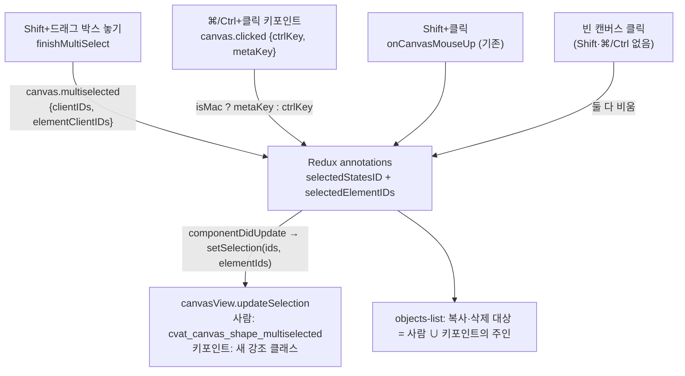
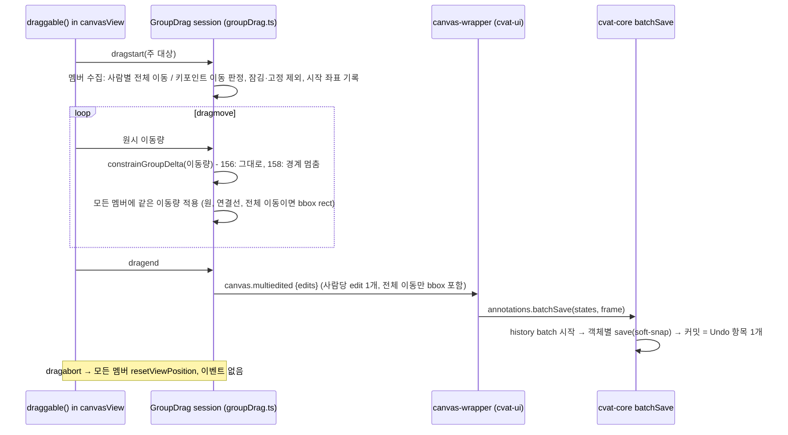

# feat: Shift+드래그 박스로 키포인트만 선택 (INNO-156)

## Summary

Shift+드래그 박스가 스켈레톤에 대해서는 박스 안의 키포인트만 선택하게 바꾼다. mac `⌘+클릭`, Windows `Ctrl+클릭`으로 키포인트 하나를 넣고 뺀다. 선택된 키포인트와 사람을 끌면 하나의 "그룹 드래그" 경로가 모두 옮기고, cvat-core의 새 history 묶음 기능으로 Undo 한 번에 되돌아간다. 복사·삭제는 선택된 키포인트의 주인(사람 전체)으로 확장한다. 서버·저장 형식 변경은 없다.

---

## Problem Frame

박스 선택은 걸친 사람을 통째로 고른다(`cvat-canvas/src/typescript/canvasView.ts`의 `finishMultiSelect`). 그래서 여러 사람의 같은 관절만 어긋난 경우를 고칠 수 없다. 또 지금 다중 이동은 객체마다 `save()`를 불러 Undo가 객체 수만큼 쌓인다. 배경과 결정 근거는 origin 문서를 따른다(see origin: docs/brainstorms/2026-11-04-inno-156-keypoint-box-select-requirements.md).

---

## Requirements

origin의 R1–R23, AE1–AE10을 그대로 따른다. 구현 단위별 매핑은 각 U의 **Requirements**에 적는다.

- 선택: R1–R7 (U2, U4)
- 선택 해제·수명: R8–R10 (U2, U4)
- 이동: R11–R17 (U3, U5). R17(경계 멈춤)은 INNO-158이 구현한다. 156은 훅 자리만 만든다.
- 복사·삭제·Undo: R18–R22 (U1, U5)
- Shift+드래그 시작 위치: R23 (INNO-157 범위, 156에서는 바꾸지 않음)

AE9(이미지 경계에서 묶음 멈춤)는 R17을 통해 INNO-158 범위이며 156에서는 검증하지 않는다.

Jira에서 결정된 기본값(2026-11-12, 반대 없음)을 확정 사항으로 반영했다. origin Q1(사각형·폴리곤은 지금처럼 객체 전체 선택)과 Q2(삭제·복사 미리보기 없음)가 해결되었다. AS4(잠긴 키포인트는 선택되지만 움직이지 않음), AS5(Shift+클릭으로 고른 여러 사람 이동도 Undo 한 번), AS10(커서·박스 모양 그대로), AS3(중심점 판정)도 확정이다.

---

## Assumptions

origin에 없던 구현 수준의 빈칸을 다음처럼 채웠다. 처음 두 항목은 사용자 결정이다.

- **그룹 이동은 명시적으로 선택된 키포인트에서만 시작한다(사용자 결정 2026-11-12).** 박스나 ⌘/Ctrl+클릭으로 고른 키포인트(`selectedElementIDs`)를 끌 때만 묶음이 움직인다. Shift+클릭으로 사람 단위 선택된 사람의 키포인트를 Shift 없이 끌면 지금처럼 그 키포인트만 움직인다. AS1("사람 전체 선택 = 보이는 키포인트 전부 선택")은 이 드래그 시작 판정에는 적용하지 않는다. 사람 전체를 옮기려면 지금처럼 bbox 안이나 몸통을 끈다. 복사·삭제 확장 규칙은 그대로다.
- **이미 선택된 키포인트도 Shift+드래그로 끌면 그 키포인트만 움직인다(사용자 결정 2026-11-12, INNO-157 쪽 결정).** 그룹 드래그 시작 조건에서 `shiftKey`를 제외한다.
- **Delete는 선택된 객체만 지운다(사용자 결정 2026-11-12).** 대상은 선택된 사람과 선택된 키포인트의 주인이다. 선택에 없는 hover·활성 사람은 사람 선택이 섞여 있어도 지우지 않는다. 기존 다중 삭제의 "활성 객체 추가" 동작을 없앤다.
- 선택된 키포인트가 hidden·outside가 되면 선택에서 뺀다(R2와 같은 기준). 보이지 않는 선택이 Delete·복사 대상을 정하는 일을 막는다.
- 프레임을 이동하면 사람·키포인트 선택을 모두 비운다. origin AS6은 "프레임 이동 시에도 유지"를 현재 규칙이라 적었지만, 실제 코드(`annotation-reducer.ts`의 `CHANGE_FRAME_SUCCESS`)는 사람 선택을 비운다. 현재 코드 규칙을 따른다.

---

## Key Technical Decisions

- KTD1. **키포인트 선택은 별도 ID 목록으로 둔다.** cvat-ui Redux에 `selectedElementIDs`(키포인트 clientID 목록)를 `selectedStatesID` 옆에 추가하고, 캔버스에는 `setSelection(clientIDs, elementClientIDs)`로 둘을 함께 내려보낸다. 박스 결과는 기존 `canvas.multiselected` 이벤트의 detail에 `elementClientIDs`를 더해 올린다. 기존 사람 선택의 왕복 경로(캔버스 이벤트 → reducer → `componentDidUpdate` → `setSelection`)를 그대로 쓰므로, fetch 후 재렌더 때 강조가 다시 붙는 동작도 같이 따라온다.
- KTD2. **"사람 전체 선택"은 저장하지 않고 드래그 시점에 판정한다.** 선택 상태는 사람 ID와 키포인트 ID 두 목록으로만 둔다. 그룹 드래그를 시작할 때 사람마다 "전체 이동"인지 "키포인트 이동"인지 정한다. 사람이 선택돼 있거나 보이는 키포인트가 모두 선택돼 있으면 전체 이동이다. 단, 잠긴 키포인트가 하나라도 있으면 키포인트 이동으로 내린다(R15·R16). 예외로 주 드래그 대상이 그 사람의 bbox rect이면 항상 전체 이동이고 bbox를 싣는다. 잠긴 키포인트만 제자리에 남는다(지금의 단일 스켈레톤 드래그와 같다). ⌘/Ctrl+클릭으로 선택된 사람의 키포인트를 빼면(R5), reducer가 그 사람을 사람 목록에서 빼고 나머지 보이는 키포인트를 키포인트 목록에 넣는다.
- KTD3. **전체 이동은 bbox를 평행 이동하고, 키포인트 이동은 bbox를 soft-snap에 맡긴다.** 전체 이동은 hidden·outside 키포인트까지 모든 키포인트와 bbox를 같은 거리만큼 옮기고 edit에 bbox를 싣는다(기존 multi-drag의 `collectSkeletonBbox` 방식). soft-snap은 hidden 키포인트도 bbox 계산에 넣는다. hidden 키포인트를 남겨 두면 bbox가 늘어나 AE4("크기 그대로")가 깨지므로 함께 옮긴다. 키포인트 이동은 bbox 없이 points만 보내 cvat-core 스켈레톤 `save`의 soft-snap이 놓을 때 bbox를 넓힌다(R14, AS7). 움직이지 않은 hidden 키포인트는 이미 bbox 안에 있으므로 soft-snap 결과가 달라지지 않는다. origin이 확인을 요청한 "보이는 키포인트" 판정과 soft-snap의 hidden 포함 규칙은 이렇게 충돌하지 않는다.
- KTD4. **그룹 드래그는 새 모듈 `cvat-canvas/src/typescript/groupDrag.ts` 한 곳에 모은다.** 지금 `canvasView.ts`의 `draggable()` 안에 인라인으로 있는 multi-drag(`selectedStartData`, `moveShapeVisually` 호출, `canvas.multiedited` 조립)를 이 모듈의 세션 객체로 옮긴다. `draggable()`은 dragstart·dragmove·dragend·dragabort에서 세션을 호출만 한다. 사람 객체 드래그와 키포인트 드래그가 같은 세션을 쓰는 것이 분리의 근거다. INNO-158과의 충돌은 `draggable()`의 세션 호출부로 좁혀진다(Coordination 참고).
- KTD5. **이동량은 한 함수만 거쳐 적용하고, 주 대상도 세션이 놓는다.** 세션은 주 드래그 대상의 원시 이동량을 `constrainGroupDelta`(이름은 구현 시 확정 가능, 함수는 하나) 한 곳에 통과시킨다. 그 결과를 주 대상을 포함한 모든 멤버에 "시작 위치 + 보정 이동량"으로 적용한다. svg.draggable이 주 대상을 먼저 옮겨도 세션이 매 dragmove마다 다시 놓으므로, 156(보정 없음)에서는 결과가 같다. INNO-158은 이 함수 본문만 바꿔 묶음 단위 경계 멈춤(158 R10·R11)을 넣는다.
- KTD6. **Undo 묶음은 cvat-core history의 batch 모드로 만든다.** `AnnotationHistory`에 batch 시작·커밋을 추가한다. batch 중의 `do()` 호출은 버퍼에 모이고, 커밋할 때 하나의 항목으로 push된다. 이 항목의 undo는 역순, redo는 정순으로 실행하고 clientIDs는 합집합이다. 스켈레톤 `save`는 안에서 `freeze(true/false)`를 부르는데, freeze는 불리언이라 바깥 freeze로는 묶을 수 없다(origin Dependencies). batch는 freeze와 독립된 상태라서 스켈레톤 내부 freeze는 요소 단위 항목만 억제하고 스켈레톤 단위 항목은 버퍼로 간다. 항목 이름은 기존 `HistoryActions.CHANGED_POINTS`를 쓴다. enum을 늘리지 않으므로 UI의 Undo 표시 문구도 바뀌지 않는다.
- KTD7. **batch 저장은 Job API `annotations.batchSave(objectStates, frame)`로 노출한다.** 포크의 `batchRemove`와 같은 자리(`session.ts`, `session-implementation.ts`, `annotations-collection.ts`)에 둔다. 컬렉션 구현은 batch를 열고 각 상태의 객체 `save(frame, state)`를 호출한 뒤 `finally`에서 커밋한다. 중간에 하나가 실패해도 이미 적용된 변경은 하나의 Undo 항목으로 남고 에러는 다시 던진다. UI의 `updateMultipleAnnotationsAsync`가 객체별 `save()` 대신 이것을 부른다. 기존 `batchUpdatePoints`는 검증·soft-snap을 건너뛰므로 쓰지 않는다(origin Dependencies).
- KTD8. **수식키 판정은 cvat-ui가 한다.** 캔버스의 키포인트 `click` 처리는 `canvas.clicked` detail에 `ctrlKey`·`metaKey`를 더해 보낸다. UI는 `bulk-wrapper.tsx`처럼 `platformInfoV2()`로 mac이면 `metaKey`, 아니면 `ctrlKey`를 토글 키로 본다. 캔버스는 플랫폼을 모른다.
- KTD9. **박스 판정은 스켈레톤과 다른 도형을 나눠 처리한다.** `finishMultiSelect`에서 스켈레톤은 사람 대신 요소를 순회해 원 중심점이 박스 안이고 hidden·outside가 아닌 키포인트만 모은다(R1·R2, AS3). 사람이 hidden·outside면 건너뛴다. 스켈레톤이 아닌 도형은 지금 규칙(사각형 겹침 → 객체 전체)을 유지한다(origin Q1 결정). 새로 더해지는 것이 없으면 이벤트를 보내지 않는다(R3).

---

## High-Level Technical Design

### 선택 상태 흐름

### 그룹 드래그 수명 주기

---

## Implementation Units

### U1. cvat-core: history batch와 `annotations.batchSave`

**Goal:** 여러 객체 저장을 Undo·Redo 한 번으로 묶는 API를 만든다.

**Requirements:** R20, R21, AS5 (AE2, AE6 바탕)

**Dependencies:** 없음

**Files:**
- `cvat-core/src/annotations-history.ts` (batch 시작·커밋, 버퍼)
- `cvat-core/src/annotations-collection.ts` (`batchSave`)
- `cvat-core/src/session.ts`, `cvat-core/src/session-implementation.ts` (Job API 노출, `batchRemove` 옆)

**Approach:**
- batch 중에는 `do()`가 `_undo`에 바로 넣지 않고 버퍼에 모은다. `frozen` 검사는 지금처럼 먼저 한다.
- 커밋 시 버퍼가 비면 아무것도 하지 않는다. 하나면 그대로 push한다. 둘 이상이면 합성 항목 하나로 push하고 `_redo`를 비운다. `MAX_HISTORY_LENGTH` 자르기는 합성 항목에도 같다.
- batch는 중첩을 허용하지 않아도 된다. 다만 커밋 누락으로 history가 영구히 batch 상태에 남지 않도록 컬렉션 구현이 `try/finally`로 감싼다.
- `batchSave`는 상태마다 `this.objects[clientID]`를 찾아 `save(frame, state)`를 부른다. 객체가 없으면 `batchRemove`처럼 `ArgumentError`를 던진다.

**Patterns to follow:** `annotations-collection.ts`의 `batchRemove`(단일 history 항목), 스켈레톤 `save`의 undo/redo 클로저 구성.

**Test scenarios:** cvat-core에는 단위 테스트 인프라가 없다(`cvat-core/package.json`에 test 스크립트 없음). 아래는 U6의 브라우저 검증에서 확인한다.
- Covers AE2. 세 사람의 발목 6개를 한 번에 옮긴 뒤 Undo 1회 → 6개 모두 원위치, Redo 1회 → 모두 다시 이동.
- Shift+클릭으로 고른 사람 2명을 끈 뒤 Undo 1회 → 둘 다 원위치(AS5).
- 한 사람만 끈 경우 history 항목이 1개만 생긴다(단일 항목은 합성하지 않음).
- 그룹 이동 중 한 객체 저장이 실패하면, 성공한 객체 변경이 Undo 1회로 되돌아가고 이후 일반 편집의 Undo가 정상 동작한다(batch 상태가 남지 않음).

**Verification:** `yarn workspace cvat-core run type-check` 통과. 브라우저에서 그룹 이동 후 Undo 버튼 1회로 전체 복구.

### U2. cvat-canvas: 키포인트 선택 상태·강조·박스 판정·클릭 수식키

**Goal:** 캔버스가 키포인트 선택을 받아 표시하고, 박스와 클릭으로 키포인트 선택을 만들어 올린다.

**Requirements:** R1, R2, R3, R4(캔버스 쪽), R7, R10

**Dependencies:** 없음

**Files:**
- `cvat-canvas/src/typescript/canvas.ts`, `canvasModel.ts`, `canvasController.ts` (`setSelection`에 `elementClientIDs` 추가, getter)
- `cvat-canvas/src/typescript/canvasView.ts` (`finishMultiSelect`, `updateSelection`, `addSkeleton`의 키포인트 `click` detail)
- `cvat-canvas/src/scss/canvas.scss` (키포인트 선택 강조 클래스)

**Approach:**
- `setSelection(clientIDs, elementClientIDs = [])`로 기존 호출과 호환을 유지한다. 모델은 두 목록을 저장하고 `OBJECTS_SELECTED`로 한 번 알린다.
- `updateSelection`은 이전 키포인트 원에서 강조 클래스를 떼고 새 목록에 붙인다. `addSkeleton`도 원을 만들 때 그 clientID가 모델의 키포인트 선택 목록에 있으면 강조 클래스를 붙인다. 프레임 이동·fetch 후 원이 비동기로 다시 그려져도 `setSelection` 호출 시점과 무관하게 강조가 남는다.
- 강조는 hover의 stroke-width 변화와 사람 단위 점선(`cvat_canvas_shape_multiselected`)과 구별되어야 한다(R7). 색만으로 구별하지 않고 바깥 링 같은 모양 단서를 함께 쓴다. 선택+hover 상태에서도 링이 보여야 한다. 정확한 색·두께는 구현 시 정하되 기존 선택색(`#40a9ff`) 계열을 쓴다.
- `finishMultiSelect`는 KTD9대로 나눈다. 결과는 기존 선택과 합집합으로 보낸다.
- 키포인트 `click`은 `shiftKey`에 더해 `ctrlKey`·`metaKey`를 보낸다.
- 박스 취소(Esc, Shift 떼기, 창 blur)는 이미 `cancelMultiSelect`로 처리된다(R10). 바꾸지 않는다.

**Patterns to follow:** 기존 `updateSelection`의 클래스 토글, `addSkeleton`의 `cvat_canvas_hidden` 판정(`element.hidden || element.outside`).

**Test scenarios:** (U6에서 브라우저로 확인)
- Covers AE1. 세 사람 발목을 지나는 가로 띠 박스 → 발목 6개만 강조, 사람 점선 표시 없음.
- 원 일부만 박스에 걸치고 중심은 밖인 키포인트는 선택되지 않는다(AS3).
- hidden 또는 outside 키포인트는 박스 안에 있어도 선택되지 않는다(R2).
- 박스가 사각형과 겹치면 사각형 전체가 선택된다(origin Q1 결정).
- 키포인트도 도형도 담지 않은 박스 → 선택 변화 없음(R3).
- Covers AE10. 박스 그리는 중 Esc → 박스 사라짐, 선택 그대로.
- 프레임 재렌더(저장 후 fetch) 뒤에도 키포인트 강조가 유지된다.

**Verification:** `yarn build:cvat-canvas` 성공. 박스로 고른 키포인트에만 강조가 보인다.

### U3. cvat-canvas: 그룹 드래그 세션

**Goal:** 선택된 키포인트와 사람을 한 번의 드래그로 함께 옮기고, 결과를 이벤트 하나로 올린다.

**Requirements:** R11, R12, R13, R14, R15, R16, R17(훅 자리만)

**Dependencies:** U2

**Files:**
- `cvat-canvas/src/typescript/groupDrag.ts` (신규: 세션 객체)
- `cvat-canvas/src/typescript/canvasView.ts` (`draggable()`의 인라인 multi-drag를 세션 호출로 교체, `moveShapeVisually`·`collectSkeletonPoints`·`collectSkeletonBbox` 재사용)

**Approach:**
- 그룹 발동 조건: Shift를 누르지 않았고, 주 대상이 선택 묶음의 멤버이며, 묶음에 주 대상 외 멤버가 있을 때. 주 대상이 키포인트면 `selectedElementIDs`에 있어야 멤버다. 사람 단위로 선택된 사람의 키포인트는 멤버가 아니다. 주 대상이 사람의 bbox·몸통이면 사람 ID 목록에 있어야 멤버다(사용자 결정 2026-11-12). 조건을 못 맞추면 지금의 단일 드래그 경로를 그대로 탄다(R13, AE8).
- dragstart에서 멤버를 정규화한다. 사람마다 KTD2로 전체 이동 또는 키포인트 이동을 정한다. 잠긴 사람·고정(pinned) 객체·잠긴 키포인트는 제외한다(R16). 키포인트 이동 멤버에서는 hidden/outside 키포인트도 제외한다. 전체 이동 멤버는 KTD3대로 hidden/outside를 포함한 모든 키포인트를 옮긴다. 주 대상을 포함한 멤버별 시작 좌표를 기록한다.
- 주 대상 외에 움직일 멤버가 남지 않으면 그룹 세션을 시작하지 않고 단일 드래그 경로로 처리한다. 잠긴 키포인트는 애초에 draggable이 붙지 않으므로 주 대상이 될 수 없다.
- dragmove에서 원시 이동량을 KTD5 함수에 통과시키고 주 대상을 포함한 모든 멤버를 "시작 위치 + 보정 이동량"으로 놓는다. 키포인트 멤버는 원 중심을 옮기고 그 사람의 연결선을 다시 그린다(`setupSkeletonEdges`). bbox rect는 움직이지 않는다(AS7). 전체 이동 멤버는 `moveShapeVisually`를 쓴다. 주 대상이 키포인트이고 그 사람이 전체 이동이면, 나머지 원과 rect는 세션이 옮긴다.
- dragend에서 사람(또는 도형)당 edit 하나를 만든다. 키포인트 이동은 `collectSkeletonPoints`만, 전체 이동 스켈레톤은 bbox까지 싣는다. `canvas.multiedited`를 한 번 보내고, 기존처럼 `drawnStates`의 `updated`를 0으로 돌린다. `canvas.dragshape` 로그 이벤트도 지금처럼 보낸다.
- dragabort는 모든 멤버를 `resetViewPosition`하고 이벤트를 보내지 않는다.
- `moveShapeVisually`의 스켈레톤 분기는 잠긴 원도 옮긴다. 전체 이동은 잠긴 키포인트가 없는 사람에게만 적용되므로(KTD2) 이 함수는 고치지 않는다.

**Technical design:** (방향 제시용) 세션은 `begin(primary) → move(rawDelta) → commit() | abort()` 네 동작을 가진다. `move`의 첫 줄이 KTD5 함수 호출이다. 세션은 canvasView 내부(`svgShapes`, `drawnStates`, 좌표 변환, `moveShapeVisually`, `collectSkeleton*`)를 생성자에서 받는 좁은 인터페이스로 접근한다. 주 대상이 전체 이동 사람의 키포인트일 때 연결선은 세션이 모든 원을 놓은 뒤 다시 그린다.

**Patterns to follow:** 현재 `draggable()`의 multi-drag 블록(dragstart 기록 → dragmove 적용 → dragend 수집 → `canvas.multiedited`), 스켈레톤 dragmove의 잠긴 요소 건너뛰기.

**Test scenarios:** (U6에서 브라우저로 확인)
- Covers AE1. 발목 하나를 아래로 20px 끌기 → 선택된 발목 6개 모두 20px 이동, 나머지 키포인트 그대로.
- Covers AE3. 선택한 손목을 bbox 밖으로 끌기 → 놓는 순간 그 사람 bbox가 손목을 감싸도록 늘어난다. 끄는 중에는 bbox가 그대로다.
- Covers AE4. outside 키포인트가 하나 있는 사람 B의 보이는 키포인트를 모두 박스 선택 후 오른쪽으로 끌기 → B의 bbox가 크기 그대로 오른쪽으로 이동.
- Covers AE8. 선택되지 않은 사람 E의 무릎 끌기 → 무릎만 이동, 기존 선택 그대로.
- Shift+클릭으로 사람 A와 B 선택 → A의 키포인트 하나를 Shift 없이 끌기 → 그 키포인트만 이동, B는 그대로(사용자 결정 2026-11-12).
- 박스로 키포인트 여러 개 선택 → 그중 하나를 Shift+드래그 → 그 키포인트만 이동(사용자 결정 2026-11-12).
- Shift+클릭으로 고른 사람 1명 + 다른 사람 키포인트 2개를 선택하고 선택된 사람의 bbox를 끌기 → 셋 다 같은 거리 이동(R12).
- 잠긴 키포인트가 포함된 선택을 다른 사람의 키포인트로 끌기 → 잠긴 키포인트는 제자리, 그 사람 bbox는 soft-snap으로만 변한다(R15·R16).
- 잠긴 키포인트가 있는 선택된 사람의 bbox rect를 직접 끌기 → bbox는 평행 이동, 잠긴 키포인트만 제자리, 놓은 뒤 rect가 튀지 않는다.
- 선택된 키포인트가 모두 잠겨 있고 선택되지 않은 키포인트를 끌기 → 단일 드래그로 처리되고 Undo 항목은 1개다.
- 드래그 중 Esc 등으로 중단 → 모든 멤버가 시작 위치로 돌아가고 저장이 일어나지 않는다.
- 회귀: 선택 없이 단일 키포인트 드래그, 단일 사람 드래그·리사이즈·회전이 지금과 같다.

**Verification:** 위 시나리오가 브라우저에서 통과하고, `draggable()` 안에 multi-drag 인라인 코드가 남지 않는다.

### U4. cvat-ui: 키포인트 선택 상태와 입력 처리

**Goal:** Redux에 키포인트 선택을 두고, 캔버스 이벤트·클릭 수식키·선택 정리 규칙을 연결한다.

**Requirements:** R3, R4, R5, R6, R8, R9

**Dependencies:** U2

**Files:**
- `cvat-ui/src/reducers/index.ts` (`selectedElementIDs` 타입)
- `cvat-ui/src/reducers/annotation-reducer.ts` (초기값, 정리 규칙, 토글)
- `cvat-ui/src/actions/annotation-actions.ts` (`selectObjects` payload 확장 또는 키포인트 전용 액션, 토글 액션)
- `cvat-ui/src/components/annotation-page/canvas/views/canvas2d/canvas-wrapper.tsx` (`onCanvasMultiSelected`, `onCanvasShapeClicked`, `onCanvasMouseDown`, `componentDidUpdate`의 `setSelection`)

**Approach:**
- `selectedStatesID`가 바뀌는 reducer 분기(초기값, `SELECT_OBJECTS`, `REMOVE_OBJECT_SUCCESS`, `REMOVE_OBJECTS_SUCCESS`, `CHANGE_FRAME_SUCCESS`, `FETCH_ANNOTATIONS_SUCCESS`, workspace 전환)에서 `selectedElementIDs`도 같은 규칙으로 정리한다(R9). 단일 삭제는 삭제된 사람의 요소만 빼고, 다중 삭제와 프레임 이동은 지금처럼 모두 비운다. fetch 때는 아직 존재하고 hidden·outside가 아닌 키포인트만 남긴다(Assumptions).
- **예외: 활성화 분기(`ACTIVATE_OBJECT`).** 지금은 `selectedStatesID`가 비어 있으면 선택을 비운다. 키포인트를 끌려면 hover 활성화가 먼저 일어나므로, 같은 규칙을 그대로 쓰면 키포인트만 선택된 상태가 hover 순간 사라진다. 두 목록 중 하나라도 비어 있지 않으면 둘 다 유지하도록 조건을 바꾼다.
- 키포인트 토글: `onCanvasShapeClicked`에서 상태에 `parentID`가 있고 플랫폼 토글 키가 눌렸으면 토글 액션을 보낸다(KTD8). 비활성 사람이어도 동작한다(R4). 사람이 사람 목록에 있으면 KTD2의 분해 규칙을 적용한다(R5). `TOGGLE_OBJECT_SELECTION`의 "처음 토글 때 활성 객체를 선택에 넣는" 동작은 물려받지 않는다. 클릭한 키포인트만 바뀐다.
- Shift+클릭 사람 토글(R6)과 키포인트 목록의 관계: 사람 목록에 있으면 빼고 그 사람의 키포인트도 지운다. 사람 목록에 없지만 보이는 키포인트가 모두 선택돼 있으면(AS1상 선택된 사람) 그 키포인트를 지워 선택 해제한다. 그 외에는 사람을 목록에 넣고 그 사람의 키포인트 항목을 지운다(사람 선택에 흡수). 점선 표시는 사람 목록에 있는 사람에게만 붙는다.
- 빈 캔버스 클릭(`onCanvasMouseDown`, 대상이 `svg`)은 Shift와 플랫폼 토글 키가 모두 없을 때만 두 목록을 비운다(R8). 토글 키를 누른 채 빈 곳을 클릭하면 아무것도 바뀌지 않는다(R4, AE5 마지막 단계).
- `componentDidUpdate`는 두 목록 중 하나라도 바뀌면 `setSelection(selectedStatesID, selectedElementIDs)`을 부른다.
- Shift+클릭(`onCanvasMouseUp`)은 그대로 사람 단위 토글이다(R6). 수식키 없는 클릭도 그대로다.

**Patterns to follow:** `TOGGLE_OBJECT_SELECTION` reducer 분기, `bulk-wrapper.tsx`의 `isMac ? metaKey : ctrlKey`, INNO-125의 workspace 전환 시 선택 보존 로직.

**Test scenarios:** (U6에서 브라우저로 확인)
- Covers AE5. (mac) 박스로 C의 키포인트 5개 선택 → ⌘+클릭으로 1개 해제 → 4개 강조 → ⌘+클릭으로 D의 코 추가 → 5개 강조 → ⌘+클릭이 빈 캔버스에 떨어짐 → 그대로.
- Shift+클릭으로 사람 A 선택 → A의 키포인트 하나 ⌘+클릭 → A의 점선 표시가 사라지고 나머지 보이는 키포인트가 강조된다(R5).
- 활성이 아닌 사람의 키포인트를 ⌘+클릭 → 선택에 들어간다(R4).
- 빈 캔버스 일반 클릭 → 사람·키포인트 선택 모두 비워진다(R8).
- 선택된 키포인트의 사람을 사이드바 등으로 단일 삭제 → 그 키포인트가 선택에서 빠지고 남은 선택은 유지된다(R9).
- 박스로 키포인트만 선택한 뒤 커서를 다른 사람 위로 옮겨 hover 활성화 → 키포인트 선택이 그대로 남는다.
- 선택된 키포인트를 hidden으로 바꾸기 → 선택에서 빠진다.
- Shift+클릭: 키포인트 일부가 선택된 사람 → 사람 선택(점선)으로 바뀐다. 보이는 키포인트가 모두 박스 선택된 사람 → 선택 해제된다.
- 프레임 이동 → 사람·키포인트 선택 모두 비워진다(현재 사람 선택 규칙과 같다).
- Windows/Linux에서는 Ctrl+클릭이 같은 동작을 한다. Ctrl 누름 상태의 hover 활성화 차단과 무관하게 동작한다.

**Verification:** `yarn workspace cvat-ui run type-check` 통과. 위 시나리오가 브라우저에서 통과한다.

### U5. cvat-ui: 그룹 이동 저장, 복사·삭제 확장

**Goal:** 그룹 이동을 Undo 한 번으로 저장하고, 키포인트 선택 상태의 복사·삭제를 사람 단위로 확장한다.

**Requirements:** R18, R19, R20, R21, R22

**Dependencies:** U1, U3, U4

**Files:**
- `cvat-ui/src/actions/annotation-actions.ts` (`updateMultipleAnnotationsAsync`가 `jobInstance.annotations.batchSave` 호출)
- `cvat-ui/src/components/annotation-page/canvas/views/canvas2d/canvas-wrapper.tsx` (`onCanvasMultiEdited`)
- `cvat-ui/src/containers/annotation-page/standard-workspace/objects-side-bar/objects-list.tsx` (`COPY_SHAPE`, `DELETE_OBJECT_STANDARD_WORKSPACE`)

**Approach:**
- `onCanvasMultiEdited`는 edit마다 points와(있으면) bbox를 상태에 싣는 지금 로직을 유지한다. 저장만 `batchSave`로 바뀐다. 실패 시 지금처럼 `UPDATE_ANNOTATIONS_FAILED` 후 fetch한다.
- 대상 집합 = 사람 목록 ∪ (키포인트 목록의 주인). 키포인트의 주인은 현재 `objectStates`의 `elements`에서 찾는다.
- 삭제: 선택이 하나라도 있으면 대상은 사람 목록 ∪ 키포인트의 주인뿐이다. 선택에 없는 활성(hover) 사람은 더하지 않는다(AS8, AE6, 사용자 결정 2026-11-12). 선택이 비어 있을 때 활성 객체를 지우는 기존 단일 삭제는 그대로다. 삭제는 기존 `removeObjects` → `batchRemove`라 Undo 한 번이다(R20). Shift(force)와 잠긴 사람 실패 동작은 그대로다.
- 복사: 같은 대상 집합을 `copyShapes`로 보낸다(R18). 붙여넣기는 그대로다.
- 단축키 바인딩은 건드리지 않는다(R22).

**Patterns to follow:** 현재 `DELETE_OBJECT_STANDARD_WORKSPACE`·`COPY_SHAPE`의 다중 선택 분기.

**Test scenarios:** (U6에서 브라우저로 확인)
- Covers AE6. C·D의 키포인트 일부만 선택, 커서는 사람 F 위 → Delete → C, D만 삭제, F는 남는다. Undo 1회 → 둘 다 복구.
- Covers AE7. 키포인트 일부만 선택 → 복사 → 붙여넣기 → 해당 사람 전체가 붙여넣기된다.
- 사람 1명 + 다른 사람 키포인트 일부 선택, 커서는 선택에 없는 사람 F 위 → Delete → 두 사람만 삭제, F는 남는다(사용자 결정 2026-11-12).
- Covers AE2. 그룹 이동 후 Undo·Redo 각 1회로 전체가 되돌아가고 다시 적용된다.

**Verification:** 위 시나리오 통과. 그룹 이동 1회 후 Undo 목록에 항목이 1개만 늘어난다.

### U6. 검증: Cypress spec과 실제 브라우저 확인

**Goal:** 핵심 흐름을 자동 테스트로 남기고, 로컬 스택에서 실제 Chrome으로 확인한다.

**Requirements:** Success Criteria 전체, AE1–AE8, AE10

**Dependencies:** U1–U5

**Files:**
- `tests/cypress/e2e/features/keypoint_box_select.js` (신규)

**Approach:**
- Cypress spec은 `skeletons_pipeline.js`의 스켈레톤 라벨·생성 명령과 포크 spec(`workspace_toggle_shortcut.js`, `issue_delete_shortcut.js`)의 task 생성 구조를 따른다. 스켈레톤 2–3개를 만들고 AE1(박스 → 키포인트만 강조), AE2(그룹 이동 + Undo 1회), AE6(삭제 확장 + Undo 1회)을 다룬다. 수식키 클릭은 CI가 Linux이므로 Ctrl+클릭으로 확인한다.
- 실제 브라우저 확인은 로컬 스택 `http://localhost:8081`의 task 89 / job 91(서 있는 데모 스켈레톤)에서 Playwright `channel="chrome"`으로 한다. mac 경로(⌘+클릭)는 여기서 확인한다. AE1–AE8, AE10과 U3의 회귀 항목을 순서대로 수행한다.
- 무거운 작업(빌드, Cypress 실행)은 구현 워크트리의 전역 mutex 규칙을 따른다.

**Test scenarios:** 위 Approach의 AE 목록과 U3 회귀 항목.

**Verification:** Cypress spec이 로컬에서 통과하거나, 실행 환경이 없으면 그 사실과 Playwright 결과를 PR에 적는다.

---

## Coordination with INNO-157 / INNO-158

- **INNO-157(같은 브랜치 `feat/inno-156-157-keypoint-select`, 156 다음 구현).** 157은 박스가 "어디서 시작할 수 있는지"만 바꾼다. 156의 선택 모델(두 ID 목록, `canvas.multiselected` detail, `finishMultiSelect`의 판정)은 그대로 쓴다. 157이 고칠 곳은 `canvasView.ts`의 `onCanvasMouseDown` 시작 조건과 박스 진행 중 hover·드래그 억제다. 156은 `onCanvasMouseDown`의 시작 조건을 건드리지 않는다. 157 R13("Shift 없는 드래그는 선택 묶음 이동")은 U3의 그룹 드래그 세션을 그대로 쓴다. 157 R11(비활성 사람의 bbox 안 빈 곳 Shift+클릭 토글)은 bbox 안 히트 판정을 박스 시작 판정과 공유하므로 157이 맡는다. 156은 Shift+클릭의 대상 판정을 바꾸지 않고, U4의 키포인트 목록 정리 규칙만 더한다.
- **INNO-158(별도 브랜치 `feat/inno-158-clamp-to-image`, 이후 통합 브랜치에서 합침).** origin 문서는 세 티켓이 같은 브랜치로 나간다고 적었지만, 현재 진행 방식은 158을 별도 브랜치로 둔다. 156 브랜치에서 `constrainGroupDelta`는 입력을 그대로 돌려준다. 통합 머지 때 158이 이 본문을 158의 `clampGroupDelta`(`cvat-canvas/src/typescript/imageBounds.ts`) 호출로 채운다. 경계 규칙의 정본은 `docs/plans/2026-11-12-158-feat-clamp-to-image-plan.md`다. 158이 156에서 받는 것은 다음과 같다.
  - 주 대상을 포함한 모든 멤버가 같은 보정 이동량으로 놓이는 단일 적용 지점(세션의 `move`). 주 대상 재배치도 세션이 하므로 158은 함수 본문만 바꾸면 된다.
  - 세션이 dragstart에 기록한 멤버별 시작 좌표. 156은 이것을 위한 별도 공개 접근자를 만들지 않는다. 158은 이 좌표로 멤버별 시작 범위를 만들어 `clampGroupDelta`에 넘긴다.
  - 158의 묶음 경계 규칙(158 R18 포함): 축마다 멤버별 허용 이동량 구간을 드래그 시작 위치로 계산한다. x축은 `[min(0, 경계xmin − 시작xmin), max(0, 경계xmax − 시작xmax)]`이고 y축도 같다. 묶음의 이동량은 그 구간들의 교집합으로 자른다. 이미 경계 밖에 있는 멤버도 판정에서 빠지지 않는다. 그 멤버는 바깥쪽으로만 묶음을 막고, 안쪽으로는 자유롭게 움직인다.
- **예상 충돌 파일.** 158도 `cvat-canvas/src/typescript/canvasView.ts`(단일 드래그·리사이즈·회전 클램프)를 고친다. 156은 multi-drag 코드를 `groupDrag.ts`로 옮기므로 `draggable()` 본문에서 충돌이 날 수 있다. 통합 시 `draggable()`의 단일 드래그 분기는 158 쪽, 그룹 분기 호출부는 156 쪽을 유지한다. cvat-core history와 cvat-ui 파일은 158이 건드리지 않을 것으로 본다.

---

## System-Wide Impact

- **Undo 동작 변화.** 기존 사람 단위 다중 이동도 Undo 한 번으로 바뀐다(AS5). 사용자 기대와 같지만 기존 동작 변경이다.
- **선택 상태 확장.** `selectedStatesID`를 읽는 곳은 `canvas-wrapper.tsx`와 `objects-list.tsx`뿐이다. 사이드바는 키포인트 선택을 표시하지 않는다(AS9).
- **cvat-core 공개 API 추가.** `annotations.batchSave`는 Job에만 추가한다. Job API는 플러그인 래퍼(`PluginRegistry.apiWrapper`)를 거치지만, 개별 `ObjectState.save` 훅은 그룹 이동에서 호출되지 않는다(Risks 참고).
- **서버·저장 형식 변경 없음.** 키포인트 선택은 화면 상태다.

---

## Risks & Dependencies

| 위험 | 대응 |
| --- | --- |
| 키포인트 드래그는 그 사람이 활성일 때만 붙는다. 다른 사람의 선택 키포인트는 비활성이라 draggable이 없다 | 세션이 비활성 사람의 원을 직접 옮긴다. draggable이 필요한 것은 주 대상뿐이다 |
| Windows Ctrl+클릭: Ctrl이 hover 활성화와 캔버스 `canvas.moved`를 막고, Ctrl+mousedown이 캔버스 pan을 시작할 수 있다 | 키포인트 `click`은 비활성 스켈레톤에도 등록되어 있어 토글은 동작한다. pan 시작 여부는 U6에서 Windows 조합으로 확인한다 |
| batch 중 예외로 커밋이 빠지면 이후 모든 편집이 버퍼에 갇힌다 | `batchSave`가 `try/finally`로 커밋한다 |
| 그룹 이동으로 주 대상이 svg.draggable 밖에서 다시 그려지면 드래그 상태가 꼬일 수 있다 | 기존 multi-drag가 쓰던 `updated = 0` 처리와 fetch 후 재렌더 흐름을 그대로 쓴다 |
| 세션이 dragmove마다 주 대상을 다시 놓으면 svg.draggable의 내부 위치 계산과 어긋날 수 있다 | 156에서는 보정 이동량이 원시 이동량과 같아 재배치가 위치를 바꾸지 않는다. 158이 보정을 넣을 때 svg.draggable과의 상호작용을 확인한다 |
| `batchSave`는 객체 `save`를 직접 불러 `ObjectState.save`의 플러그인 훅을 거치지 않는다 | 현재 `ObjectState.save`에 훅을 거는 플러그인은 없다. Job API 수준(`annotations.batchSave`)은 `apiWrapper`를 거친다 |
| 선택 인원이 많으면 dragmove마다 연결선 재생성 비용이 커질 수 있다 | U6에서 데모 job(사람 여러 명) 기준으로 끊김을 확인한다. 측정 기준이 없어 최적화는 미리 하지 않는다 |
| 단위 테스트 인프라가 없다(cvat-core·cvat-canvas·cvat-ui) | Cypress spec과 Playwright 확인으로 대신한다(U6) |

---

## Scope Boundaries

origin의 Scope Boundaries를 그대로 따른다. 키포인트 선택 상태의 라벨·속성·잠금·숨김 일괄 조작, 키포인트만 따로 복사·삭제, 사이드바 표시, 키보드 선택, 다른 workspace 동작 변경, 서버 변경은 하지 않는다.

### Deferred to Follow-Up Work

- 이미지 경계 멈춤: INNO-158이 KTD5 함수에 구현한다.
- 박스 시작 위치 확장: INNO-157이 같은 브랜치에서 구현한다.
- 쓰이지 않는 `annotations.batchUpdatePoints` 정리: 156 범위 밖이다.

---

## Sources & Research

- 박스·multi-drag: `cvat-canvas/src/typescript/canvasView.ts`의 `finishMultiSelect`, `onCanvasMouseDown`, `draggable()`(multi-drag 블록), `moveShapeVisually`, `collectSkeletonPoints`, `collectSkeletonBbox`, `addSkeleton`(키포인트 `click`·`mouseover`), `resizable()`(활성 스켈레톤의 요소별 draggable)
- 선택 왕복: `cvat-canvas/src/typescript/canvasModel.ts`의 `setSelection`, `cvat-ui/src/components/annotation-page/canvas/views/canvas2d/canvas-wrapper.tsx`, `cvat-ui/src/reducers/annotation-reducer.ts`
- Undo·soft-snap: `cvat-core/src/annotations-history.ts`, `cvat-core/src/annotations-objects.ts`(스켈레톤 `save`의 freeze와 soft-snap), `cvat-core/src/annotations-collection.ts`(`batchRemove`)
- 복사·삭제: `cvat-ui/src/containers/annotation-page/standard-workspace/objects-side-bar/objects-list.tsx`
- bbox 규칙: `docs/plans/2026-05-19-001-feat-skeleton-bbox-persistence-plan.md`
- 관련 요구사항: `docs/brainstorms/2026-11-04-inno-157-box-select-inside-bbox-requirements.md`, `docs/brainstorms/2026-11-04-inno-158-clamp-to-image-requirements.md`
