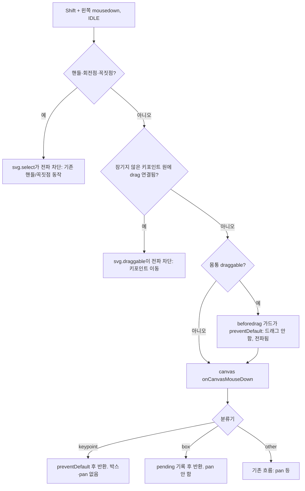
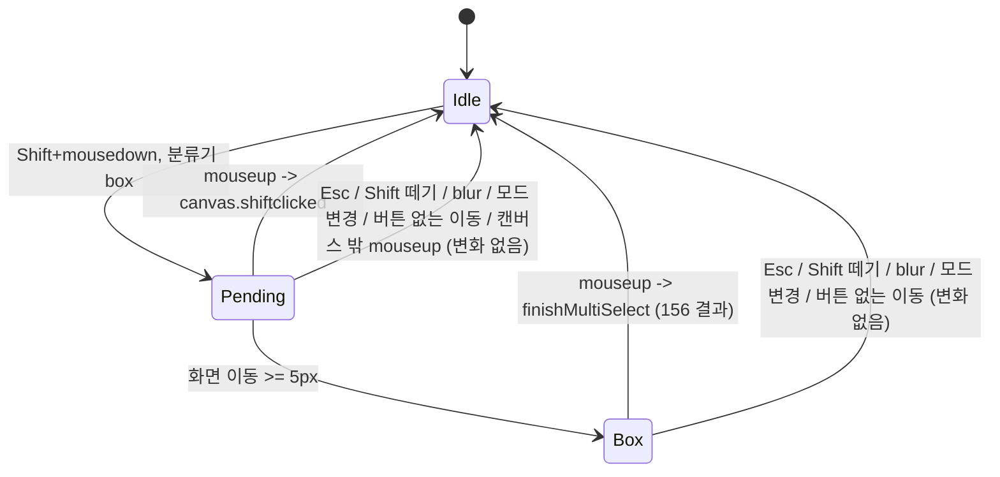

# feat: Start Shift+drag box selection inside objects (INNO-157)

## Summary

커서 모드(IDLE)에서 Shift+드래그 박스를 객체 안(skeleton bbox 내부, 사각형·폴리곤 몸통, 연결선, 외곽선)에서도 시작할 수 있게 한다. 키포인트·핸들·꼭짓점 위에서는 지금 동작을 유지한다. Shift 제스처의 "클릭이냐 박스냐" 판정을 canvas 한 곳(화면 5px)으로 모으고, 비활성 사람의 bbox 안 Shift+클릭 토글과 Shift 중 십자 커서를 추가한다. 이 티켓은 박스가 **어디서 시작되는지**만 바꾸고, 박스가 **무엇을 고르는지**는 INNO-156이 정한다. `cvat-canvas`와 `cvat-ui` 캔버스 래퍼 작업이며 서버 변경은 없다.

---

## Problem Frame

박스는 mousedown 대상이 캔버스 배경(`this.content`)이나 이미지일 때만 시작된다(`cvat-canvas/src/typescript/canvasView.ts`의 `onCanvasMouseDown`). 객체 위에서는 시작 지점과 활성 상태에 따라 사람 전체가 끌려가거나(활성 skeleton의 감싼 rect 드래그), 캔버스가 이동(pan)하거나, 우연히 박스가 시작된다(비활성 skeleton의 숨은 rect를 클릭이 통과). 사람이 붐비는 장면에서는 커서가 거의 항상 누군가를 활성화하고 있어 박스를 시작하기 어렵다(see origin).

코드 조사로 확인한 사실이 계획의 뼈대를 정한다.

- 객체 몸통 드래그는 `svg.draggable.js`의 `start`가 mousedown에서 `stopPropagation`하므로 캔버스 mousedown까지 오지 않는다. 같은 함수가 먼저 `beforedrag`를 발생시키고 그 이벤트가 `preventDefault`되면 드래그를 시작하지 않고 전파도 막지 않는다.
- 크기조절·회전 핸들과 폴리곤 꼭짓점은 `svg.select.js`가 mousedown에서 `stopPropagation`한다. 그래서 이들 위의 Shift+드래그는 새 박스 경로에 원래 닿지 않는다(R8·R9 자동 유지).
- skeleton 그룹은 `'pointer-events': 'all'`로 그려진다(`addSkeleton`). `all`은 `visibility`와 `fill`을 무시하므로, 비활성 사람의 감싼 rect도 `visibility: hidden`인 채 클릭 대상이다. origin의 "비활성 bbox 안은 클릭이 이미지로 통과해 박스가 시작된다"는 서술은 코드와 다르다. 실제로는 대상이 rect라서 지금 판정에서 pan으로 빠질 가능성이 높다(실브라우저 확인 필요). 이 계획은 어느 쪽이든 같은 경로로 처리한다.
- 같은 이유로 DOM 순서상 뒤에 그려진 skeleton의 감싼 rect는 활성 여부와 무관하게 앞 사람의 키포인트를 덮는다. 활성 객체는 `activateShape`에서 `this.content` 맨 끝으로 옮겨지므로 활성 사람의 rect가 특히 넓게 덮는다. 그래서 AE3(A 활성, A bbox 안의 B 무릎을 Shift+드래그)은 DOM 대상만으로는 B의 키포인트를 찾을 수 없다.
- 키포인트 원은 IDLE에서 `mousemove`의 전파를 막는다(`addSkeleton`의 `mousemove` 핸들러). 덮이지 않은 키포인트 위를 지나는 포인터 이동은 캔버스 mousemove에 도달하지 않는다.
- Shift+클릭 토글은 UI(`canvas-wrapper.tsx`의 `onCanvasMouseDown`/`onCanvasMouseUp`)가 `elementFromPoint`로 대상을 찾는다. 활성 skeleton의 키포인트는 드래그가 mousedown 전파를 막아 UI의 시작점 기록이 안 되므로, 키포인트 위 Shift+클릭은 이 경로에 일관되게 걸리지 않는다.
- 클릭 판정(UI, 화면 5px 초과면 무시)과 박스 무시 판정(`finishMultiSelect`, 캔버스 좌표 5 미만이면 무시)이 서로 다른 단위와 다른 위치에 있다. 중간에 멀리 갔다가 돌아오면 둘 다 성립하거나 둘 다 안 되는 경우가 있다(R12 위반).

---

## Requirements

origin R1–R17, AE1–AE10을 따른다. 미결정 질문 Q1–Q6은 2026-11-12 Jira 시안 댓글에서 권장안으로 확정됐다(Assumptions 참고). 요약:

- R1–R5. IDLE + Shift+드래그는 skeleton bbox 안(테두리·연결선 포함), 다른 도형의 몸통·외곽선, 배경에서 박스를 시작한다. 활성·선택 여부와 무관하고, 객체가 움직이거나 캔버스가 이동하지 않는다.
- R6–R10. 보이는 잠기지 않은 키포인트 위는 그 키포인트 이동(어느 사람이 활성이든), 잠긴 키포인트 위는 박스, 핸들·꼭짓점은 기존 동작, IDLE이 아니면 박스 없음.
- R11–R13. Shift+클릭은 사람 단위 토글이며 비활성 사람의 bbox 빈 곳도 토글한다(겹치면 맨 위 사람). 클릭과 박스는 같은 화면 5px 기준으로 빈틈없이 나뉜다. Shift 없는 드래그는 그대로다.
- R14–R16. 박스 진행 중에만 hover 활성화·객체 반응을 막는다. 취소 규칙(Esc, Shift 떼기, 창 blur)은 그대로다. 결과 계산은 INNO-156 규칙.
- R17. IDLE + Shift를 누른 채 박스가 시작될 위치 위에서는 십자 커서.

---

## Key Technical Decisions

- **박스 시작은 "캔버스 mousedown 판정 + Shift일 때 몸통 드래그 취소" 조합.** 몸통 `draggable`에 `beforedrag` 가드를 달아 IDLE + Shift + 왼쪽 버튼이면 `preventDefault`한다. 그러면 mousedown이 캔버스로 올라오고, `onCanvasMouseDown`의 시작 판정이 대상이 `this.content` 안의 무엇이든 받아들이도록 넓힌다. `beforedrag` 취소만으로는 대상이 감싼 rect라서 지금 판정에서 pan으로 빠지고, 캔버스 판정만으로는 drag가 전파를 막아 도달하지 않으므로 둘 다 필요하다(origin Deferred 질문 해소). 박스 경로는 지금처럼 `enableDrag` 이전에 반환한다(R5).
- **가드는 몸통 드래그에만, 키포인트 드래그에는 달지 않는다.** `draggable`은 skeleton 키포인트(요소별)에도 쓰인다. 키포인트 Shift+드래그는 이동이어야 하므로(R6) 가드는 최상위 도형 호출에만 적용한다. 핸들·꼭짓점은 `svg.select`가 전파를 막으므로 손댈 필요가 없다.
- **"박스 시작 가능 지점" 분류기 하나를 mousedown과 커서가 공유한다.** 입력은 이벤트 대상과 화면 좌표, 출력은 `box` / `keypoint` / `other`다. `keypoint`는 (a) 대상이 보이는 잠기지 않은 키포인트 원이거나 (b) 화면에 그려진 원 반경 안에 보이는 잠기지 않은 키포인트가 있는 경우다(b는 활성 rect가 덮은 다른 사람 키포인트, AE3). 잠긴 키포인트는 `box`다(R7). mousedown(U1)과 십자 커서(U5)가 같은 함수를 써서 "커서가 보여준 것 = 누르면 일어나는 것"을 보장한다.
- **Shift 제스처는 canvas가 단일 상태기계로 판정한다.** mousedown에서는 박스를 바로 그리지 않고 "대기(pending)" 시작점(화면 좌표)만 기록한다. 제스처 동안은 `window`에 mousemove·mouseup 리스너를 단다(키포인트 원이 mousemove 전파를 막고, 캔버스 밖에서 놓을 수도 있으므로). 화면 거리 5px 이상이 되면 박스를 만든다. mouseup에서도 그 좌표로 거리를 다시 잰다. 박스가 있으면 박스 결과, 없으면 Shift+클릭이다. 왼쪽 버튼이 눌려 있지 않은 mousemove(`buttons & 1`이 0)가 오면 제스처를 취소한다. 판정이 한 곳, 한 단위, 한 번의 사실("박스가 만들어졌는가")에 묶이므로 R12의 빈틈과 이중 처리가 구조적으로 없다. `finishMultiSelect`의 캔버스 좌표 5 미만 무시 조건은 제거한다(박스가 만들어진 뒤 작게 되돌아온 경우 "아무 일도 없음"이 되기 때문). 빈 박스는 INNO-156 R3에 따라 선택을 바꾸지 않는다.
- **Shift+클릭 대상은 canvas가 결정하고 이벤트로 알린다.** 새 이벤트 `canvas.shiftclicked`(detail: 최상위 clientID)를 canvas가 보낸다. 대상은 mousedown 대상 요소의 최상위 도형이다(skeleton의 rect·연결선·요소면 그 skeleton). 감싼 rect가 숨어 있어도 hit 대상이므로 DOM이 이미 "맨 위에 그려진 것"을 돌려준다. 그래서 겹친 bbox는 맨 위 사람, skeleton bbox 안에 그려진 사각형은 둘 중 위에 그려진 쪽이 된다(R11, Q5). 대상이 배경이면 이벤트를 보내지 않는다. UI의 `onCanvasMouseUp` Shift 분기(`elementFromPoint`)는 이 이벤트 처리로 대체한다. 같은 Shift 제스처를 두 곳이 판정하지 않게 하기 위해서다.
- **키포인트 위 Shift+클릭도 157이 맡는다.** 키포인트 press는 제스처 상태기계에 들어오지 않으므로(드래그가 전파를 막거나 분류기 `keypoint`), UI `onCanvasShapeClicked`의 Shift early-return을 "skeleton 요소면 부모 사람 토글, 최상위 도형이면 무시(이미 `canvas.shiftclicked`가 처리)"로 바꾼다. INNO-156 계획 U4는 "Shift+클릭(`onCanvasMouseUp`)은 그대로"라고 적었는데, 157이 그 경로를 이 두 경로로 대체한다(156 R6 결과는 같다).
- **AE3은 Shift 중 키포인트 hover 활성화로 푼다.** Shift를 누른 상태의 캔버스 mousemove에서 분류기가 `keypoint`(덮인 다른 사람 키포인트 포함)를 찾으면 `canvas.moved`에 그 키포인트의 `activatedElementID`와 주인 사람의 clientID를 실어 보낸다. UI `onCanvasCursorMoved`는 이 경우 `annotations.select`로 다시 고르지 않고 받은 사람·요소를 그대로 활성화한다(`select`는 가장 가까운 객체를 고르므로 다른 사람이 뽑힐 수 있다). 활성화되면 그 사람이 맨 위로 올라가 다음 mousedown이 키포인트 원에 닿고 기존 키포인트 드래그가 동작한다. 기존 키포인트 `mouseover` 경로(Shift 정보 없이 활성화)와 같은 원리를 덮인 경우까지 넓히는 것이다.
- **분류기 `keypoint`인 Shift press는 아무것도 하지 않는다.** 활성화 왕복이 끝나기 전에 누르면 키포인트 원에 드래그가 아직 없어 mousedown이 캔버스로 온다. 이때 `preventDefault` 후 `enableDrag` 전에 반환한다. 박스도 pan도 없다(R5). 다시 누르면 키포인트가 움직인다.
- **R14 억제는 제스처 상태에 묶는다.** pending 또는 박스 진행 중에는 키포인트 `mouseover`의 활성화 이벤트, Shift 중 키포인트 hover 활성화(위 결정)를 모두 보내지 않는다. Shift만 누른 상태(제스처 없음)에서는 막지 않는다(R6 보존).
- **십자 커서는 CSS 클래스 하나.** IDLE + Shift + 분류기 `box`일 때 `this.content`에 준비 클래스를 붙이고, 그 아래 도형·이미지의 커서를 crosshair로 덮는다(`cvat_canvas_shape_draggable:hover`의 `move` 포함). 키포인트 원은 인라인 `cursor: default`, 핸들은 자체 hover 커서를 유지한다. 클래스는 mousemove, Shift keydown/keyup, blur, 제스처 종료, 활성 객체 변경과 객체 다시 그리기 때 마지막 포인터 위치로 다시 계산한다.
- **아무것도 바뀌지 않는 제스처는 조용히 끝난다.** 빈 박스, 배경 Shift+클릭, 활성화 전 키포인트 press는 별도 알림이나 효과 없이 끝난다(박스는 사라진다). origin과 INNO-156이 박스 모양·피드백을 바꾸지 않기로 했다.
- **Shift+클릭 토글은 IDLE에서만 (사용자 결정 2026-11-12).** 지금 UI 토글은 모드를 보지 않는다. canvas 판정으로 옮기면서 IDLE로 제한한다. 그리기·편집 모드의 기존 Shift 동작은 바꾸지 않는다.

---

## Assumptions

- Q1–Q6 권장안 확정(2026-11-12 Jira 시안 댓글, 이의 없음): 핸들·회전·꼭짓점 기존 유지(Q1·Q3), skeleton이 아닌 도형은 박스에 걸치면 객체 전체 선택(Q2, 결과 계산은 156), 다른 도형 몸통도 같은 시작 규칙(Q3), 잠긴 키포인트 위 = 박스(Q4), 겹친 bbox의 Shift+클릭 = 맨 위 사람(Q5), 십자 커서 넣음(Q6).
- "맨 위 사람"은 그 지점에서 hit되는 맨 위 요소의 주인이다(DOM 그리기 순서, `sortObjects`의 z-order 정렬 후 활성 객체가 맨 뒤). 활성 사람이 겹친 영역에서 이긴다. 화면에 보이는 그리기 순서와 같다.
- INNO-156 계획(`docs/plans/2026-11-12-156-feat-keypoint-box-select-plan.md`)과 맞춘 내용:
  - 156이 `finishMultiSelect`의 결과 계산을 소유한다(KTD9: skeleton은 키포인트 중심점, 다른 도형은 객체 전체, 새로 더할 것이 없으면 이벤트 없음). 157은 그 함수의 진입 조건(캔버스 좌표 5 미만 무시)만 제거한다. 156 계획은 이 조건에 기대지 않는다.
  - 156의 `⌘/Ctrl+클릭`은 `canvas.clicked` detail의 `ctrlKey`·`metaKey`를 UI `onCanvasShapeClicked`가 판정한다(156 KTD8). 157의 `onCanvasShapeClicked` Shift 분기 변경은 같은 함수의 다른 분기다.
  - 156 U4는 Shift+클릭을 기존 `onCanvasMouseUp` 그대로 둔다. 157 U3이 이를 `canvas.shiftclicked` + `onCanvasShapeClicked` 부모 토글로 대체한다. 156 R6의 결과(키포인트 위 포함 사람 토글)는 유지된다.
  - 156의 그룹 드래그 세션(156 U3, `cvat-canvas/src/typescript/groupDrag.ts`)은 Shift 없는 드래그 경로다. 157의 `beforedrag` 가드는 Shift일 때 몸통 드래그에만 동작하므로 세션이 시작되지 않을 뿐 세션 코드는 건드리지 않는다. 키포인트 드래그에는 가드가 없다.
  - 선택 상태는 156의 모델을 그대로 쓴다. 캔버스는 `setSelection(clientIDs, elementClientIDs)`로 받고, Redux는 `selectedStatesID`와 `selectedElementIDs`를 둔다. 157의 Shift+클릭 토글은 사람 단위 기존 토글 액션만 보낸다. 사람을 토글할 때 그 사람의 `selectedElementIDs`를 어떻게 정리하는지는 156 U4의 규칙을 따른다.
  - 156 KTD8은 `canvas.clicked` detail에 `ctrlKey`·`metaKey`를 더한다. 157은 같은 detail의 `shiftKey`만 읽는다.
- **선택된 키포인트 위 Shift+드래그 = 그 키포인트만 이동 (사용자 결정 2026-11-12).** 이미 선택된 키포인트(또는 선택된 사람의 키포인트)에서 시작해도 묶음은 움직이지 않는다. 156 계획이 그룹 드래그 세션 시작 조건에 `shiftKey` 제외를 넣는다(156 U3). 157은 키포인트 드래그에 가드를 달지 않으므로 추가 작업이 없다. U2·U6에서 검증한다.
- **R11 소유 정정.** origin의 Coordination은 "R11의 비활성 사람 토글은 156과 같이 정한다"고 적었다. 156 계획(Coordination)과 작업 지시에 따라 R11은 157이 소유한다. bbox 안 hit 판정을 박스 시작 판정과 공유하기 때문이다. brainstorm 문서는 고치지 않고 이 계획을 정본으로 본다.
- **그리기·편집 중 Shift+클릭은 토글하지 않는다 (사용자 결정 2026-11-12).** 그리기 도구가 켜져 있거나 편집(폴리곤 다시 그리기) 중이면 bbox 안 Shift+클릭이 선택을 바꾸지 않는다. 그 모드의 기존 Shift 동작은 그대로다. 토글은 IDLE 선택 상태에서만 동작하고, Shift+드래그 박스 시작도 같은 규칙이다(R10).

---

## High-Level Technical Design

Shift+왼쪽 mousedown이 어디로 가는지:

Shift 제스처 상태:

---

## Implementation Units

### U1. Shift 제스처 상태기계와 박스 시작 지점 분류기

**Goal:** 박스 시작 판정을 "분류기 `box`면 시작"으로 넓히고, 박스 생성을 화면 5px 이후로 미루며, mouseup에서 박스/클릭을 한 번에 판정한다.

**Requirements:** R1–R5, R7, R10, R12, R15 (R16 결과 병합은 156 `finishMultiSelect`가 그대로 수행)

**Dependencies:** INNO-156 구현이 같은 브랜치에 먼저 들어와 있을 것(`finishMultiSelect` 결과 계산).

**Files:**
- Modify: `cvat-canvas/src/typescript/canvasView.ts` (`onCanvasMouseDown`, `onCanvasMouseMove`, `onCanvasMouseUpHandler`, `finishMultiSelect` 진입 조건, `cancelMultiSelect`, `onKeyDown`/`onKeyUp`, `onWindowBlur`, 새 분류기와 pending 상태 필드)
- Modify: `cvat-canvas/src/typescript/consts.ts` (5px 상수, 기존 상수 파일이 맞으면)
- Test: `tests/cypress/e2e/features/box_select_inside_bbox.js` (U6에서 작성)

**Approach:**
- 분류기는 IDLE이 아니면 `other`. 대상이 `this.content` 밖이면 `other`. 대상 또는 화면 좌표 근처에 보이는 잠기지 않은 키포인트가 있으면 `keypoint`. 그 외 `this.content` 안이면 `box`. 키포인트 근접 판정은 그려진 원의 화면 반경을 쓴다(`circle.r × scale` 계열).
- `onCanvasMouseDown`: Shift + 왼쪽 + 분류기 `box`면 pending(화면 좌표, SVG 좌표, 대상 요소)을 기록하고 `preventDefault` 후 반환한다. 박스 rect는 아직 만들지 않는다. Shift + 왼쪽 + 분류기 `keypoint`면 `preventDefault` 후 반환한다(박스·pan 없음). `other`는 지금의 나머지 흐름(선택된 도형 early-return, `enableDrag`)을 그대로 탄다.
- 제스처 동안 `window` mousemove·mouseup 리스너를 단다. mousemove: 왼쪽 버튼이 눌려 있지 않으면 취소. pending이고 화면 거리가 5px 이상이면 박스 rect를 pending 시작점에서 만든다. 이후는 기존 크기 갱신.
- mouseup: 그 좌표로 거리를 다시 재서 5px 이상이면 박스로 본다(필요하면 그 자리에서 박스를 만든다). 박스가 있으면 `finishMultiSelect`. 박스 없이 pending만 있고 mouseup이 캔버스 안이면 U3의 Shift+클릭 처리, 캔버스 밖이면 취소. 끝나면 pending과 window 리스너를 정리한다. 기존 `onCanvasMouseUpHandler`는 이 경로로 합친다.
- `finishMultiSelect`의 "대각선 5 미만이면 무시" 조건을 제거한다. 박스 생성 자체가 5px 기준을 이미 통과했다.
- 취소(`cancelMultiSelect`)는 박스와 pending을 모두 비운다. Esc, Shift keyup, 창 blur에서 이미 호출된다. 모드가 IDLE에서 벗어날 때도 호출되게 한다(그리기 단축키를 누른 경우 등).

**Patterns to follow:** 기존 `multiSelectBox`/`multiSelectStart` 필드와 `translateToSVG` 사용, `cancelMultiSelect` 호출 지점.

**Test scenarios:**
- Happy path: 배경에서 Shift+드래그 → 박스가 생기고 결과가 선택에 더해진다(R3 회귀).
- Covers AE7. 비활성 사각형 몸통 안에서 Shift+드래그 → 박스가 그려지고 캔버스가 이동하지 않는다.
- 비활성 skeleton의 연결선 위에서 Shift+드래그 → 박스 시작, pan 없음.
- Edge: Shift+mousedown 후 4px 이동하고 놓음 → 박스 없음, Shift+클릭으로 처리.
- Edge: Shift+mousedown 후 10px 이동했다가 2px 지점으로 돌아와 놓음 → 박스로 처리되고 Shift+클릭 토글은 일어나지 않는다(R12).
- Edge: 높은 확대 배율(예: 800%)과 낮은 배율에서 같은 화면 이동량이 같은 판정을 낸다.
- Edge: 키포인트 근처에서 Shift+mousedown 후 키포인트 원 위로 10px 이동해 놓음 → 박스로 처리(키포인트 원이 mousemove를 막아도 판정이 맞다).
- Edge: Shift+mousedown 후 캔버스 밖(사이드바)에서 놓고 다시 캔버스로 들어옴 → 박스가 생기지 않는다.
- Covers AE9. 박스 중 Esc → 박스 사라짐, 선택 그대로. Shift 떼기, 창 blur도 같다.
- Covers AE10. 폴리곤 그리기 중 Shift+드래그 → 박스 없음.
- 잠긴 키포인트 위에서 Shift+드래그 → 박스 시작(R7).

**Verification:** 객체 안 어디서 시작해도(키포인트·핸들·꼭짓점 제외) 박스가 생기고 pan이 일어나지 않는다. 같은 제스처가 박스와 토글을 동시에 내지 않는다.

---

### U2. Shift일 때 몸통 드래그 취소

**Goal:** 활성 객체의 몸통(skeleton 감싼 rect, 사각형·폴리곤 등)에서 시작한 Shift+드래그가 객체를 옮기지 않고 캔버스 mousedown으로 올라가게 한다.

**Requirements:** R1, R2, R4, R5, R8, R9, R13, AE1, AE4, AE6, AE8

**Dependencies:** U1

**Files:**
- Modify: `cvat-canvas/src/typescript/canvasView.ts` (`draggable`에 `beforedrag` 가드, 최상위 도형 호출에만)

**Approach:**
- `draggable`에 "몸통 여부"를 구분하는 방법을 둔다. 키포인트 요소 호출(`resizable` 안)과 최상위 호출(도형 생성·활성화 경로)을 인자나 대상 클래스로 구분한다. 키포인트 요소에는 가드를 달지 않는다.
- 가드 조건: `this.mode === Mode.IDLE` + 이벤트 `shiftKey` + 왼쪽 버튼. 이때 `beforedrag` 이벤트를 `preventDefault`한다. Shift 없는 드래그, 156의 묶음 이동은 영향 없다(R13).
- 고정(pinned)·잠긴 객체는 몸통 drag가 없으므로 이미 캔버스로 올라온다. U1 분류기가 `box`를 돌려준다.
- 리스너는 `draggable` 재호출 때 쌓이지 않게 기존 해제 경로와 짝을 맞춘다. 비활성화 때 `dragstart`/`dragmove`/`dragend`를 떼는 곳에서 `beforedrag`도 뗀다. 이 포크에서 resize 리스너가 쌓여 회전이 깨진 전례가 있다(커밋 `14c09a2fab`).

**Patterns to follow:** `draggable` 안의 `dragstart`/`dragmove`/`dragend` 등록 방식. `svg.draggable.js`의 `beforedrag` 계약(취소되면 `preventDefault`·`stopPropagation` 모두 생략).

**Test scenarios:**
- Covers AE1. 사람 A 활성, A bbox 안 빈 곳 Shift+드래그 → 박스, A 위치 불변(points·bbox 저장 호출 없음).
- Covers AE4. A가 선택된 상태에서 A bbox 안 Shift+드래그 → 새 박스, A 불변. 같은 곳 Shift 없이 드래그 → 선택 묶음 이동.
- 활성 사각형 몸통에서 Shift+드래그 → 박스, 사각형 불변.
- Covers AE2. A의 손목 키포인트 Shift+드래그 → 손목만 이동, 박스 없음.
- 156 키포인트 선택으로 여러 키포인트가 선택된 상태에서 그중 하나를 Shift+드래그 → 그 키포인트만 이동, 나머지 선택 키포인트는 그대로(사용자 결정 2026-11-12, 156 그룹 세션의 `shiftKey` 제외에 의존).
- Covers AE6. skeleton bbox 오른쪽 아래 핸들 Shift+드래그 → 기존 핸들 동작(사각형·bbox는 Shift 정밀 회전/크기조절 유지), 박스 없음.
- Covers AE8. 활성 폴리곤 꼭짓점 Shift+클릭 → 꼭짓점 편집 시작.
- 회귀: Shift 없는 몸통 드래그, 회전 핸들 Shift 스냅이 그대로 동작. 같은 객체를 여러 번 활성/비활성한 뒤에도 가드가 한 번만 동작.

**Verification:** Shift+드래그로 어떤 객체도 몸통째 움직이지 않는다. 키포인트·핸들·꼭짓점 동작은 바뀌지 않는다.

---

### U3. canvas가 판정하는 Shift+클릭 토글

**Goal:** U1에서 박스 없이 끝난 Shift 제스처를 사람 단위 토글로 처리한다. 비활성 사람의 bbox 빈 곳도 토글하고, 겹치면 맨 위 사람을 고른다.

**Requirements:** R11, R12, R16(결과 병합은 156), AE5

**Dependencies:** U1

**Files:**
- Modify: `cvat-canvas/src/typescript/canvasView.ts` (클릭 대상 해석, `canvas.shiftclicked` 발송)
- Modify: `cvat-canvas/README.md` (이벤트 목록에 `canvas.shiftclicked` 추가)
- Modify: `cvat-ui/src/components/annotation-page/canvas/views/canvas2d/canvas-wrapper.tsx` (`onCanvasMouseDown`/`onCanvasMouseUp`의 Shift 분기와 `shiftClickStart` 제거, `canvas.shiftclicked` 리스너 등록·해제와 토글 처리)
- Modify: `docs/multi-selection-feature.md` (Shift+클릭·Shift+드래그 흐름 갱신)

**Approach:**
- 대상 해석: pending에 기록한 mousedown 대상 요소에서 `.cvat_canvas_shape` 최상위 도형을 찾는다(skeleton의 rect·연결선·요소면 그 skeleton). 숨은 감싼 rect도 hit 대상이므로 겹친 곳에서는 맨 위에 그려진 것이 나온다. 대상이 배경(`this.content`)이면 이벤트를 보내지 않는다. 실브라우저에서 비활성 rect가 hit되지 않는 것으로 드러나면, 감싼 rect 범위(`data-xtl/ytl/xbr/ybr`)가 지점을 포함하는 skeleton 중 DOM 순서상 마지막 것을 대체 후보로 쓴다.
- 이벤트 detail은 최상위 `clientID` 하나. UI는 기존 `onToggleObjectSelection`을 그대로 호출한다(첫 Shift+클릭 때 활성 객체를 포함하는 기존 규칙 유지).
- UI의 `shiftClickStart` 추적과 `onCanvasMouseUp`의 `elementFromPoint` 분기를 제거한다.
- `onCanvasShapeClicked`: Shift이고 상태가 skeleton 요소(`parentID` 있음)면 부모 사람을 토글한다. Shift이고 최상위 도형이면 지금처럼 반환한다(`canvas.shiftclicked`가 이미 처리, 이중 토글 방지). 156의 `⌘/Ctrl` 분기는 그대로 둔다.

**Patterns to follow:** `canvas.multiselected` 이벤트 발송·수신 방식, `onCanvasMultiSelected`의 리스너 등록/해제 쌍.

**Test scenarios:**
- Covers AE5. A 비활성, A bbox 안 빈 곳 Shift+클릭 → A 선택 토글, 박스 없음. 다시 Shift+클릭 → 해제.
- 두 사람 bbox가 겹친 영역에서 Shift+클릭 → 맨 위에 그려진 사람만 토글. 아래 사람을 먼저 활성화(맨 위로 올림)한 뒤 같은 곳 → 그 사람이 토글.
- 사각형 몸통 Shift+클릭 → 사각형 토글(기존 동작 회귀 없음). 폴리곤·타원도 같다.
- skeleton bbox 안에 그려진 사각형의 몸통 Shift+클릭 → 위에 그려진 쪽 하나만 토글.
- 활성 사람의 키포인트 Shift+클릭(움직임 없음) → 그 사람 토글, 박스 없음. 비활성 사람의 키포인트도 같다(156 R6).
- 배경(어떤 bbox에도 안 들어감) Shift+클릭 → 선택 변화 없음.
- Edge: 숨김(hidden) 사람의 bbox 영역 Shift+클릭 → 그 사람은 후보가 아니다.
- 그리기 모드, 폴리곤 다시 그리기(편집) 중 bbox 안 Shift+클릭 → 토글 없음, 그 모드의 기존 Shift 동작 유지(사용자 결정 2026-11-12).

**Verification:** 키포인트가 아닌 bbox 안 Shift+클릭은 활성 여부와 무관하게 정확히 한 사람을 토글한다. 한 번의 클릭이 두 번 토글되지 않는다.

---

### U4. 키포인트 우선과 박스 진행 중 hover 억제

**Goal:** 활성 사람의 bbox가 다른 사람의 키포인트를 덮어도 Shift+드래그가 그 키포인트를 옮기게 하고(AE3), 박스 진행 중에는 지나가는 객체가 활성화되지 않게 한다.

**Requirements:** R6, R14, AE3

**Dependencies:** U1 (분류기, 제스처 상태)

**Files:**
- Modify: `cvat-canvas/src/typescript/canvasView.ts` (캔버스 `mousemove` 리스너의 Shift 분기, 키포인트 `mouseover`의 제스처 중 억제)
- Modify: `cvat-ui/src/components/annotation-page/canvas/views/canvas2d/canvas-wrapper.tsx` (`onCanvasCursorMoved`의 Shift early-return 조건)

**Approach:**
- 캔버스 `mousemove`: IDLE + Shift + 제스처 없음이면 분류기의 키포인트 근접 판정을 돌린다. 덮인 키포인트를 찾고 그 키포인트가 현재 활성 요소가 아니면 `canvas.moved`를 `activatedElementID`, 주인 사람 clientID와 함께 보낸다.
- UI `onCanvasCursorMoved`: Shift 이벤트에 주인 clientID가 있으면 `annotations.select` 없이 그 사람·요소를 활성화한다. 없으면 지금처럼 반환한다. `select`는 가장 가까운 객체를 고르므로 근처의 다른 키포인트나 사각형 외곽선이 뽑힐 수 있어 쓰지 않는다.
- 키포인트 `mouseover`와 위 hover 활성화는 pending·박스 진행 중이면 보내지 않는다. Shift만 누른 상태에서는 보낸다(R6).
- 근접 판정은 보이는(hidden·outside·`cvat_canvas_hidden` 아님) 잠기지 않은 키포인트만 본다. 여러 개면 맨 위 사람의 것을 고른다.

**Patterns to follow:** 키포인트 `mouseover`가 보내는 `canvas.moved` detail 형태(`activatedElementID`, `states`).

**Test scenarios:**
- Covers AE3. A 활성, A bbox 안에 보이는 B의 무릎. Shift를 누른 채 무릎 위로 이동 → B 활성화. Shift+드래그 → B 무릎만 이동, A 불변, 박스 없음.
- Shift를 누른 채 A의 빈 bbox 영역 위를 움직임 → 활성 객체가 바뀌지 않는다(기존 Shift 억제 유지).
- Covers R14. 박스를 그리며 다른 사람들의 키포인트 위를 지나감 → 어떤 사람도 활성화되지 않고 움직이지 않는다.
- Edge: 숨김 키포인트 위치 위에서 Shift+드래그 → 박스 시작(그려지지 않은 키포인트는 "키포인트 위"가 아님).
- Edge: Shift를 누른 채 키포인트에 올라간 직후(활성화 왕복 전) 누름 → 박스도 pan도 없다. 활성화 뒤 다시 누르면 키포인트가 움직인다.
- 두 비활성 사람이 겹치고 뒤에 그려진 사람의 rect가 앞 사람의 키포인트를 덮음 → Shift hover로 앞 사람이 활성화되고 그 키포인트를 Shift+드래그로 옮길 수 있다.

**Verification:** 화면에 보이는 잠기지 않은 키포인트 위의 Shift+드래그는 어느 사람이 활성이든 그 키포인트를 옮긴다. 박스 진행 중에는 활성 객체가 바뀌지 않는다.

---

### U5. Shift 중 십자 커서

**Goal:** IDLE에서 Shift를 누르고 박스가 시작될 위치 위에 있으면 커서를 crosshair로 보여준다.

**Requirements:** R17

**Dependencies:** U1 (분류기)

**Files:**
- Modify: `cvat-canvas/src/typescript/canvasView.ts` (준비 클래스 토글: mousemove, Shift keydown/keyup, blur, 모드 변경, 제스처 종료, 활성화 변경, 객체 다시 그리기)
- Modify: `cvat-canvas/src/scss/canvas.scss` (준비 클래스 아래 도형·이미지·배경 crosshair, draggable `move` 커서 덮기)

**Approach:**
- 마지막 포인터 위치를 기억해 Shift keydown 시점에도 커서가 바로 바뀌게 한다.
- 분류기 `keypoint`면 클래스를 떼서 키포인트 기본 커서를 보인다. 핸들은 mousemove 대상이 핸들이므로 `other`로 분류해 클래스를 뗀다.
- 박스 진행 중에는 crosshair를 유지한다.

**Patterns to follow:** `canvas.scss`의 `.svg_select_points_*:hover`, `.cvat_canvas_shape_draggable:hover` 커서 규칙.

**Test scenarios:**
- Shift를 누른 채 배경, 비활성 사각형 몸통, 활성 skeleton bbox 안 → crosshair.
- Shift를 누른 채 키포인트, 크기조절 핸들 위 → 기존 커서.
- Shift 떼기, 그리기 모드 진입 → 기존 커서.
- Shift를 누른 채 가만히 있는 동안 hover 활성화가 끝나 덮였던 키포인트가 위로 올라옴 → 마우스를 움직이지 않아도 기본 커서로 바뀐다.

**Verification:** 커서 모양이 누르기 전에 결과(박스 vs 키포인트·핸들)를 정확히 알려준다.

---

### U6. Cypress e2e와 실브라우저 확인

**Goal:** 시작 지점별 결과를 자동 회귀 테스트로 고정하고, 겹친 사람 장면을 실제 브라우저에서 확인한다.

**Requirements:** AE1–AE10, Success Criteria

**Dependencies:** U1–U5

**Files:**
- Create: `tests/cypress/e2e/features/box_select_inside_bbox.js`

**Approach:**
- Cypress: 사각형 2개와 폴리곤 1개를 만든 작업에서 몸통 Shift+드래그 → 박스·pan 없음·도형 위치 불변, 꼭짓점 Shift+클릭 → 편집, 4px vs 10px 판정, Esc 취소, 그리기 중 박스 없음을 확인한다. skeleton 생성이 실용적이면(`skeletons_pipeline.js` 패턴) 비활성 bbox Shift+클릭 토글과 bbox 안 Shift+드래그도 넣는다. 박스 결과(무엇이 선택되는가)는 156 spec이 맡고, 여기서는 "박스가 생겼다"와 "객체가 움직이지 않았다"만 본다.
- 실브라우저(Playwright, `channel="chrome"`): 로컬 스택 `http://localhost:8081`, task 89 / job 91, frame 1(서로 겹친 서 있는 skeleton 2명)에서 AE1·AE3·AE4·AE5·AE6과 겹친 영역 Shift+클릭(맨 위 사람), 십자 커서를 확인한다. UI 변경이 있으므로 UI 이미지 재빌드 또는 dev 서버가 필요하다.
- 무거운 빌드·e2e 실행은 워크트리 전역 mutex 아래에서 대상 spec만 돌린다.

**Patterns to follow:** `tests/cypress/e2e/features/workspace_toggle_shortcut.js`(포크 spec 구조, 작업 생성·정리), `tests/cypress/e2e/features/skeletons_pipeline.js`(skeleton 생성).

**Test scenarios:** 위 U1–U5의 AE 연결 시나리오를 spec과 실브라우저 체크리스트로 나눠 담는다. `cvat-canvas`에는 단위 테스트 기반이 없어 새로 만들지 않는다.

**Verification:** 새 spec이 통과하고, 실브라우저 체크리스트가 모두 기대대로다. 기존 `skeletons_pipeline.js`가 계속 통과한다.

---

## System-Wide Impact

- **작업자:** Shift+드래그로 객체 몸통을 옮기던 동작이 없어진다(origin 결정). 몸통 이동은 Shift 없는 드래그로만 한다.
- **canvas 공개 계약:** 새 이벤트 `canvas.shiftclicked`가 생긴다. `cvat-canvas/README.md` 이벤트 목록에 추가한다. 다른 소비자는 `cvat-ui` 하나다.
- **비IDLE 모드:** Shift+클릭 선택 토글이 IDLE로 제한된다(사용자 결정 2026-11-12). 그리기·편집 모드의 기존 Shift 동작은 그대로다.
- **SAM 플러그인 등 다른 모드:** IDLE이 아니면 분류기가 `other`라 영향 없다.

---

## Risks & Dependencies

- **INNO-156 선행(같은 브랜치 `feat/inno-156-157-keypoint-select`).** 157은 156 위에 구현한다. 공유 지점: `finishMultiSelect`(156 결과 계산, 157 진입 조건), `canvas-wrapper.tsx`의 `onCanvasMouseUp`(156 `⌘/Ctrl` 분기 가능, 157 Shift 분기 제거), `draggable`(156 묶음 이동, 157 Shift 가드), 선택 상태(156 키포인트 선택). 156 계획이 이 가정과 다르면 U1·U3을 맞춘다.
- **INNO-158 공유 파일(별도 브랜치 `feat/inno-158-clamp-to-image`, 통합 브랜치에서 합침).** origin은 세 티켓을 같은 브랜치로 적었지만 158 계획과 작업 지시에 따라 158은 따로 간다. 158은 `canvasView.ts`의 `draggable`(dragmove 경계 고정, 키포인트 원 clamp)과 resize·회전 경로를 건드린다. 157은 같은 함수에 `beforedrag` 가드만 더하므로 논리 충돌은 없고 텍스트 충돌만 예상된다. 통합 시 가드는 158의 단일 드래그 분기와 독립적으로 유지한다. 157은 `cvat-canvas/src/scss/canvas.scss`와 `canvas-wrapper.tsx`도 고치므로 158이 같은 파일을 건드렸는지 통합 때 확인한다.
- **활성화 왕복 지연(AE3).** Shift hover 활성화는 Redux 왕복을 거친다. 활성화 전에 누르면 아무 일도 없다(박스·pan 없음). 받아들인 한계이며, 왕복 시간이 체감되는지 실브라우저에서 확인한다.
- **mousemove 비용.** Shift 중 매 mousemove에서 분류기가 키포인트를 훑는다. 붐비는 장면에서 느리면 현재 화면 안 skeleton으로 좁히거나 프레임당 1회로 묶는다.
- **리스너 누적.** `draggable`은 활성화마다 다시 불린다. 가드가 쌓이면 이중 취소는 무해하지만 메모리·디버깅 비용이 생긴다. 기존 해제 경로와 짝을 맞춘다.
- **회전 중 감싼 rect 좌표.** Shift+클릭 후보 판정은 감싼 rect의 `data-*` 좌표를 쓴다. skeleton 회전은 키포인트에 굽히고 bbox는 축 정렬이므로 정지 상태에서는 맞다. 회전 조작 중 일시 transform은 IDLE이 아니어서 해당 없다.

---

## Scope Boundaries

- 박스가 무엇을 고르는지(키포인트 단위, skeleton이 아닌 도형 처리), `⌘/Ctrl+클릭`, 복사·삭제 범위, 묶음 이동, 선택 표시 스타일은 INNO-156이다.
- 드래그 중 이미지 경계 고정은 INNO-158이다.
- 박스 모양·색은 바꾸지 않는다.
- 서버 변경 없음.

---

## Open Questions

### Deferred to Implementation

- 몸통/키포인트 `draggable` 호출을 구분하는 정확한 방법(인자 추가 vs 대상 클래스 판정).
- 키포인트 근접 판정 반경의 정확한 값(그려진 원 반경 + stroke). 화면 표시와 일치하는지 실브라우저에서 확인.
- 모드 변경 시 `cancelMultiSelect`를 부를 지점(모드 setter가 없어 대입 지점이 여러 곳).
- 마스크 도형(`image` 요소)이 `this.content` 안 대상 판정에 그대로 걸리는지.
- 텍스트 라벨(`cvat_canvas_text`) 위 Shift+드래그가 박스를 시작하는지(pointer-events 설정에 따라 다름). 시작하는 쪽이 R1 취지에 맞다.
- 폴리곤 방향 화살표(`cvat_canvas_poly_direction`) 위 Shift+드래그. 분류기상 `box`다. 화살표 고유 동작이 있으면 `other`로 뺀다.
- 비활성 감싼 rect가 실제로 hit되는지(`pointer-events: all`) Chrome에서 확인. U3의 대체 후보 경로가 필요한지 여기서 정해진다.

---

## Sources & Research

- origin: `docs/brainstorms/2026-11-04-inno-157-box-select-inside-bbox-requirements.md`
- 짝 문서: `docs/brainstorms/2026-11-04-inno-156-keypoint-box-select-requirements.md`, `docs/brainstorms/2026-11-04-inno-158-clamp-to-image-requirements.md`, `docs/plans/2026-11-12-156-feat-keypoint-box-select-plan.md`, `docs/plans/2026-11-12-158-feat-clamp-to-image-plan.md`
- 박스·드래그·활성화: `cvat-canvas/src/typescript/canvasView.ts` (`onCanvasMouseDown`, `onCanvasMouseMove`, `finishMultiSelect`, `cancelMultiSelect`, `draggable`, `resizable`, `activateShape`, `sortObjects`, skeleton 생성부의 키포인트 `mouseover`와 감싼 rect)
- 핸들 Shift 처리: `cvat-canvas/src/typescript/svg.patch.ts` (`resize` 패치)
- 서드파티 계약: `node_modules/svg.draggable.js/dist/svg.draggable.js` (`start`의 `beforedrag` → `preventDefault`/`stopPropagation`), `node_modules/svg.select.js/dist/svg.select.js` (핸들·꼭짓점 mousedown `stopPropagation`)
- 감싼 rect 표시: `cvat-canvas/src/scss/canvas.scss`
- UI: `cvat-ui/src/components/annotation-page/canvas/views/canvas2d/canvas-wrapper.tsx` (`onCanvasMouseDown`/`onCanvasMouseUp`, `onCanvasCursorMoved`, `onCanvasShapeClicked`)
- 거리 기반 선택: `cvat-core/src/annotations-collection.ts` (`select`), `cvat-core/src/annotations-objects.ts` (`SkeletonShape.distance`)
- 기존 기능 문서: `docs/multi-selection-feature.md`
- skeleton bbox 결정: `docs/plans/2026-05-19-001-feat-skeleton-bbox-persistence-plan.md`
