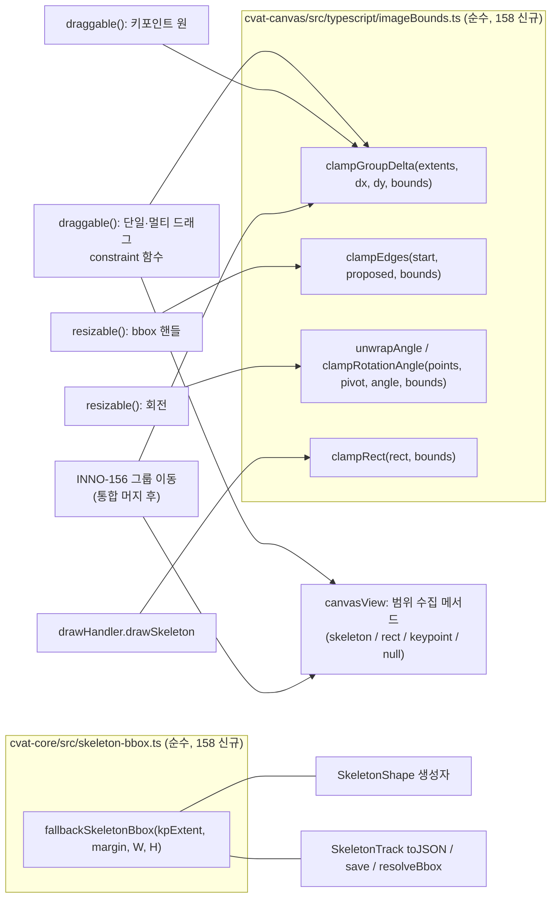

# feat: Clamp skeleton bbox, keypoints and whole-object drags to the image (INNO-158)

## Summary

스켈레톤 bbox·키포인트와 객체 통째 이동(스켈레톤, 회전 없는 사각형)이 편집 중에 이미지 경계에서 "벽처럼" 멈추게 한다. 핵심은 의존성 없는 순수 함수 하나다. 이 함수는 "움직이는 묶음의 시작 범위 + 이동량(delta)"을 받아 경계 안으로 잘린 이동량을 돌려준다. 단일·멀티 드래그, 키포인트 드래그, bbox 핸들, 회전, 새 스켈레톤 그리기가 모두 이 함수 계열을 쓴다. INNO-156의 그룹 이동도 통합 머지 후 같은 함수를 부른다. cvat-core에서는 ±20px 대체 bbox를 이미지 경계로 자르고, 사각형 통째 이동은 놓을 때 잘리지 않게 한다. 서버·DB·export 변경은 없다.

---

## Problem Frame

새 스켈레톤을 이미지 가장자리에 그리면 bbox(키포인트 범위 ±20px)와 키포인트가 이미지 밖으로 나간다. bbox 핸들, 키포인트 드래그, 객체 통째 드래그로도 경계를 넘을 수 있다. 편집 반영 시 `fitPoints` 보정은 스켈레톤 요소와 bbox를 건너뛴다. 반대로 사각형은 점마다 잘려서, 가장자리로 끈 사각형이 놓는 순간 줄어든다(see origin: `docs/brainstorms/2026-11-04-inno-158-clamp-to-image-requirements.md`).

이 계획의 난점은 세 가지다.

- **기존 경계 밖 객체.** 잡는 순간 튀면 안 되고, 바깥으로만 막고 안쪽은 풀어 줘야 한다.
- **같은 영역의 병렬 작업.** INNO-156이 같은 `canvasView.ts` 드래그 경로에 키포인트 그룹 이동을 새로 만든다.
- **흩어진 대체 bbox 계산.** ±20px 대체 bbox가 cvat-core 네 곳에 흩어져 있다.

---

## Requirements

origin R1–R20을 그대로 따른다. origin의 가정 Q1–Q5는 2026-11-12 Jira 시안 댓글의 기본값으로 확정됐다(아래 Assumptions 참조). 요약:

- R1–R4. 스켈레톤 bbox: 핸들 resize가 경계에서 멈춤, 새로 그릴 때와 bbox가 비어 있을 때 만드는 ±20px 대체 bbox는 경계에서 잘림, 키포인트를 옮길 때의 자동 확장(soft-snap)은 경계까지만.
- R5–R7. 키포인트 드래그가 경계에서 멈춤(`outside`로 자동 전환 없음), 새 스켈레톤 그리기 사각형은 경계까지만 늘어남, 회전은 키포인트가 닿는 각도에서 멈춤.
- R8–R10. 스켈레톤·사각형 통째 이동은 크기 유지하며 축별로 멈춤, 멀티 드래그는 묶음 전체가 멈춤.
- R11. INNO-156 키포인트 그룹 이동도 묶음 전체가 멈춤. 158 단독 브랜치에는 그룹 이동 경로가 없으므로 R11은 통합 머지 단계가 맡는다("INNO-156 연동"의 `constrainGroupDelta` 본문 채우기 + 통합 브랜치 AE6 확인). origin은 156/157이 먼저 배포된다고 가정했지만, 실제로는 두 브랜치를 병렬로 만들고 통합 브랜치에서 합치므로 158이 helper를 먼저 제공하고 R11 연결은 머지 때 한다.
- R12–R16. 커서 − 잡은 지점 오프셋을 자른 값으로 움직임(튀지 않음, 축 독립), 알림 없음, 창 밖 드래그 정상 종료, annotation·track 모드 모두, Undo 단위 불변.
- R17–R20. 기존 경계 밖 데이터는 그대로, 잡아도 튀지 않고 바깥으로만 막힘, 사각형은 놓아도 안 잘림, 경계 밖 키포인트가 있으면 bbox는 그 키포인트까지는 허용.

Acceptance Examples AE1–AE9는 origin 그대로이며, 각 유닛의 테스트 시나리오와 U6 브라우저 검증에 연결한다.

---

## Key Technical Decisions

- **경계 판정은 "시작 위치 기준 허용 구간" 하나로 통일한다.** 움직이는 항목마다 드래그 시작 시점의 범위(extent: xmin, ymin, xmax, ymax)를 잡는다. 그 항목이 허용하는 이동량은 x축 `[min(0, 경계xmin − xmin), max(0, 경계xmax − xmax)]`, y축도 같은 식이다. 묶음 전체의 허용 구간은 항목별 구간의 교집합이다. 모든 구간이 0을 포함하므로 교집합은 비지 않는다. 그래서 잡는 순간 튀지 않고(R18), 이미 나가 있는 방향으로는 더 못 가며, 안쪽으로는 자유롭다. 축을 따로 자르므로 벽을 따라 미끄러진다(R12). svg.draggable의 `minX/maxX` 객체 제약은 절대값이라 기존 경계 밖 객체를 첫 이동에 안으로 튀게 하므로 쓰지 않는다(origin Deferred 질문 해소).
- **순수 함수는 새 파일 `cvat-canvas/src/typescript/imageBounds.ts`에 둔다.** import가 없는 파일이고 TS 문법은 타입 표기만 쓴다(enum·parameter property 금지). 그래야 Node 24의 `node --test`가 빌드 없이 바로 돌린다. `shared.ts`는 svg.js를 import하므로 노드에서 로드되지 않아 쓰지 않는다. 이 파일이 158과 156이 공유하는 계약이다(아래 "INNO-156 연동" 참조).
- **드래그 clamp는 svg.draggable의 constraint 함수로 건다.** svg.draggable 2.2.2는 constraint 함수에 "시작 box + 커서 이동량"으로 만든 제안 좌표 `(x, y)`를 넘긴다. 제안 좌표에서 시작 좌표를 빼면 원시 delta가 나오고, 이를 자르면 R12가 그대로 성립한다. 마스크의 `snapToGrid: 1`은 같은 함수 안에서 `x − (x % 1)`(= `Math.trunc`, svg.draggable과 같은 0 방향 자르기)로 재현해 경로를 하나로 둔다.
- **한 tick에 자른 delta 하나를 주 객체·자식·동반 객체 모두에 적용한다.** 지금은 `dragmove`가 라이브러리 이동 *전에* 발생한다(svg.draggable 소스 확인). 그래서 스켈레톤 자식 원과 멀티 드래그 동반 객체가 이동 전 위치(`instance.x()`, `shape.bbox()`)를 읽어 한 tick씩 늦는다. clamp가 들어가면 이 늦음 때문에 주 객체와 동반 객체의 멈춤 위치가 어긋날 수 있다. 자식·동반 객체 이동은 constraint 함수가 계산한 delta로 같은 tick에 동기화한다. constraint 안에서 옮길지, `dragmove`에서 `preventDefault` 후 직접 옮길지는 구현 시 정한다. 불변식은 "같은 delta, 같은 tick"이다.
- **범위 수집은 `canvasView.ts`의 작은 수집 메서드 한 곳에서 한다.** 객체 하나의 clamp 대상 범위를 이렇게 만든다.
  - 스켈레톤: wrapping rect의 bbox ∪ 그 경로가 실제로 옮기는 키포인트(`outside` 포함 — R8). 주 객체 드래그는 잠긴 키포인트를 옮기지 않으므로 빼고, `moveShapeVisually`(동반 객체)는 잠긴 원도 옮기므로 넣는다. 회전은 cvat-core `saveRotation`이 잠금과 무관하게 모든 요소를 돌리므로 전부 넣는다.
  - 회전 없는 사각형: 사각형 box.
  - 키포인트 하나: 그 중심점(폭 0 범위).
  - 그 밖의 도형(회전 사각형, 폴리곤, 마스크 등): `null`. 묶음 판정에 끼지 않는다(R10).
  156의 그룹 이동도 이 메서드로 범위를 모은다. 렌더되지 않은 키포인트 원은 상태의 좌표를 canvas 좌표로 옮겨 쓴다(`collectSkeletonPoints`의 fallback과 같은 방식).
- **경계는 canvas 좌표의 현재 이미지다.** `{offset, offset, offset + geometry.image.width, offset + geometry.image.height}`이고, 기존 `fitPoints`와 같이 경계값을 포함한다. 프레임마다 크기가 다른 task에서도 캔버스가 보여 주는 현재 프레임 크기를 쓰므로 화면과 일치한다. cvat-core 쪽은 `framesInfo[frame]`을 쓴다(현행 `fitPoints`와 같음).
- **bbox 핸들 resize는 기존 "키포인트 포함" 클램프 앞에서 경계를 자른다.** 움직이는 변마다 허용 범위는 `[min(경계min, 시작값), max(경계max, 시작값)]`이다. 그 다음 기존 키포인트 포함 클램프가 이긴다(R20). svg.resize의 `constraint` 옵션은 절대값이라 쓰지 않는다. 기존 키포인트 포함 클램프처럼 `resizing` 핸들러에서 `instance.move/size`로 되돌려 쓴다. svg.resize가 매 이벤트마다 시작값에서 다시 계산하므로 같은 패턴이 이미 동작한다.
- **회전은 정수 각도 단위로 자른다.** `resizing`에서 svg.resize가 준 각도를 그대로 쓰지 않는다. 먼저 각도를 펼친다(unwrap). svg.js의 `transform().rotation`은 (−270°, 90°] 범위라 시계 방향 120°가 −240°로 읽힌다. 그래서 매 tick 원시 각도를 이전 tick의 펼친 각도에 가장 가까운 동치 각도(±360k)로 바꿔 연속된 부호 있는 제스처 각도를 만든다. 그 다음 0°에서 이 각도 방향으로 1°씩 키포인트를 bbox 중심 기준으로 돌려 보며 시작 위치 기준 허용 영역을 벗어나기 직전 각도를 고른다. 커서가 허용 범위로 돌아오기 전까지는 자른 각도를 유지하므로 벽 반대편으로 튀지 않는다. 이 각도로 미리보기를 그리고(`skeletonGestureRotation`), 같은 각도를 `resizedone`에서 내보낸다. cvat-core의 `saveRotation`도 같은 피벗(저장된 bbox 중심)으로 같은 정수 각도를 굽는다. 그래서 굽힌 키포인트가 경계 안에 있고, 이어지는 bbox 자동 확장도 경계를 넘지 않는다(R3·R7). 이미 정수 반올림(`Math.round`)이 있으므로 정수 단위가 기존 동작과 맞는다.
- **새 스켈레톤 그리기는 그리는 사각형 자체를 자른다.** `drawSkeleton`의 `drawupdate`에서 사각형을 경계로 자르고 템플릿 키포인트를 잘린 크기에 배치한다(미리보기). `drawstop`도 같은 잘린 사각형에 키포인트를 다시 배치한다. 지금은 좌상단만 자르고 키포인트를 자르기 전 크기로 배치해 밖으로 나간다. drawHandler는 그린 사각형을 bbox로 넘기지 않는 현행을 유지한다. 결과 bbox는 cvat-core 대체 bbox가 만들고, 이 bbox도 경계에서 잘린다(R2, AE1).
- **±20px 대체 bbox는 cvat-core 공통 순수 함수 하나로 만든다.** 새 파일 `cvat-core/src/skeleton-bbox.ts`(import 없음)에 둔다. 키포인트 범위와 margin, 이미지 크기를 받아 각 변을 `키포인트 범위 ± margin`으로 잡고 이미지 경계로 자른다. 다만 경계 밖 키포인트보다 안쪽으로는 들어오지 않는다(R20). 식은 `xtl = max(kpMinX − m, min(0, kpMinX))`, `xbr = min(kpMaxX + m, max(W, kpMaxX))`이고 y도 같다. 네 곳에 같은 함수를 적용한다: `SkeletonShape` 생성자, track `toJSON`, track `save`의 soft-snap 시드, track `get`의 `resolveBbox`. 프레임 간 값이 어긋나지 않게 하기 위해서다(origin Deferred 질문 해소).
- **사각형 통째 이동의 놓을 때 잘림은 cvat-core에서 "크기 보존 편집" 판정으로 건너뛴다.** `Drawn.validateStateBeforeSave`의 `fitPoints` 앞에서 판정한다. 회전 0인 사각형이고, 새 폭·높이가 현재 값과 같으면(작은 epsilon, 예 1e-3) 통째 이동으로 보고 자르지 않는다(R9·R19). 현재 값은 shape는 `this.points`, track은 해당 프레임 위치다. 크기 조절(핸들)은 크기가 바뀌므로 지금처럼 잘린다(범위 밖, 현행 유지). canvas → cvat-ui → ObjectState로 "이동임" 플래그를 흘리는 방식은 세 패키지를 건드리고 multi-edit 경로까지 바꿔야 하므로 택하지 않았다.
- **soft-snap(R3)은 코드 변경 없이 충족한다.** 키포인트가 canvas에서 이미 경계 안으로 잘려 들어오므로 "bbox ⊇ 보이는 키포인트" 확장은 경계를 넘지 않는다. 이미 밖에 있던 키포인트는 R20대로 bbox가 그 키포인트까지 간다. 단, track의 대체 bbox 시드는 위 공통 함수로 바꾼다.

---

## Assumptions

origin의 가정 Q1–Q5는 2026-11-12 Jira 시안 댓글에 올린 기본값이고, 반대 의견이 없어 확정으로 본다.

- Q1. 멀티 드래그는 하나라도 경계에 닿으면 묶음 전체가 그 축으로 멈춘다(간격·포즈 유지).
- Q2. 회전은 키포인트가 닿는 각도에서 멈춘다.
- Q3. 기존 경계 밖 객체는 잡아도 튀지 않고, 바깥으로만 막힌다.
- Q4. 사각형 크기 조절 핸들은 범위 밖이다. 지금처럼 놓을 때 잘린다.
- Q5. 가장자리에서 새 스켈레톤을 그릴 때 그리는 사각형은 경계까지만 늘어나고 키포인트는 그 안에 배치된다. 자동 20px 여백은 경계에서 잘린다.

계획 단계에서 추가로 정한 기본값:

- `outside` 키포인트도 통째 드래그·회전의 범위 계산에 넣는다(R8 "함께 옮겨지되 이미지 밖으로는 나가지 않는다"와 일관). 이미 밖에 있는 `outside` 키포인트는 시작 위치 기준 규칙으로 면제되므로 드래그를 막지 않는다.
- 범위에는 그 경로가 실제로 옮기는 키포인트만 넣는다. 주 객체 통째 드래그는 잠긴 키포인트를 옮기지 않아 빼고, 동반 객체 이동과 회전은 잠긴 키포인트도 옮기므로 넣는다.

---

## High-Level Technical Design

### 공유 helper와 호출 지점



### 묶음 delta clamp (방향 제시용 의사코드)

```text
clampGroupDelta(extents, dx, dy, b):
  lo_x, hi_x = -inf, +inf
  for e in extents:                       # 드래그 시작 시점 범위
      lo_x = max(lo_x, min(0, b.xmin - e.xmin))
      hi_x = min(hi_x, max(0, b.xmax - e.xmax))
      (y 동일)
  return clamp(dx, lo_x, hi_x), clamp(dy, lo_y, hi_y)   # 구간은 항상 0을 포함
```

드래그 한 tick의 흐름은 이렇다. 원시 delta는 제안 좌표 − 시작 좌표로 구한다. `clampGroupDelta`로 자른 뒤 주 객체 좌표(= 시작 + 자른 delta)를 constraint 반환값으로 쓴다. 같은 delta를 스켈레톤 자식 원·엣지, 멀티 드래그 동반 객체(시작 위치 + delta)에 적용한다.

---

## Implementation Units

### U1. 순수 경계 helper와 단위 테스트

**Goal:** 158·156이 공유할 경계 계산 함수를 의존성 없이 만든다.

**Requirements:** R1, R5–R12, R18, R20 (계산 계층)

**Dependencies:** 없음

**Files:**
- 생성: `cvat-canvas/src/typescript/imageBounds.ts`
- 수정: `.eslintignore`(`cvat-canvas/tests/`, `cvat-core/tests/` 추가). 두 패키지 ESLint는 `parserOptions.project`가 tsconfig를 가리키는데 tsconfig `include`에 테스트가 없어 파싱 오류가 난다. 그러면 Lefthook pre-commit과 CI `yarn run eslint .`가 막힌다. 대안은 `*/tests/*.test.ts`용 override(`project: null`, `import/extensions` 끔)다.
- 수정: `cvat-canvas/package.json`, `cvat-core/package.json`에 `test:unit` 스크립트(`node --test tests/`)
- 테스트: `cvat-canvas/tests/imageBounds.test.ts`

**Approach:**
- 타입: `Bounds`(xmin, ymin, xmax, ymax), `Extent`(같은 모양). 함수 넷.
  - `clampGroupDelta`: 묶음 이동량. Key Technical Decisions의 식을 따른다.
  - `clampEdges`: bbox 핸들 resize. 움직인 변마다 `[min(경계, 시작값), max(경계, 시작값)]`로 자른다.
  - `unwrapAngle(raw, prevUnwrapped)`: svg.js 각도 범위 (−270°, 90°]를 이전 tick 기준 연속 각도로 펼친다.
  - `clampRotationAngle`: 정수 각도 탐색. 입력은 펼친 각도다. 0에서 그 각도 부호 방향으로 1°씩 돌려 보고, 처음으로 허용 영역(점별 시작 위치 기준)을 벗어나기 직전 각도를 돌려준다. 회전 계산은 `rotate2DPoints`와 같은 식(시계 방향 양수)을 파일 안에 복제한다.
  - `clampRect`: 그리기 사각형을 경계 안으로 자른다.
- 빈 범위 목록이면 delta를 그대로 돌려준다. 폭 0 범위(키포인트)도 같은 식으로 다룬다.
- 파일은 import 없이 타입 표기만 쓴다. 테스트는 `node:test`·`node:assert`만 쓰고 `.ts` 확장자로 import한다. tsconfig `include`가 `canvas.ts`뿐이라 테스트 파일은 웹팩 빌드·type-check에 들어가지 않는다.

**Execution note:** 순수 함수이므로 테스트 먼저 작성한다.

**Patterns to follow:** `cvat-canvas/src/typescript/shared.ts`의 `clamp`, `rotate2DPoints`(식만 참고, import하지 않음).

**Test scenarios:**
- Happy path: 경계 0..1920, 범위 [100,100,400,300], dx=−500 → dx=−100. dy=+50 → 그대로 50(축 독립, AE4의 "벽 따라 미끄러짐").
- Happy path: 범위 둘(사람 A [100..400], 사람 B [1500..1800]), dx=+300 → +120(B가 1920에 닿음). A 간격 유지 확인. Covers AE5.
- Edge: 이미 밖인 범위 [−15..300], dx=−10 → 0(더 못 나감). dx=+50 → 50(튀지 않고 안쪽 이동). Covers AE7.
- Edge: 이미 밖인 범위 [−30..270], dx=+10 → +10(결과 −20, 자르지 않음). Covers AE8.
- Edge: 키포인트 범위(폭 0) x=5, dx=−20 → −5(x=0). 커서가 되돌아와 dx=−3 → −3(튐 없음). Covers AE3.
- Edge: 경계에 정확히 붙은 범위(xmax=1920), dx=+1 → 0, dx=−1 → −1.
- Edge: 빈 범위 목록 → 원시 delta 그대로.
- `clampEdges`: 오른쪽 아래 핸들을 (2000,1100)으로 → (1920,1080). Covers AE2. 시작값이 이미 −15인 왼쪽 변을 −20으로 → −15, 0으로 → 0.
- `clampRotationAngle`: 어깨 점이 x=1900, 피벗 기준 반지름이 커서 30°에서 1920을 넘는 배치 → 요청 45° → 넘기 직전 정수 각도. 요청 −45°(반대 방향)는 넘지 않으면 −45 그대로. 요청 0 → 0. Covers AE9.
- `unwrapAngle`: 이전 85°, 원시 −265° → 95°(시계 방향 계속). 이전 95°, 원시 −240° → 120°. 이전 −10°, 원시 −20° → −20°. 펼친 120° 요청이 30°에서 막히면 30° 유지(반대쪽 −240° 방향으로 튀지 않음).
- `clampRotationAngle`: 이미 밖인 점(x=−5)이 회전으로 x=−3이 되는 각도는 허용, x=−8이 되는 각도에서 멈춤.
- `clampRect`: 시작 (1900,500), 커서 (2100,800) → 사각형 오른쪽 변이 1920. 시작점이 이미지 밖(−50)이면 xmin 0.

**Verification:** `test:unit` 스크립트로 두 테스트 파일이 통과하고, `yarn run eslint .`가 테스트 파일 때문에 실패하지 않는다. `yarn build:cvat-canvas`가 helper를 포함해 성공한다.

---

### U2. 단일·멀티 드래그와 키포인트 드래그 clamp

**Goal:** 스켈레톤·사각형 통째 드래그, 멀티 드래그, 키포인트 하나 드래그가 경계에서 축별로 멈추게 한다.

**Requirements:** R5, R8–R10, R12–R16, R18

**Dependencies:** U1

**Files:**
- 수정: `cvat-canvas/src/typescript/canvasView.ts` (`draggable()`, `moveShapeVisually()`, 새 범위 수집 메서드, 경계 계산 헬퍼 메서드)
- 테스트: `cvat-canvas/tests/imageBounds.test.ts` (U1 계산 커버), 동작은 U6 브라우저 검증

**Approach:**
- `dragstart`에서 시작 상태를 잡는다.
  - 주 객체: 시작 좌표, 범위 수집 메서드로 만든 범위.
  - 동반 객체(`selectedStartData`): 각자 시작 위치와 범위.
  - 현재 이미지 경계(canvas 좌표).
- 범위 목록은 주 객체와 동반 객체 중 수집 결과가 `null`이 아닌 것만 모은다(R10). 주 객체가 폴리곤처럼 범위 밖이어도, 범위 내 동반 객체가 있으면 묶음이 멈춘다.
- `draggable()`은 constraint 함수로 초기화한다. 함수 안에서 원시 delta → `clampGroupDelta` → 주 객체 좌표를 돌려준다. 마스크는 같은 함수에서 `Math.trunc`로 `snapToGrid: 1`을 재현한다(음수 좌표에서 floor와 다르므로 trunc 유지).
- 스켈레톤 자식 원·엣지와 동반 객체(`moveShapeVisually`)는 같은 tick의 자른 delta로 옮긴다. `moveShapeVisually`는 "현재 bbox 중심 기준" 대신 "시작 위치 + delta"를 받도록 바꿔 늦음을 없앤다. 주 객체 경로의 잠긴 키포인트 건너뛰기는 유지한다. `moveShapeVisually`는 지금처럼 잠긴 원도 옮기며(동작 변경 없음), 그래서 동반 스켈레톤 범위에는 잠긴 원도 넣는다.
- 키포인트 원 드래그(`resizable()` 안의 요소별 `draggable` 호출)도 같은 `draggable()`을 거치므로 자동으로 clamp된다. 범위는 원 중심(폭 0)이다. 원 x는 `cx − r`이므로 시작 좌표 대비 delta로만 계산하면 반지름과 무관하다.
- `dragend`·`dragabort`·`multiedited` 발행 경로와 Undo 단위는 그대로 둔다(R16). 사각형 통째 이동의 놓을 때 잘림 제거는 U5가 맡는다.
- 경계 계산은 `this.geometry.offset`과 `this.geometry.image`로 만드는 작은 private 메서드 한 곳에 둔다(U3·U4·156도 사용).

**Patterns to follow:** 기존 `dragstart`의 `selectedStartData` 수집, `collectSkeletonPoints`의 렌더 안 된 키포인트 fallback.

**Test scenarios:** (U6에서 실제 브라우저로 확인. 계산은 U1이 커버)
- Covers AE4. 300×200 사각형을 왼쪽 위 밖으로 끔 → (0,0)에서 멈춤. 계속 아래로 끌면 x=0에 붙은 채 아래로 이동.
- Covers AE3. 손목 키포인트를 왼쪽 밖으로 끔 → x=0에서 멈추고 `outside`가 되지 않음. 커서를 되돌리면 튀지 않음. 놓은 뒤 bbox 왼쪽 변 ≥ 0.
- Covers AE5. 사람 둘 + 폴리곤 하나를 멀티 선택해 오른쪽으로 끔 → 오른쪽 사람 bbox가 1920에 닿는 순간 셋 다 멈춤. 간격 유지.
- Covers AE7. 기존 bbox xtl=−15인 스켈레톤: 잡자마자 튀지 않음. 왼쪽으로 더 안 감. 오른쪽으로는 정상 이동.
- 경계 안 드래그 회귀: 드래그 감도·최종 위치가 기존과 같고 Undo 한 번에 원위치.
- 멀티 드래그 중 Esc(abort) → 모든 객체가 시작 위치로 복귀(기존 동작 유지).
- 잠긴 키포인트가 있는 스켈레톤 통째 드래그 → 잠긴 점은 그대로, 나머지는 같은 delta.
- 마스크 단독 드래그 → 정수 격자 스냅 유지.
- 커서가 브라우저 창 밖으로 나갔다가 밖에서 버튼을 뗌 → 드래그 정상 종료(R14).

**Verification:** U6 시나리오 통과. 경계 안 드래그의 결과 좌표가 변경 전과 같다.

---

### U3. bbox 핸들 resize와 회전 clamp

**Goal:** 스켈레톤 bbox 모서리·변 핸들과 회전 핸들이 경계에서 멈추게 한다.

**Requirements:** R1, R3, R7, R13, R18, R20

**Dependencies:** U1

**Files:**
- 수정: `cvat-canvas/src/typescript/canvasView.ts` (`resizable()`의 스켈레톤 `resizing`·`resizestart` 분기)
- 테스트: `cvat-canvas/tests/imageBounds.test.ts` (`clampEdges`, `unwrapAngle`, `clampRotationAngle`)

**Approach:**
- `resizestart`에서 시작 bbox(`data-xtl` 등), 키포인트 시작 좌표, 경계를 잡는다.
- 크기 조절(회전 0): `instance`의 x·y·width·height를 `clampEdges`로 자른다. 그 다음 기존 "키포인트 포함" 클램프를 그대로 적용한다. 키포인트 포함 규칙이 이긴다(R20). 사각형(스켈레톤이 아닌 도형) resize는 건드리지 않는다.
- 회전: svg.resize가 준 각도를 `unwrapAngle`로 펼친 뒤(이전 tick 값은 `resizestart`에서 0으로 초기화) `clampRotationAngle`에 넘긴다. 피벗은 시작 bbox 중심, 점 목록은 함께 도는 키포인트 전부다(잠긴·`outside` 키포인트 포함, cvat-core가 모두 돌리므로). `resizedone`의 [0,360) 정규화는 그대로 둔다. 돌려받은 각도를 `skeletonGestureRotation`에 넣는다. 미리보기 회전과 `resizedone`의 내보내는 각도 모두 이 값을 쓴다. 0° 근처의 정상 회전 감도는 그대로다.
- 알림·시각 표시는 추가하지 않는다(R13).

**Patterns to follow:** 같은 핸들러의 기존 "keypoint containment clamp"(`instance.move/size` 후 `data-*` 갱신).

**Test scenarios:**
- Covers AE2. 오른쪽 아래 핸들을 이미지 밖으로 끔 → 핸들이 (1920,1080)에서 멈춤. 놓은 뒤 bbox xbr=1920, ybr=1080.
- 왼쪽 변 핸들을 안쪽으로 끌어 키포인트를 지나치려 함 → 기존처럼 가장 왼쪽 키포인트에서 멈춤(회귀 없음).
- Covers AE7 계열. bbox xtl=−15인 기존 스켈레톤의 왼쪽 변을 더 왼쪽으로 → −15 유지. 오른쪽으로는 이동.
- 보이는 키포인트가 x=−5인 기존 스켈레톤의 왼쪽 변 → −5보다 안쪽으로 못 들어옴(R20).
- Covers AE9. 가장자리 스켈레톤 회전 → 어깨 키포인트가 1920에 닿는 각도에서 미리보기가 멈춤. 놓은 뒤 모든 키포인트 x≤1920, bbox xbr≤1920. Undo 한 번에 원상복귀.
- 경계와 먼 스켈레톤 회전 → 기존과 같은 각도로 회전(회귀 없음). 90°를 넘겨 계속 돌려도 미리보기가 튀지 않는다.
- 잠긴 키포인트가 가장자리에 있는 스켈레톤 회전 → 잠긴 점도 경계에서 회전을 멈춘다.

**Verification:** U6 시나리오 통과. 회전 후 저장된 키포인트·bbox가 모두 이미지 안이다.

---

### U4. 새 스켈레톤 그리기 clamp

**Goal:** 가장자리에서 새 스켈레톤을 그릴 때 그리는 사각형과 키포인트가 경계를 넘지 않게 한다.

**Requirements:** R2(canvas 쪽), R6

**Dependencies:** U1

**Files:**
- 수정: `cvat-canvas/src/typescript/drawHandler.ts` (`drawSkeleton`의 `drawupdate`·`drawstop`)
- 테스트: `cvat-canvas/tests/imageBounds.test.ts` (`clampRect`)

**Approach:**
- `drawupdate`: 그리는 사각형의 x·y·width·height를 `clampRect`로 자르고 사각형에 반영한다. 템플릿 키포인트(상대 위치 0..1)는 잘린 폭·높이로 배치한다. 미리보기도 결과와 같은 모양이 된다.
- `drawstop`: 최종 사각형도 같은 함수로 자른다. 키포인트 좌표는 DOM의 `cx`(이전 미리보기 값)가 아니라 템플릿 상대 위치 × 잘린 크기 + 잘린 좌상단으로 다시 계산한다. 그래서 미리보기와 결과가 어긋나지 않는다.
- 그린 사각형을 bbox로 넘기지 않는 현행은 유지한다. bbox는 cvat-core 대체 bbox(U5)가 키포인트 범위 ±20px를 경계에서 잘라 만든다.
- 붙여넣기(`pasteSkeleton`)와 canvas `addSkeleton`의 표시용 fallback은 범위 밖이다(Scope Boundaries).

**Patterns to follow:** 같은 파일의 `getFinalRectCoordinates(points, true)`(경계 자르기 기존 방식).

**Test scenarios:**
- Covers AE1. 1920×1080에서 x≈1880에서 시작해 오른쪽 밖까지 끌며 그림 → 미리보기 사각형 오른쪽 변이 1920에서 멈춤. 놓은 뒤 키포인트 모두 x≤1920. bbox 오른쪽 변 1920, 왼쪽 여백 20px.
- 이미지 밖에서 시작해 안으로 끌며 그림 → 사각형 좌상단이 경계로 잘리고 키포인트 모두 안쪽.
- 경계 안에서 그림 → 기존과 같은 배치(회귀 없음).
- 너무 작은 사각형(제약 미달) → 기존처럼 그리기 취소.

**Verification:** U6 시나리오 통과. 새로 그린 스켈레톤의 키포인트·bbox에 경계 밖 좌표가 없다.

---

### U5. cvat-core: 대체 bbox 경계 자르기와 사각형 이동 잘림 제거

**Goal:** ±20px 대체 bbox가 경계를 넘지 않게 하고, 사각형 통째 이동은 놓을 때 잘리지 않게 한다.

**Requirements:** R2, R4, R9, R15, R17, R19, R20

**Dependencies:** 없음 (U1–U4와 병렬 가능)

**Files:**
- 생성: `cvat-core/src/skeleton-bbox.ts`
- 수정: `cvat-core/src/annotations-objects.ts` (`SkeletonShape` 생성자 대체 bbox, `SkeletonTrack`의 `toJSON`·`save` 시드·`get`의 `resolveBbox`, `Drawn.validateStateBeforeSave`의 사각형 판정)
- 테스트: `cvat-core/tests/skeleton-bbox.test.ts`

**Approach:**
- `skeleton-bbox.ts`: 키포인트 범위, margin, 이미지 폭·높이를 받아 대체 bbox를 돌려준다(식은 Key Technical Decisions). import 없이 타입 표기만 쓴다. 네 곳의 `SKELETON_*_FALLBACK_MARGIN` 계산을 이 함수 호출로 바꾼다. 이미지 크기는 `this.framesInfo[frame]`이다(생성자는 `data.frame`, track은 각 frame).
- 저장된 유효 bbox는 절대 건드리지 않는다(R17). 대체 bbox는 "값이 없어 새로 만드는" 경우에만 쓰인다(R4).
- `Drawn.validateStateBeforeSave`: 회전 0인 사각형이고 새 points의 폭·높이가 현재 값과 epsilon 안에서 같으면 `fitPoints`를 건너뛴다. 현재 값은 shape는 `this.points`, track은 `this.get(frame).points`다. 위치는 하위 클래스가 넘기는 작은 protected 훅이나 오버라이드로 구현 시 정한다. `checkShapeArea` 검사는 그대로 거친다.
- 범위 밖 도형과 사각형 크기 조절은 기존 `fitPoints` 경로 그대로다.

**Execution note:** 공통 함수는 테스트 먼저 작성한다. 사각형 판정은 기존 resize 잘림이 유지되는지 확인하는 시나리오를 함께 둔다.

**Patterns to follow:** `SkeletonShape` 생성자의 기존 fallback 블록, `fitPoints`의 `clamp` 사용.

**Test scenarios:**
- 단위(`skeleton-bbox.test.ts`): 1920×1080, 키포인트 x 1850..1905 → bbox xbr=1920, xtl=1830. Covers AE1.
- 단위: 키포인트가 전부 안쪽이고 경계와 멀면 → 기존과 같은 ±20.
- 단위: 키포인트 하나가 x=−5(이미 밖) → xtl=−5(키포인트까지는 허용, 더 나가지 않음). R20.
- 단위: 키포인트 x=3 → xtl=0(여백 3px만).
- 단위: 키포인트 범위가 비어 있음 → 호출부가 기존처럼 `[0,0,0,0]`을 유지(함수는 유한한 범위만 받음).
- 통합(U6 브라우저): bbox가 `[]`인 기존 가장자리 스켈레톤을 열면 bbox가 경계 안. 저장된 bbox가 −15인 스켈레톤은 열고 저장해도 −15 그대로. Covers AE7.
- 통합: 왼쪽이 −30인 기존 사각형을 오른쪽으로 10px 끌어 놓음 → xtl=−20, 크기 그대로. Covers AE8.
- 통합: 경계 밖으로 걸친 사각형의 핸들 resize → 놓을 때 지금처럼 잘림(회귀 없음).
- 통합: track 모드 사각형을 보간 프레임에서 경계까지 끌어 놓음 → 그 프레임 키프레임 크기 그대로. 다른 프레임 불변. R15.

**Verification:** `test:unit` 통과. `yarn workspace cvat-core run type-check` 통과. U6의 해당 시나리오 통과.

---

### U6. 실제 브라우저 검증과 선택적 Cypress

**Goal:** 드래그 손맛과 저장 결과를 실제 스택에서 확인한다.

**Requirements:** R1–R20 전반, AE1–AE9

**Dependencies:** U2, U3, U4, U5

**Files:**
- 선택 생성: `tests/cypress/e2e/features/clamp_to_image.js` (비용이 맞을 때만)
- 검증 스크립트는 저장소에 넣지 않는다(스크래치 위치).

**Approach:**
- 로컬 스택 `http://localhost:8081`에서 Playwright(`channel="chrome"`)로 확인한다. 대상은 task 89 / job 91이고, frame 2에 왼쪽 가장자리에 서 있는 스켈레톤이 있다. cvat-canvas·cvat-core 변경이 UI 번들에 들어가므로 UI 이미지 재빌드(`--build`)나 UI dev 서버가 필요하다.
- 마우스를 이미지 밖·창 밖까지 끌고, 놓은 뒤 서버에 저장된 값(job annotations API 응답)으로 경계 안 여부를 확인한다. 실제 이미지 크기는 frame meta로 읽는다.
- 무거운 작업(이미지 빌드, Cypress)은 전역 mutex를 잡고 실행한다. 단위 테스트는 mutex 없이 돌린다.
- Cypress는 기존 `tests/cypress/e2e/features/skeletons_pipeline.js`의 스켈레톤 생성 명령을 재사용할 수 있으면 AE1·AE4만 고정한다. 아니면 생략하고 Playwright 결과를 PR에 남긴다.

**Test scenarios:**
- AE1–AE5, AE7–AE9를 위 유닛 시나리오대로 실행한다(AE6은 INNO-156 통합 후 통합 브랜치에서 실행).
- 회귀: 경계 안 스켈레톤 드래그·핸들·회전·키포인트 이동·Undo, 폴리곤 단독 드래그(지금처럼 잘림).
- track 모드 스켈레톤: 경계까지 끈 프레임만 바뀌고 이웃 키프레임은 불변.

**Verification:** 모든 시나리오 결과(스크린샷 또는 저장 좌표)를 PR 설명에 남긴다.

---

## INNO-156 연동 (통합 브랜치)

- **브랜치.** 158은 `feat/inno-158-clamp-to-image`에서 단독 작업한다. 통합 브랜치에서 `feat/inno-156-157-keypoint-select`와 합친다.
- **공유 계약.**
  - `cvat-canvas/src/typescript/imageBounds.ts`의 `clampGroupDelta(extents, dx, dy, bounds)`.
  - `canvasView.ts`의 범위 수집 메서드와 경계 계산 메서드(U2).
  - 소유: `clampGroupDelta`(계산)와 위 두 메서드는 158이 만든다. `groupDrag.ts`의 세션과 `constrainGroupDelta`(적용 지점)는 156이 만든다. 통합 머지 때 `constrainGroupDelta`가 `clampGroupDelta`를 부르도록 158 쪽이 본문을 채운다. 두 이름은 역할이 달라 둘 다 남는다.
- **156 계획의 구조.** 156 계획(`docs/plans/2026-11-12-156-feat-keypoint-box-select-plan.md`)은 `draggable()` 안의 인라인 multi-drag를 새 모듈 `cvat-canvas/src/typescript/groupDrag.ts`의 세션(`begin → move(rawDelta) → commit | abort`)으로 옮긴다. `move`의 첫 줄이 `constrainGroupDelta` 한 함수이고, 156에서는 입력을 그대로 돌려주는 자리표시다(156 KTD5). 세션은 멤버별 시작 범위(이미지 좌표) 접근자를 제공한다.
- **156이 부를 위치(통합 머지 시 158이 채움).** `groupDrag.ts`의 `constrainGroupDelta` 본문을 `clampGroupDelta(멤버별 시작 범위, rawDx, rawDy, 이미지 경계)` 호출로 바꾼다.
  - 범위와 경계의 좌표계를 맞춘다. 156 접근자가 이미지 좌표를 주면 경계는 `{0, 0, W, H}`, canvas 좌표면 offset을 더한다. helper는 좌표계에 무관하다.
  - 멤버 범위: 선택 키포인트는 중심점, 전체 이동하는 사람은 범위 수집 메서드 결과(bbox ∪ 키포인트), 회전 없는 사각형은 box, 그 밖의 도형은 제외한다. 잠긴 항목·pinned는 156이 이미 뺀다.
  - R18은 "이미 밖에 나간 멤버를 판정에서 제외"가 아니라 "시작 위치 기준 허용 구간"으로 처리한다. 즉 그 멤버는 이미 나가 있는 방향으로만 묶음을 막는다. 156 계획의 해당 문구보다 이 계획의 식이 정본이다.
  - 주 대상 위치 보정: 그룹 세션이 활성일 때 158의 constraint 함수는 자체 계산 대신 세션이 자른 delta로 주 대상을 놓는다. 그래서 주 대상과 멤버가 같은 tick에 같은 delta를 쓴다(156이 158에 넘긴 "주 대상 보정 책임").
  - 일부 키포인트만 선택된 사람의 bbox는 놓을 때 soft-snap으로 확장된다. 키포인트가 이미 잘려 있으므로 R3이 자동으로 성립한다.
- **둘 다 건드리는 파일.**
  - `cvat-canvas/src/typescript/canvasView.ts`: `draggable()`의 `dragstart`·`dragmove`·`dragend`, `moveShapeVisually()`, `resizable()`의 요소별 `draggable` 호출부. 충돌이 가장 큰 곳이다.
  - `cvat-core/src/annotations-objects.ts`: 158은 대체 bbox 네 곳과 `Drawn.validateStateBeforeSave`를 고친다. 156은 스켈레톤 `save`/history 묶음 쪽을 고칠 가능성이 있다. 같은 파일의 다른 영역이다.
  - `cvat-canvas/src/typescript/groupDrag.ts`: 156이 만들고, 158은 통합 머지 때 `constrainGroupDelta` 본문만 바꾼다.
  - 158만 건드리는 파일: `imageBounds.ts`, `skeleton-bbox.ts`, `drawHandler.ts`, 두 테스트 파일, `.eslintignore`, 두 패키지의 `package.json`(`test:unit`). cvat-ui는 158에서 수정하지 않는다.
- **충돌 해결 원칙.** `draggable()`에서 단일 드래그·키포인트 원 clamp(constraint 함수)는 158 쪽을, 그룹 분기 호출부는 156 쪽을 유지한다. 158 브랜치가 인라인 multi-drag에 넣은 clamp(U2의 `moveShapeVisually` 시작 위치 + delta 변경 포함)는 156이 그 블록을 `groupDrag.ts`로 옮기면 버리고, 같은 동작을 `constrainGroupDelta` 본문으로 옮긴다. 158 단독 브랜치에서는 인라인 multi-drag에도 clamp를 넣어 R10을 단독으로 검증할 수 있게 한다. 통합 브랜치에서 AE5(사람 둘 + 폴리곤)와 AE6(키포인트 3개 그룹 이동이 경계에서 멈추고 Undo 한 번)을 다시 확인한다.

---

## Scope Boundaries

- 회전 사각형, 폴리곤, 폴리라인, 포인트, 타원, 큐보이드, 마스크의 경계 제한은 하지 않는다. 이들의 편집 시 보정은 지금 그대로다. 멀티 드래그에서는 함께 움직이되 멈춤 판정에 끼지 않는다.
- 사각형 크기 조절 핸들은 지금처럼 놓을 때 잘린다.
- 기존 경계 밖 데이터의 일괄 보정(마이그레이션), export 클리핑, 서버 serializer 검증은 하지 않는다.
- 붙여넣기(Ctrl+V, `pasteSkeleton` 포함), 프레임 전파(copy to next frame), 가져오기(import)의 좌표는 제한하지 않는다.
- canvas `addSkeleton`의 표시용 fallback(`SKELETON_RECT_MARGIN`)은 바꾸지 않는다. cvat-core가 항상 bbox를 채워 주므로 실사용 경로가 아니다.

### Deferred to Follow-Up Work

- 붙여넣기·프레임 전파·가져오기 좌표의 경계 제한(origin 후속 과제).
- `dragmove`가 이동 전에 발생해 생기는 한 tick 늦음 중 158이 건드리지 않는 경로(예: 경계와 무관한 엣지 재계산 타이밍) 정리.

---

## System-Wide Impact

- **사용자:** 어노테이터·검수자 모두 같은 동작이다(Standard·Review workspace 차이 없음). 알림이 없으므로 "왜 안 움직이지"라는 혼란이 있을 수 있다. 멈추는 것 자체가 피드백이라는 결정(R13)을 따른다.
- **데이터:** 새 편집에서 경계 밖 좌표가 생기지 않는다. 기존 데이터는 불변이다. 사각형 통째 이동이 더 이상 잘리지 않으므로 이미 밖에 걸친 사각형은 놓아도 밖에 걸친 채 저장된다(R19, 의도된 변화).
- **track 모드:** 대체 bbox 계산이 네 곳 모두 같은 함수로 바뀌어 프레임 간 일관성이 유지된다. 단, 이미지 크기가 프레임마다 다르면 프레임별 경계가 다르게 적용된다(각 프레임의 `framesInfo`).
- **INNO-156:** 공유 helper 계약을 158이 먼저 만든다. 위 "INNO-156 연동" 참조.

---

## Risks & Dependencies

| 위험 | 영향 | 가능성 | 완화 |
|------|------|--------|------|
| 자식·동반 객체 동기화 변경이 경계 안 드래그 손맛을 바꿈 | 높음 | 중간 | "같은 delta, 같은 tick" 불변식. U6 회귀 시나리오로 경계 안 결과 좌표가 이전과 같은지 확인 |
| 사각형 크기 보존 판정이 다른 경로의 의도된 잘림을 건너뜀 | 중간 | 낮음 | 판정은 회전 0 사각형 + 폭·높이 동일일 때만 한다. 크기가 바뀌는 resize는 그대로 잘린다. U5 회귀 시나리오 |
| 회전 1°씩 탐색 비용 | 낮음 | 낮음 | 최대 180회 × 키포인트 수십 개의 단순 산술이라 한 이벤트에 무시할 수준 |
| 156과 `canvasView.ts` 드래그 경로 머지 충돌 | 중간 | 높음 | 계약을 별도 파일로 분리. 충돌 해결 원칙 명시. 통합 브랜치에서 AE6 확인 |
| `node --test`의 TS 타입 제거가 helper 문법을 거부 | 낮음 | 낮음 | helper는 타입 표기만 쓰고 import 없음. Node 24 기본 동작. 막히면 테스트 실행 방법만 조정 |
| 경계값 부동소수 오차로 경계 1e-12 밖 저장 | 낮음 | 낮음 | 경계에서 자르면 `offset + width − offset`이 정확하다. 문제 시 U5 저장 경로에서 확인 |

---

## Sources & Research

- `cvat-canvas/src/typescript/canvasView.ts`: `draggable()`(단일·멀티 드래그, `selectedStartData`, 잠긴 키포인트 제외), `moveShapeVisually()`, `resizable()`(스켈레톤 키포인트 포함 클램프, `skeletonGestureRotation`, 요소별 `draggable`), `collectSkeletonPoints/Bbox`, `addSkeleton` fallback.
- `node_modules/svg.draggable.js/dist/svg.draggable.js` 2.2.2: `drag()`가 `dragmove`를 이동 전에 발생시키고, constraint 함수에 `startPoints.box + 커서 이동량`을 넘김. 객체 제약 `minX/maxX`는 절대값.
- `cvat-canvas/src/typescript/svg.patch.ts`: draggable 패치가 인자를 그대로 넘김(constraint 함수 사용 가능).
- `cvat-canvas/src/typescript/drawHandler.ts`: `drawSkeleton`(좌상단만 자르고 키포인트를 자르기 전 크기로 배치), `getFinalRectCoordinates`.
- `cvat-core/src/annotations-objects.ts`: `fitPoints`·`Drawn.validateStateBeforeSave`, `SkeletonShape` 생성자 fallback, `saveRotation`(피벗 = 저장된 bbox 중심), 스켈레톤 `save` soft-snap, `SkeletonTrack`의 `toJSON`·`save`·`resolveBbox` fallback.
- `docs/plans/2026-05-19-001-feat-skeleton-bbox-persistence-plan.md`: 축 정렬 bbox, 회전은 키포인트에 굽힘, 모서리 핸들은 bbox만 조절.
- `docs/brainstorms/2026-11-04-inno-156-keypoint-box-select-requirements.md`: 그룹 이동, R17(경계 묶음 멈춤 → INNO-158 R10·R11).
- 저장소에 JS 단위 테스트 러너가 없다(Jest·Mocha 미설치). 그래서 Node 24 내장 `node --test`를 쓴다.
